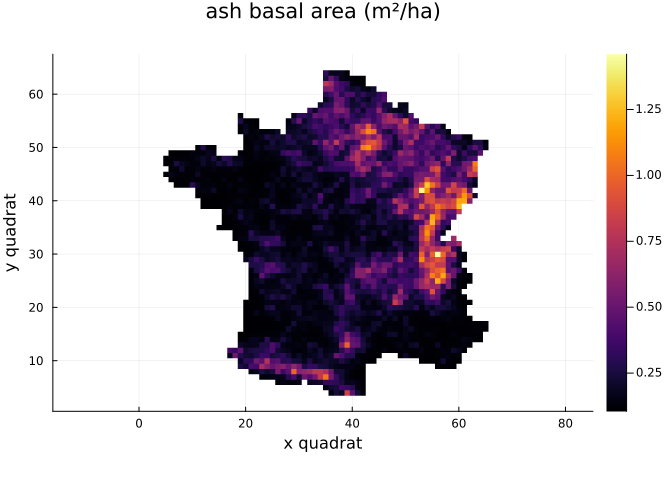
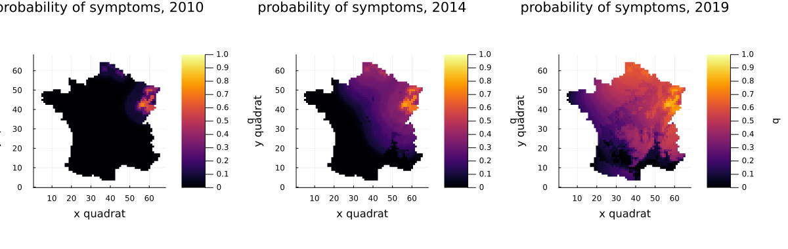
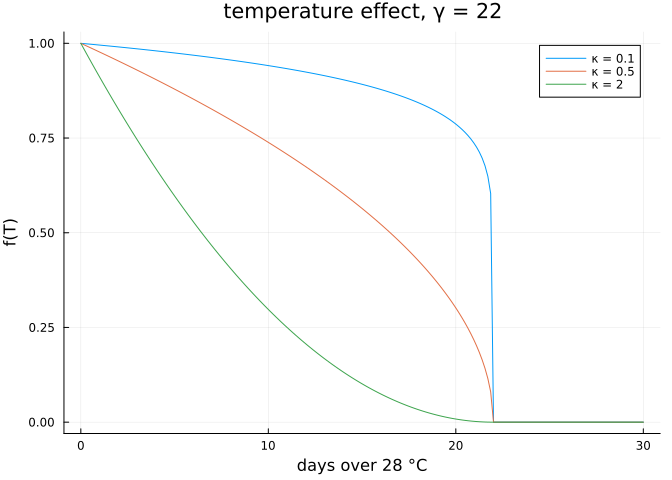

# The ash dieback model
Simon Frost

- [Overview](#overview)
- [Setup](#setup)
- [The data](#the-data)
- [Simulating the epidemic](#simulating-the-epidemic)
- [The likelihood](#the-likelihood)
- [Temperature](#temperature)

## Overview

Ash dieback, caused by the invasive fungus *Hymenoscyphus fraxineus*
(“Chalara”), reached north-eastern France around 2008 and spread across
the country in a decade. Fritsch, Grosdidier, Gégout-Petit and Marçais
built a mechanistic-statistical model of that spread and fitted it to
the national forest health survey. This vignette loads the data,
simulates the model at one parameter set, maps it, and checks the
likelihood against the authors’ code, PEOC.

## Setup

``` julia
using AshDieback
using Plots
using Statistics
```

## The data

`load_peoc_data` reads the files shipped with PEOC 1.0 and puts them on
the grid of 16 km quadrats: 62 × 61 for mainland France plus three empty
border quadrats on each side.

``` julia
data = load_peoc_data()
```

    PEOCData on a 68 × 67 grid of 16.0 km quadrats
      climate years:     2007:2022 (temperature index T28)
      ash density > 0:   2295 quadrats
      survey:            2008:2023, 4168 quadrat-years

The survey visits plots of about 30 trees and records the proportion
with symptoms. Repeat visits to a quadrat in a year are merged:

``` julia
[(o.year, length(o), sum(o.visits), round(mean(o.proportion); digits = 3))
 for o in data.observations]
```

    16-element Vector{Tuple{Int64, Int64, Int64, Float64}}:
     (2008, 85, 183, 0.103)
     (2009, 433, 753, 0.067)
     (2010, 345, 504, 0.049)
     (2011, 415, 620, 0.153)
     (2012, 350, 515, 0.094)
     (2013, 323, 438, 0.192)
     (2014, 358, 493, 0.227)
     (2015, 371, 520, 0.235)
     (2016, 303, 410, 0.178)
     (2017, 262, 341, 0.089)
     (2018, 201, 254, 0.108)
     (2019, 109, 132, 0.113)
     (2020, 220, 345, 0.212)
     (2021, 166, 214, 0.315)
     (2022, 137, 166, 0.374)
     (2023, 90, 111, 0.326)

Ash density, from the national forest inventory, sets where the fungus
can multiply:

``` julia
d = copy(data.ash_density)
d[d .== 0] .= NaN
heatmap(permutedims(d); aspect_ratio = :equal, title = "ash basal area (m²/ha)",
        xlabel = "x quadrat", ylabel = "y quadrat")
```



## Simulating the epidemic

The parameter set below is close to the paper’s reduced model (no Allee
effect, no rainfall effect, persistent symptoms).

``` julia
θ = AshDiebackParameters(; r_symp = 1000.0, r_allee = 0.0, beta_0 = 30.0, beta_1 = 0.0,
                         D = 20.0, S_sat = 90.0, gamma = 22.0, C_pers = 1.0,
                         C_init = 0.0085, kappa = 0.1)
prob = AshDiebackProblem(data, θ)
sol = solve(prob)
size(sol.symptoms)
```

    (68, 67, 12)

`sol.fungi` holds the colonised rachis per ash for 2007–2018 (the first
two years imputed from prevalence maps) and `sol.symptoms` the
probability that a tree has symptoms in each survey year 2008–2019.
Plotting a solution maps one year:

``` julia
plot(plot(sol; year = 2010), plot(sol; year = 2014), plot(sol; year = 2019);
     layout = (1, 3), size = (1200, 380), clims = (0, 1))
```



The epidemic front moves from the north-east towards the south-west:
from the foci in the north-east in 2010, by 2014 it covers most of the
north-eastern half of the country.

## The likelihood

The likelihood treats the trees with symptoms in each visited quadrat as
binomial:

``` julia
loglikelihood(sol)
```

    -25151.766135874208

PEOC’s own value at this parameter set, computed by PEOC 1.0 under
Python 2.7, is −25151.76613587413. `peoc_loglikelihood` also returns
PEOC’s zero-likelihood flag:

``` julia
ll, zero = peoc_loglikelihood(sol)
(ll, zero, abs(ll / -25151.76613587413 - 1))
```

    (-25151.766135874183, false, 1.9984014443252818e-15)

The agreement is to rounding error. It relies on solving the diffusion
so that every value of the spore field keeps its relative accuracy: far
from the front the field is as small as 1e-100, and the likelihood takes
its logarithm. `SparseCrankNicolson`, the default, does this with a
sparse Cholesky factorisation; `DenseCrankNicolson` is PEOC’s original
dense scheme, about 30 times slower:

``` julia
@time solve(prob);
```

      0.771671 seconds (120.40 k allocations: 1.661 GiB, 6.91% gc time)

## Temperature

Hot summers slow symptom development through f(T) = (\[1 − T/γ\]₊)^κ,
where T counts the days over 28 °C in July and August:

``` julia
T = range(0, 30; length = 200)
plot(T, [temperature_effect.(T, 22.0, κ) for κ in (0.1, 0.5, 2.0)];
     label = ["κ = 0.1" "κ = 0.5" "κ = 2"], xlabel = "days over 28 °C",
     ylabel = "f(T)", title = "temperature effect, γ = 22")
```


