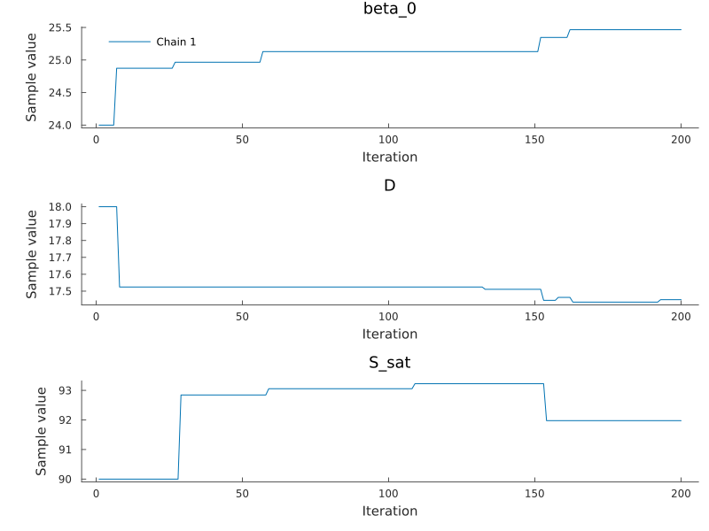

# Inference
Simon Frost

- [Overview](#overview)
- [Setup](#setup)
- [The posterior](#the-posterior)
- [Metropolis–Hastings](#metropolishastings)
- [AMIS](#amis)
- [Turing](#turing)

## Overview

The paper estimates the parameters by Bayesian inference under uniform
priors, with two samplers: a component-wise Metropolis–Hastings
algorithm and adaptive multiple importance sampling (AMIS). This
vignette builds the posterior of the paper’s reduced model and runs
short versions of both, then shows the Turing.jl interface. A likelihood
takes about a second, so the runs here are far too short for real
estimates; they show the workflow.

## Setup

``` julia
using AshDieback
using AbstractMCMC
using MCMCChains
using LinearAlgebra
using LogDensityProblems
using Random
using Plots

data = load_peoc_data()
θ0 = AshDiebackParameters([1000.0, 0.0, 24.0, 0.0, 18.0, 90.0, 21.50001, 1.0, 0.0085, 0.05])
prob = AshDiebackProblem(data, θ0)
```

    AshDiebackProblem: survey years 2008:2019, T28 temperature index
      p = (r_symp = 1000.0, r_allee = 0.0, beta_0 = 24.0, beta_1 = 0.0, D = 18.0, S_sat = 90.0, gamma = 21.50001, C_pers = 1.0, C_init = 0.0085, kappa = 0.05)

## The posterior

The reduced model (eq. 13 of the paper) has no Allee effect and no
rainfall effect, fixes γ and C_pers, and estimates β₀, D, S, C_init and
κ:

``` julia
post = AshDiebackPosterior(prob, reduced_model_prior_ranges())
free_parameters(post)
```

    5-element Vector{Symbol}:
     :beta_0
     :D
     :S_sat
     :C_init
     :kappa

`post` is a LogDensityProblems.jl log density over the free parameters:

``` julia
x0 = θ0[post.free]
LogDensityProblems.logdensity(post, x0)
```

    -24747.687122819294

## Metropolis–Hastings

PEOC’s sampler updates one parameter per iteration with a gamma proposal
centred on its current value (shape 200, so a standard deviation of 7 %
of the value):

``` julia
spl = ComponentwiseGammaMH(post)
chain = sample(Xoshiro(1), post, spl, 200; initial_params = x0, chain_type = Chains,
               progress = false)
```

    Chains MCMC chain (200×7×1 Array{Float64, 3}):

    Iterations        = 1:1:200
    Number of chains  = 1
    Samples per chain = 200
    parameters        = beta_0, D, S_sat, C_init, kappa
    internals         = lp, accepted

    Use `describe(chains)` for summary statistics and quantiles.

Trace plots of three of the parameters (MCMCChains’ default plot adds
density plots, which need StatsPlots.jl):

``` julia
plot(chain[:, [:beta_0, :D, :S_sat], 1]; seriestype = :traceplot, size = (800, 600))
```



## AMIS

AMIS draws batches from a Gaussian proposal, weights all draws so far
against the mixture of the proposals used, and moves the proposal to the
weighted mean and covariance. The paper’s initial proposal for the T28
index (its Table 2) has these variances:

``` julia
Σ0 = Diagonal([3.0, 0.4, 1.0, 1e-8, 1.5e-5])
res = amis(Xoshiro(2), post, x0, Matrix(Σ0); iterations = 3, samples = 40)
res.means[end]
```

    5-element Vector{Float64}:
     23.757714698480207
     18.35221796563086
     90.82809512972419
      0.00853446963586239
      0.04698373744905713

With several threads (`julia --threads=auto`) the likelihoods of a batch
are evaluated in parallel.

## Turing

`turing_model(post)` gives the same posterior as a Turing.jl model, so
Turing’s samplers and tools apply. The likelihood has no useful
gradient, so use a gradient-free sampler:

``` julia
using Turing
model = turing_model(post)
Turing.DynamicPPL.logjoint(model, (; θ = x0)) ≈ LogDensityProblems.logdensity(post, x0)
```

    true
