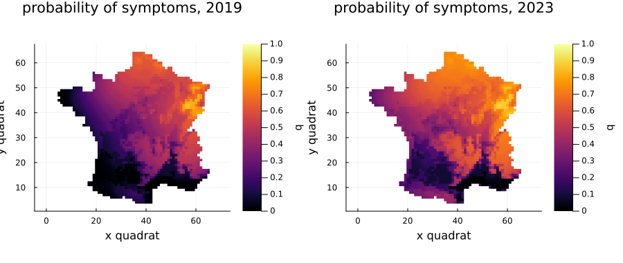
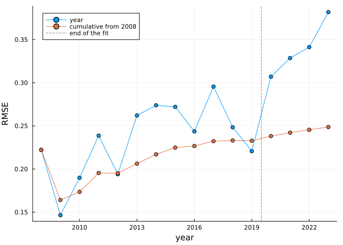
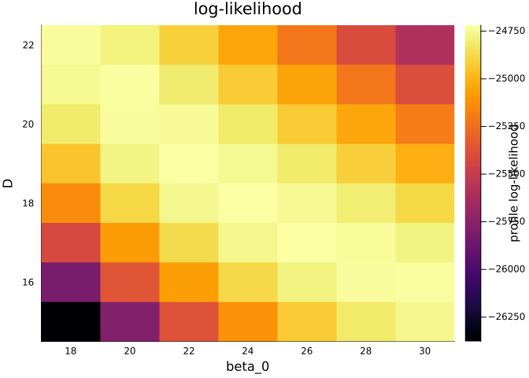

# Validation and the likelihood surface
Simon Frost

- [Overview](#overview)
- [The best parameter set](#the-best-parameter-set)
- [Forecasting beyond the fit](#forecasting-beyond-the-fit)
- [Table 4](#table-4)
- [The likelihood on a grid](#the-likelihood-on-a-grid)

## Overview

The paper fits the model to the survey of 2008–2019 and holds back
2020–2023 to test it. This vignette reproduces that test at the paper’s
best parameter set (Table 4), maps the forecast, and draws the
likelihood on a regular grid, PEOC’s actions 5 and 8.

``` julia
using AshDieback
using Plots
```

## The best parameter set

The paper’s θmax (eq. 14) is the sample of its AMIS run with the highest
likelihood:

``` julia
data = load_peoc_data()
θmax = AshDiebackParameters(; r_symp = 1000.0, r_allee = 0.0, beta_0 = 23.26, beta_1 = 0.0,
                            D = 18.51, S_sat = 92.0, gamma = 21.50001, C_pers = 1.0,
                            C_init = 0.00855, kappa = 0.056)
prob = AshDiebackProblem(data, θmax)
loglikelihood(prob)
```

    -24717.21496294487

## Forecasting beyond the fit

Changing `final_year` extends the simulation with the observed climate.
Nothing is refitted:

``` julia
forecast = remake(prob; settings = ModelSettings(; final_year = 2023))
sol = solve(forecast)
plot(plot(sol; year = 2019), plot(sol; year = 2023); layout = (1, 2), size = (900, 380),
     clims = (0, 1))
```



## Table 4

`rmse` compares each plot visit with the probability of symptoms in its
quadrat, each year and cumulatively:

``` julia
t = rmse(sol)
```

    RMSETable: year, observations, RMSE of the year, RMSE from 2008
      2008   183  0.2222  0.2222
      2009   753  0.1465  0.1641
      2010   504  0.1898  0.1735
      2011   620  0.2387  0.1954
      2012   515  0.1940  0.1952
      2013   438  0.2621  0.2062
      2014   493  0.2739  0.2170
      2015   520  0.2720  0.2249
      2016   410  0.2437  0.2267
      2017   341  0.2956  0.2323
      2018   254  0.2484  0.2331
      2019   132  0.2207  0.2328
      2020   345  0.3070  0.2381
      2021   214  0.3286  0.2421
      2022   166  0.3413  0.2455
      2023   111  0.3819  0.2487

All of these are within one unit in the fourth decimal of the paper’s
table. Two differ in that digit: the cumulative value for 2012 (0.1952
against 0.1951) and the RMSE of 2020 (0.3070 against 0.3071). The
printed θmax is rounded, so such differences are to be expected. The
paper’s table also has one more plot in 2020 and in 2021 than the
released data. The years from 2020 were not used in the fit, and the
error rises there, as the paper reports.

``` julia
plot(t.years, [t.annual t.cumulative]; label = ["year" "cumulative from 2008"],
     marker = :circle, xlabel = "year", ylabel = "RMSE")
vline!([2019.5]; label = "end of the fit", linestyle = :dash, color = :gray)
```



## The likelihood on a grid

`likelihood_grid` evaluates the log-likelihood on a Cartesian product of
parameter values, holding the rest at their values in the problem. It
uses threads when Julia has them. Here are β₀ and D, the strongly
correlated pair:

``` julia
grid = likelihood_grid(prob, (; beta_0 = range(18, 30; length = 7),
                              D = range(15, 22; length = 8)))
best_parameters(grid)
```

    ([1000.0, 0.0, 24.0, 0.0, 18.0, 92.0, 21.50001, 1.0, 0.00855, 0.056], -24718.651008031204)

``` julia
plot(grid; x = :beta_0, y = :D, title = "log-likelihood")
```



The ridge from high β₀ and low D to low β₀ and high D is the correlation
of −0.97 in the paper’s Table 3: more spores are offset by slower
diffusion.

With more than two axes, `plot` shows the profile, maximised over the
others, and `profile_likelihood` returns it. PEOC’s own grid
(`peoc_grid_axes()`) has 630 000 points, which is several hours’ work on
one machine.
