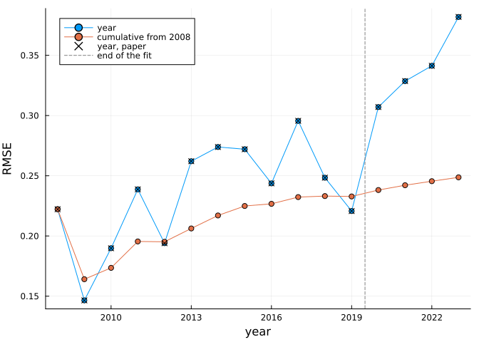
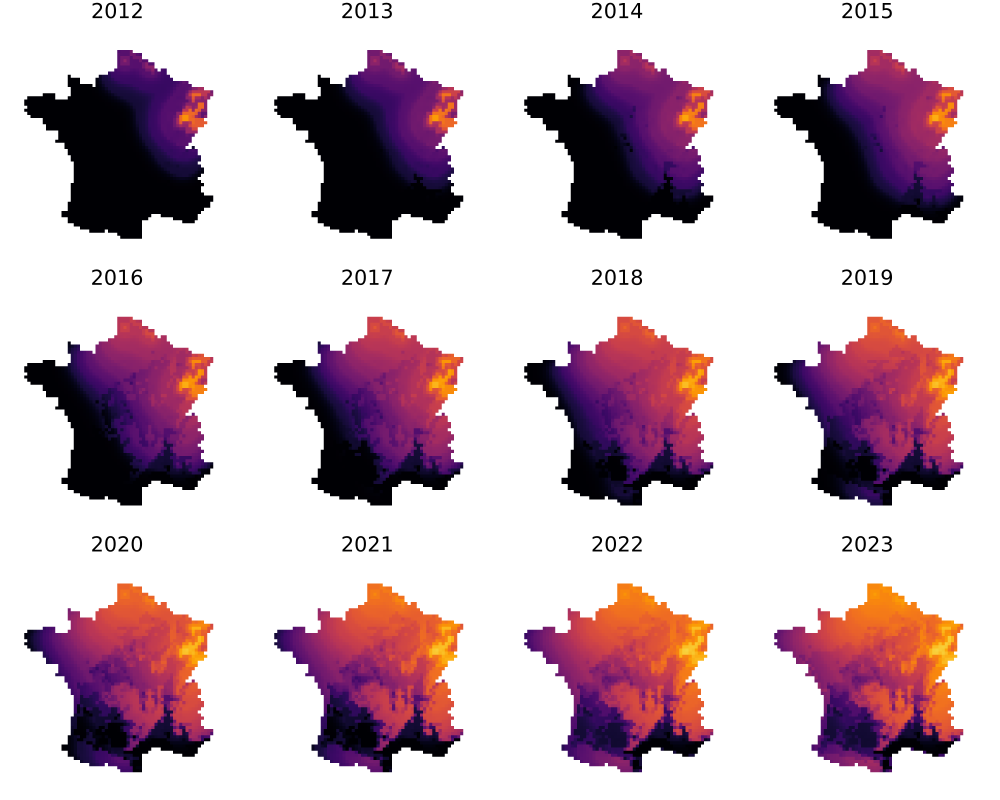
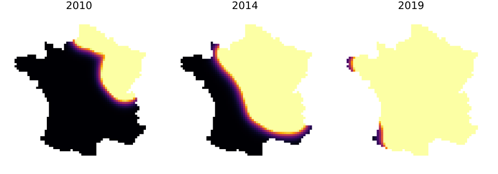
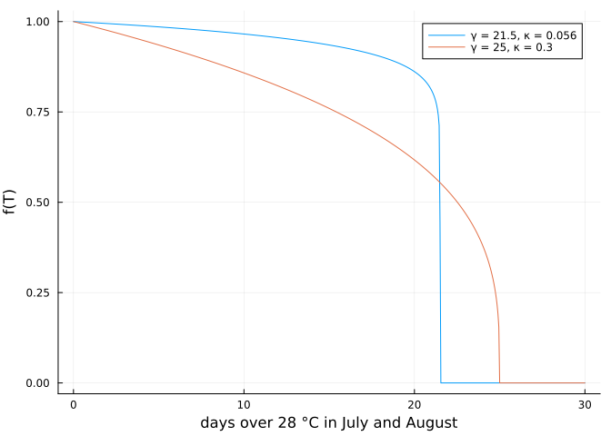
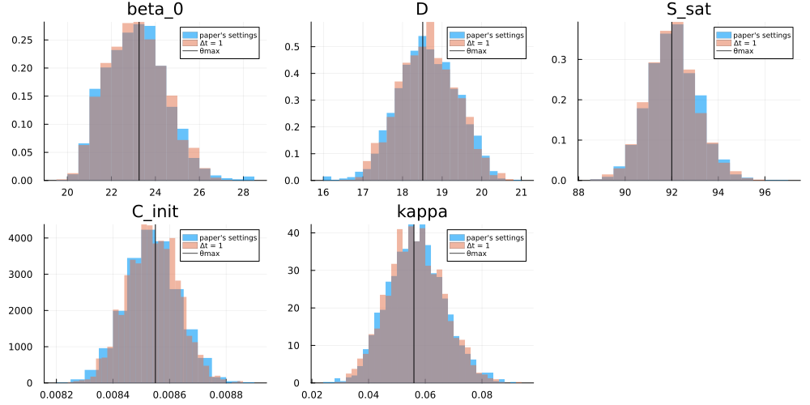
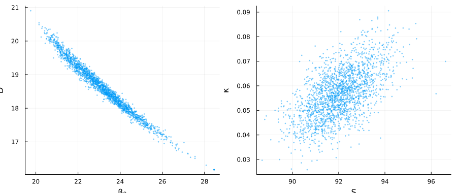
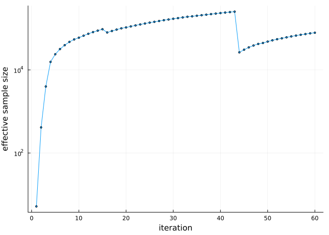
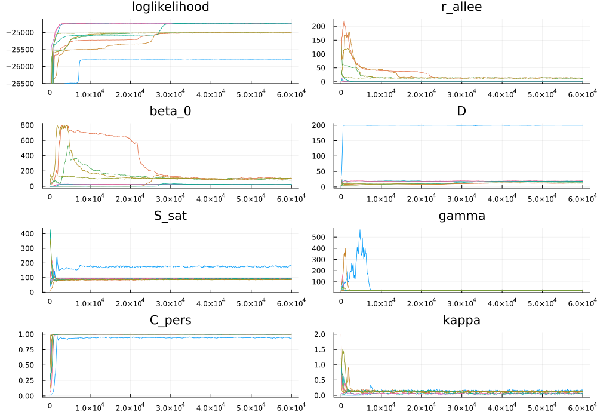

# Reproducing the paper
Simon Frost

- [Overview](#overview)
- [Setup](#setup)
- [The best parameter set](#the-best-parameter-set)
- [Table 4](#table-4)
- [Figures 5, 6, 8 and 12](#figures-5-6-8-and-12)
- [The posterior](#the-posterior)
- [Appendix A.1 and the model
  reduction](#appendix-a1-and-the-model-reduction)
- [How wide should the posterior be?](#how-wide-should-the-posterior-be)
- [What is not reproduced](#what-is-not-reproduced)

## Overview

This vignette reproduces the results of Fritsch, Grosdidier,
Gégout-Petit and Marçais, *Mechanistic-statistical model for the
expansion of ash dieback* (<https://hal.science/hal-04690647>), with the
released data, and goes one step past them by asking how wide the
paper’s posterior should be.

Almost everything is computed as the document renders. Two results take
far too long for that, so they are read from files in `results/`, each
with the command that regenerates it:

| Result | How it is obtained here | Time |
|:---|:---|:---|
| θmax likelihood, Table 4, Figures 5, 6 and 8 | live | seconds |
| Posterior at Δt = 1 | live | minutes |
| Temperature function, likelihood in γ, overdispersion, wider posterior | live | minutes |
| Posterior at the paper’s settings, for Table 3 and eq. 14 | `results/amis_reference*`, from `scripts/run_amis.jl` then `scripts/export_vignette_results.jl` | 25 h on 8 threads |
| Ten Metropolis–Hastings chains of Appendix A.1, Figure 9 | `results/a1_*`, thinned from runs of the Python port (`peoc_py3/scripts/appendix_a1_chains.sh`, `export_a1_chains.py`) | days |

The paper’s own numbers are typed into the code below, so each
comparison is explicit. The last section lists what this does not cover.

## Setup

``` julia
using AshDieback
using CSV
using DataFrames
using LinearAlgebra
using Plots
using Printf
using Random
using Statistics
using TOML

BLAS.set_num_threads(1)  # the threads go to the likelihoods of a batch
const RESULTS = joinpath(@__DIR__, "results")

"Print a Markdown table from a cell with `#| output: asis`."
function md_table(header, rows)
    println("| ", join(header, " | "), " |")
    println("|", repeat("---|", length(header)))
    foreach(r -> println("| ", join(r, " | "), " |"), rows)
    println()
end
fmt(x, d = 3) = @sprintf("%.*f", d, x)
sig(x) = @sprintf("%.4g", x)

data = load_peoc_data()
θmax = AshDiebackParameters(; r_symp = 1000.0, r_allee = 0.0, beta_0 = 23.26, beta_1 = 0.0,
                            D = 18.51, S_sat = 92.0, gamma = 21.50001, C_pers = 1.0,
                            C_init = 0.00855, kappa = 0.056)
prob = AshDiebackProblem(data, θmax)
```

    AshDiebackProblem: survey years 2008:2019, T28 temperature index
      p = (r_symp = 1000.0, r_allee = 0.0, beta_0 = 23.26, beta_1 = 0.0, D = 18.51, S_sat = 92.0, gamma = 21.50001, C_pers = 1.0, C_init = 0.00855, kappa = 0.056)

## The best parameter set

The paper gives θmax in eq. 14 and a fit to the survey of 2008–2019. Its
log-likelihood is:

``` julia
ll_max = loglikelihood(prob)
```

    -24717.21496294487

The package’s test suite holds this port to PEOC under Python 2.7 to a
relative 1e-10 at many parameter sets (measured: at most 8e-15).

## Table 4

The paper holds back the survey of 2020–2023 to test the model. Each row
gives the number of plot visits, the RMSE of the year and the RMSE from
2008 to that year:

``` julia
paper_table4 = (years = 2008:2023,
                observations = [183, 753, 504, 620, 515, 438, 493, 520, 410, 341, 254, 132, 346, 215, 166, 111],
                annual = [0.2222, 0.1465, 0.1898, 0.2387, 0.1940, 0.2621, 0.2739, 0.2720, 0.2437, 0.2956, 0.2484,
                          0.2207, 0.3071, 0.3286, 0.3413, 0.3819],
                cumulative = [0.2222, 0.1641, 0.1735, 0.1954, 0.1951, 0.2062, 0.2170, 0.2249, 0.2267, 0.2323,
                              0.2331, 0.2328, 0.2381, 0.2421, 0.2455, 0.2487])
forecast = solve(remake(prob; settings = ModelSettings(; final_year = 2023)))
t = rmse(forecast)
@assert t.years == collect(paper_table4.years)
```

``` julia
md_table(["Year", "Visits, paper", "Visits", "RMSE, paper", "RMSE", "To this year, paper", "To this year"],
         [[y, paper_table4.observations[i], t.observations[i], fmt(paper_table4.annual[i], 4), fmt(t.annual[i], 4),
           fmt(paper_table4.cumulative[i], 4), fmt(t.cumulative[i], 4)] for (i, y) in enumerate(t.years)])
```

| Year | Visits, paper | Visits | RMSE, paper | RMSE   | To this year, paper | To this year |
|------|---------------|--------|-------------|--------|---------------------|--------------|
| 2008 | 183           | 183    | 0.2222      | 0.2222 | 0.2222              | 0.2222       |
| 2009 | 753           | 753    | 0.1465      | 0.1465 | 0.1641              | 0.1641       |
| 2010 | 504           | 504    | 0.1898      | 0.1898 | 0.1735              | 0.1735       |
| 2011 | 620           | 620    | 0.2387      | 0.2387 | 0.1954              | 0.1954       |
| 2012 | 515           | 515    | 0.1940      | 0.1940 | 0.1951              | 0.1952       |
| 2013 | 438           | 438    | 0.2621      | 0.2621 | 0.2062              | 0.2062       |
| 2014 | 493           | 493    | 0.2739      | 0.2739 | 0.2170              | 0.2170       |
| 2015 | 520           | 520    | 0.2720      | 0.2720 | 0.2249              | 0.2249       |
| 2016 | 410           | 410    | 0.2437      | 0.2437 | 0.2267              | 0.2267       |
| 2017 | 341           | 341    | 0.2956      | 0.2956 | 0.2323              | 0.2323       |
| 2018 | 254           | 254    | 0.2484      | 0.2484 | 0.2331              | 0.2331       |
| 2019 | 132           | 132    | 0.2207      | 0.2207 | 0.2328              | 0.2328       |
| 2020 | 346           | 345    | 0.3071      | 0.3070 | 0.2381              | 0.2381       |
| 2021 | 215           | 214    | 0.3286      | 0.3286 | 0.2421              | 0.2421       |
| 2022 | 166           | 166    | 0.3413      | 0.3413 | 0.2455              | 0.2455       |
| 2023 | 111           | 111    | 0.3819      | 0.3819 | 0.2487              | 0.2487       |

``` julia
gaps = vcat(round.(t.annual; digits = 4) .- paper_table4.annual, round.(t.cumulative; digits = 4) .- paper_table4.cumulative)
worst = maximum(abs, gaps)
differ = count(x -> abs(x) > 1e-9, gaps)
visits = [(y, paper_table4.observations[i], t.observations[i])
          for (i, y) in enumerate(t.years) if paper_table4.observations[i] != t.observations[i]]
(; worst_difference = round(worst; digits = 4), entries_that_differ = differ, visits_that_differ = visits)
```

    (worst_difference = 0.0001, entries_that_differ = 2, visits_that_differ = [(2020, 346, 345), (2021, 215, 214)])

Of the 32 RMSE entries, 2 differ from the paper, by at most 0.0001. The
printed θmax is rounded, so differences of that size are to be expected.
The released data have one visit fewer than the paper in 2020 and in
2021.

``` julia
plot(t.years, [t.annual t.cumulative]; label = ["year" "cumulative from 2008"], marker = :circle,
     xlabel = "year", ylabel = "RMSE")
plot!(t.years, paper_table4.annual; label = "year, paper", seriestype = :scatter, marker = :x, color = :black)
vline!([2019.5]; label = "end of the fit", linestyle = :dash, color = :gray)
```



## Figures 5, 6, 8 and 12

Figures 5 and 6 show the probability that a tree develops symptoms, to
the end of the fit and beyond it:

``` julia
panels = [plot(forecast; year = y, clims = (0, 1), colorbar = false, title = string(y), axis = false, ticks = false,
               xlabel = "", ylabel = "") for y in 2012:2023]
plot(panels...; layout = (3, 4), size = (1000, 800))
```



Figure 8 shows the spores reaching each point after the cap S. It sits
at the cap across most of the country within a few years, which is why
cutting spore production has little effect until the cut is large.
Vignette 6 follows that up:

``` julia
panels = [plot(forecast; year = y, field = :fungi, clims = (0, 92), colorbar = false, title = string(y), axis = false,
               ticks = false, xlabel = "", ylabel = "") for y in (2010, 2014, 2019)]
plot(panels...; layout = (1, 3), size = (1000, 350))
```



Figure 12 is the temperature function, f(T) = (\[1 − T/γ\]₊)^κ. With κ
small it is close to a step at γ:

``` julia
f(T, γ, κ) = max(0.0, 1 - T / γ)^κ
plot(0:0.05:30, T -> f(T, 21.50001, 0.056); label = "γ = 21.5, κ = 0.056",
     xlabel = "days over 28 °C in July and August", ylabel = "f(T)")
plot!(0:0.05:30, T -> f(T, 25.0, 0.3); label = "γ = 25, κ = 0.3")
```



## The posterior

The paper’s AMIS is 60 iterations of 10 000 draws at Δt = 0.1, which
took 25 hours on 8 threads here. This cell runs the cheaper version from
vignette 4 from the paper’s starting proposal, so the posterior below is
recomputed as the document renders:

``` julia
θ0 = AshDiebackParameters(; r_symp = 1000.0, r_allee = 0.0, beta_0 = 24.0, beta_1 = 0.0, D = 18.0, S_sat = 90.0,
                          gamma = 21.50001, C_pers = 1.0, C_init = 0.0085, kappa = 0.05)
priors = reduced_model_prior_ranges()
fast = AshDiebackPosterior(AshDiebackProblem(data, θ0; settings = ModelSettings(; delta_t = 1.0)), priors)
exact = AshDiebackPosterior(AshDiebackProblem(data, θ0), priors)
params = free_parameters(fast)
res = amis(Xoshiro(2), fast, [24.0, 18.0, 90.0, 0.0085, 0.05], Matrix(Diagonal([3.0, 0.4, 1.0, 1e-8, 1.5e-5]));
           iterations = 15, samples = 1000)
effective_sample_size(res)
```

    10033.654736420482

The run at the paper’s settings comes from its saved files:

``` julia
reference = TOML.parsefile(joinpath(RESULTS, "amis_reference.toml"))
reference_draws = CSV.read(joinpath(RESULTS, "amis_reference_draws.csv"), DataFrame)
reference_log = CSV.read(joinpath(RESULTS, "amis_reference_log.csv"), DataFrame)
@assert Symbol.(reference["parameters"]) == collect(params)
(; iterations = reference["iterations"], draws = reference["draws"], ess = round(reference["ess"]),
 largest_weight_times_average = round(reference["largest_weight_times_average"]))
```

    (iterations = 60, draws = 600000, ess = 78521.0, largest_weight_times_average = 1892.0)

Eq. 14 and the posterior, with the mean and 95 % interval of each run:

``` julia
X, _, w = amis_draws(res)
μfast = X * w
Xc = X .- μfast
Σfast = (Xc .* w') * Xc'
sdfast = sqrt.(diag(Σfast))
θmax_free = [23.26, 18.51, 92.0, 0.00855, 0.056]
md_table(["Parameter", "θmax, eq. 14", "Δt = 1, 15 000 draws", "Paper's settings"],
         [[params[j], sig(θmax_free[j]),
           string(sig(μfast[j]), " [", sig(weighted_quantile(X[j, :], w, 0.025)), ", ", sig(weighted_quantile(X[j, :], w, 0.975)), "]"),
           string(sig(reference["mean"][j]), " [", sig(reference["q025"][j]), ", ", sig(reference["q975"][j]), "]")]
          for j in eachindex(params)])
```

| Parameter | θmax, eq. 14 | Δt = 1, 15 000 draws | Paper’s settings |
|----|----|----|----|
| beta_0 | 23.26 | 23.12 \[20.82, 25.76\] | 23.13 \[20.84, 25.91\] |
| D | 18.51 | 18.64 \[17.29, 20.05\] | 18.64 \[17.21, 20.01\] |
| S_sat | 92 | 92.04 \[89.96, 94.17\] | 92.05 \[89.99, 94.17\] |
| C_init | 0.00855 | 0.008539 \[0.00836, 0.008713\] | 0.00854 \[0.008362, 0.008715\] |
| kappa | 0.056 | 0.05646 \[0.03777, 0.07608\] | 0.05655 \[0.03773, 0.07634\] |

``` julia
xbest, _ = best_sample(res)
(; best_of_fast_run = NamedTuple(zip(params, round.(xbest; sigdigits = 4))),
 loglikelihood_at_best = round(loglikelihood(exact, xbest); digits = 2),
 loglikelihood_at_θmax = round(loglikelihood(exact, θmax_free); digits = 2))
```

    (best_of_fast_run = (beta_0 = 23.25, D = 18.55, S_sat = 91.99, C_init = 0.00854, kappa = 0.05706), loglikelihood_at_best = -24717.28, loglikelihood_at_θmax = -24717.21)

Figure 3, the marginal posteriors, with θmax as a vertical line. The
fast run is resampled by weight, so that the two can be compared:

``` julia
rng = Xoshiro(3)
cw = cumsum(w)
fast_draws = X[:, [searchsortedfirst(cw, min(rand(rng), cw[end])) for _ in 1:2000]]
panels = map(enumerate(params)) do (j, n)
    p = histogram(reference_draws[!, n]; normalize = :pdf, alpha = 0.6, bins = 30, label = "paper's settings", title = string(n),
                  linewidth = 0)
    histogram!(p, fast_draws[j, :]; normalize = :pdf, alpha = 0.5, bins = 30, label = "Δt = 1", linewidth = 0)
    vline!(p, [θmax_free[j]]; color = :black, label = "θmax")
    p
end
plot(panels...; layout = (2, 3), size = (1000, 500), legend = :topright, legendfontsize = 6)
```



Figure 4, the two pairs with the strongest correlations:

``` julia
plot(scatter(reference_draws.beta_0, reference_draws.D; markersize = 1.5, markerstrokewidth = 0, alpha = 0.5,
             xlabel = "β₀", ylabel = "D", legend = false),
     scatter(reference_draws.S_sat, reference_draws.kappa; markersize = 1.5, markerstrokewidth = 0, alpha = 0.5,
             xlabel = "S", ylabel = "κ", legend = false); layout = (1, 2), size = (900, 380))
```



Table 3, the correlations:

``` julia
order = [2, 1, 5, 3, 4]  # the table's order: D, β₀, κ, S, C_init
labels = ["D", "β₀", "κ", "S", "C_init"]
paper_table3 = [1.0 NaN NaN NaN NaN; -0.97 1.0 NaN NaN NaN; 0.06 -0.04 1.0 NaN NaN; 0.09 -0.11 0.58 1.0 NaN; -0.09 0.08 0.02 -0.14 1.0]
Rref = reduce(vcat, permutedims.(reference["correlation"]))
Rfast = Σfast ./ (sdfast * sdfast')
md_table(["Pair", "Paper", "Paper's settings", "Δt = 1"],
         [[labels[i] * " / " * labels[j], fmt(paper_table3[i, j], 2), fmt(Rref[order[i], order[j]], 2), fmt(Rfast[order[i], order[j]], 2)]
          for i in 2:5 for j in 1:(i - 1)])
```

| Pair        | Paper | Paper’s settings | Δt = 1 |
|-------------|-------|------------------|--------|
| β₀ / D      | -0.97 | -0.99            | -0.99  |
| κ / D       | 0.06  | 0.07             | 0.07   |
| κ / β₀      | -0.04 | -0.04            | -0.05  |
| S / D       | 0.09  | 0.10             | 0.10   |
| S / β₀      | -0.11 | -0.12            | -0.12  |
| S / κ       | 0.58  | 0.59             | 0.60   |
| C_init / D  | -0.09 | -0.10            | -0.11  |
| C_init / β₀ | 0.08  | 0.08             | 0.10   |
| C_init / κ  | 0.02  | 0.02             | 0.00   |
| C_init / S  | -0.14 | -0.15            | -0.15  |

``` julia
differences = [abs(paper_table3[i, j] - Rref[order[i], order[j]]) for i in 2:5 for j in 1:(i - 1)]
(; largest_difference = round(maximum(differences); digits = 3), D_β₀ = round(Rref[order[2], order[1]]; digits = 3),
 second_largest_difference = round(sort(differences)[end - 1]; digits = 3))
```

    (largest_difference = 0.017, D_β₀ = -0.987, second_largest_difference = 0.011)

The strongest correlation, between β₀ and D, is −0.97 in the paper and
stronger here at both step sizes. So the step size doesn’t explain it,
and this difference remains unexplained.

The effective sample size of the reference run shows why it is not a
measure of precision here. A single draw at iteration 44 took a share
about 1900 times the average (`scripts/check_amis_weights.jl`):

``` julia
plot(reference_log.iteration, reference_log.ess; marker = :circle, markersize = 2, legend = false, yscale = :log10,
     xlabel = "iteration", ylabel = "effective sample size")
```



## Appendix A.1 and the model reduction

The paper’s first step ran ten Metropolis–Hastings chains on the full
model, then fixed r = 0, β₁ = 0, C_pers = 1 and γ = 21.50001. The chains
shipped with PEOC came from an earlier model version, so they were
re-run with the released model and the Python port from the paper’s ten
starting points. Here is every 100th iteration of each of those chains,
as in Figure 9:

``` julia
chains = CSV.read(joinpath(RESULTS, "a1_chains.csv"), DataFrame)
best = CSV.read(joinpath(RESULTS, "a1_best.csv"), DataFrame)
function chain_panel(col; kw...)
    p = plot(; legend = false, title = string(col), kw...)
    for g in groupby(chains, :chain)
        plot!(p, g.iteration, g[!, col]; linewidth = 0.8)
    end
    return p
end
nothing
```

``` julia
plot(chain_panel(:loglikelihood; ylims = (-26500, -24600)), chain_panel(:r_allee), chain_panel(:beta_0), chain_panel(:D),
     chain_panel(:S_sat), chain_panel(:gamma), chain_panel(:C_pers), chain_panel(:kappa); layout = (4, 2), size = (1000, 700))
```



The chains settle at three levels. After iteration 30 000, by chain:

``` julia
burn = 30_000
late = filter(:iteration => >(burn), chains)
by_chain = combine(groupby(late, :chain), :loglikelihood => median => :ll, :r_allee => median => :r, :beta_0 => median => :beta_0,
                   :D => median => :D, :S_sat => median => :S, :gamma => median => :gamma, :C_pers => median => :C_pers,
                   :kappa => median => :kappa)
by_chain = leftjoin(by_chain, best; on = :chain)
sort!(by_chain, :ll; rev = true)
md_table(["Chain", "Median log-likelihood", "Best", "r", "β₀", "D", "S", "γ", "C_pers", "κ"],
         [[r.chain, fmt(r.ll, 1), fmt(r.best_loglikelihood, 1), sig(r.r), sig(r.beta_0), sig(r.D), sig(r.S), sig(r.gamma), sig(r.C_pers), sig(r.kappa)]
          for r in eachrow(by_chain)])
```

| Chain | Median log-likelihood | Best | r | β₀ | D | S | γ | C_pers | κ |
|----|----|----|----|----|----|----|----|----|----|
| 7 | -24727.5 | -24724.1 | 6.825e-05 | 22.31 | 19.01 | 92.41 | 21.5 | 0.9995 | 0.05812 |
| 6 | -24730.7 | -24724.2 | 0.0002428 | 24.76 | 17.63 | 91.71 | 21.5 | 0.9994 | 0.05323 |
| 4 | -24731.4 | -24724.6 | 7.021e-05 | 24.97 | 17.65 | 91.93 | 21.51 | 0.999 | 0.05561 |
| 9 | -24731.4 | -24725.4 | 0.0003602 | 24.67 | 17.81 | 91.76 | 21.5 | 0.9993 | 0.0542 |
| 8 | -25012.2 | -25008.0 | 13.64 | 94.4 | 12.82 | 86.75 | 22.92 | 0.9997 | 0.1206 |
| 5 | -25012.2 | -25008.6 | 13.69 | 100.4 | 12.39 | 86.47 | 22.91 | 0.9999 | 0.1137 |
| 10 | -25012.4 | -25008.1 | 13.74 | 98.64 | 12.5 | 86.75 | 22.91 | 0.9995 | 0.1174 |
| 3 | -25013.1 | -25008.1 | 13.6 | 94.74 | 12.77 | 86.72 | 22.91 | 0.9998 | 0.1203 |
| 2 | -25014.1 | -25008.6 | 13.87 | 104.5 | 12.15 | 87.08 | 22.91 | 0.9996 | 0.1182 |
| 1 | -25799.5 | -25795.6 | 0.06471 | 2.624 | 199.8 | 175.1 | 21.45 | 0.9444 | 0.147 |

``` julia
region1 = by_chain.chain[by_chain.ll .> maximum(by_chain.ll) - 100]
region2 = by_chain.chain[maximum(by_chain.ll) - 500 .< by_chain.ll .< maximum(by_chain.ll) - 100]
(; best_level = sort(region1), second_level = sort(region2),
 best_of_all_chains = round(maximum(best.best_loglikelihood); digits = 1), at_θmax = round(ll_max; digits = 1))
```

    (best_level = [4, 6, 7, 9], second_level = [2, 3, 5, 8, 10], best_of_all_chains = -24724.1, at_θmax = -24717.2)

The best level recovers θmax and the paper’s reduction, with none of it
imposed: r and β₁ near 0, C_pers near 1 and γ near 21.5. The levels are
up to 1072 log-units apart, so only the best carries posterior weight,
and pooling all ten chains is meaningless. Inside the best level, mixing
is poor. This is split R̂ over its chains, on these thinned draws:

``` julia
function split_rhat(x)  # chains × draws
    n = size(x, 2) ÷ 2
    s = vcat(x[:, 1:n], x[:, (n + 1):(2n)])
    W = mean(var(s; dims = 2))
    B = n * var(mean(s; dims = 2))
    return sqrt(((n - 1) / n * W + B / n) / W)
end
good = filter(:chain => in(region1), late)
stack_col(c) = permutedims(reduce(hcat, [g[!, c] for g in groupby(good, :chain)]))
md_table(["Parameter", "θmax", "Median in the best level", "2.5 %", "97.5 %", "Split R̂"],
         [[c, v, sig(median(good[!, c])), sig(quantile(good[!, c], 0.025)), sig(quantile(good[!, c], 0.975)), fmt(split_rhat(stack_col(c)), 2)]
          for (c, v) in ((:beta_0, 23.26), (:D, 18.51), (:S_sat, 92.0), (:C_init, 0.00855), (:kappa, 0.056), (:gamma, 21.50001), (:C_pers, 1.0))])
```

| Parameter | θmax     | Median in the best level | 2.5 %    | 97.5 %   | Split R̂ |
|-----------|----------|--------------------------|----------|----------|---------|
| beta_0    | 23.26    | 24.38                    | 21.17    | 28.32    | 1.52    |
| D         | 18.51    | 17.91                    | 16.2     | 19.68    | 1.75    |
| S_sat     | 92.0     | 91.93                    | 89.68    | 94.4     | 1.03    |
| C_init    | 0.00855  | 0.008552                 | 0.008376 | 0.008737 | 1.00    |
| kappa     | 0.056    | 0.05566                  | 0.03334  | 0.08105  | 1.02    |
| gamma     | 21.50001 | 21.5                     | 21.5     | 21.55    | 1.01    |
| C_pers    | 1.0      | 0.9994                   | 0.9971   | 1        | 1.04    |

So these chains locate the region without estimating its posterior,
which matches the paper’s use of them for model reduction only, before
its coarse grid and AMIS.

What separates the levels is that **the likelihood jumps in γ**. The
temperature index is a mean of four integers, so its values are
multiples of 0.25, and f(T) switches a set of quadrats on or off as γ
crosses one. This holds each level’s best thinned draw and moves γ
alone:

``` julia
function best_draw(ids)
    g = filter(:chain => in(ids), chains)
    return g[argmax(g.loglikelihood), :]
end
function γ_profile(r, γs)
    v = zeros(length(γs))
    Threads.@threads :dynamic for i in eachindex(γs)
        θ = AshDiebackParameters(; r_symp = 1000.0, r_allee = r.r_allee, beta_0 = r.beta_0, beta_1 = r.beta_1, D = r.D,
                                 S_sat = r.S_sat, gamma = γs[i], C_pers = r.C_pers, C_init = r.C_init, kappa = r.kappa)
        v[i] = loglikelihood(remake(prob; p = θ))
    end
    return v
end
γs = [21.4999, 21.50001, 21.8, 22.7, 22.95, 23.2]
profile1, profile2 = γ_profile(best_draw(region1), γs), γ_profile(best_draw(region2), γs)
```

    ([-24780.215460472144, -24718.296734281525, -24753.57453884844, -24799.22421551826, -24753.655129245133, -24759.149553998494], [-25186.040377718684, -25050.008015832507, -25072.637744675485, -25090.447938946298, -25008.216966092157, -25015.917275892258])

``` julia
md_table(["γ", "From the best level", "From the second level"],
         [[γs[i], fmt(profile1[i], 1), fmt(profile2[i], 1)] for i in eachindex(γs)])
```

| γ        | From the best level | From the second level |
|----------|---------------------|-----------------------|
| 21.4999  | -24780.2            | -25186.0              |
| 21.50001 | -24718.3            | -25050.0              |
| 21.8     | -24753.6            | -25072.6              |
| 22.7     | -24799.2            | -25090.4              |
| 22.95    | -24753.7            | -25008.2              |
| 23.2     | -24759.1            | -25015.9              |

A one-parameter-at-a-time sampler almost never crosses a jump like this,
which is why the chains stay apart.

## How wide should the posterior be?

The paper’s likelihood treats the trees surveyed in a quadrat as
independent. Around the fit, are the counts as variable as that?
Pearson’s and the deviance’s statistic per degree of freedom would be
about 1 if so. Cells with very small expected counts are unreliable for
this, so the table also restricts to cells where nq(1−q) is large
enough:

``` julia
xlogy(k, r) = k == 0 ? 0.0 : k * log(r)
function cell_stats(sol)
    out = NamedTuple[]
    for (l, (o, b)) in enumerate(zip(sol.prob.survey, sol.prob.binomial))
        q = view(sol.symptoms, :, :, l)
        for i in eachindex(o.x)
            k, nk = b.infected[i], b.healthy[i]
            n = k + nk
            qi = clamp(q[o.x[i], o.y[i]], 1e-300, 1 - 1e-16)
            push!(out, (; year = o.year, v = n * qi * (1 - qi), pearson = (k - n * qi)^2 / (n * qi * (1 - qi)),
                        deviance = 2 * (xlogy(k, k / (n * qi)) + xlogy(nk, nk / (n * (1 - qi))))))
        end
    end
    return DataFrame(out)
end
cells = cell_stats(solve(prob))
per_df(d, npar = 5) = (sum(d.pearson) / (nrow(d) - npar), sum(d.deviance) / (nrow(d) - npar))
nothing
```

``` julia
md_table(["Cells", "N", "Pearson / df", "Deviance / df"],
         [[name, nrow(d), fmt(per_df(d)[1], 1), fmt(per_df(d)[2], 1)]
          for (name, d) in (("all", cells), ("nq(1−q) ≥ 0.5", filter(:v => >=(0.5), cells)),
                            ("nq(1−q) ≥ 1", filter(:v => >=(1), cells)), ("nq(1−q) ≥ 2", filter(:v => >=(2), cells)))])
```

| Cells         | N    | Pearson / df | Deviance / df |
|---------------|------|--------------|---------------|
| all           | 3555 | 47.8         | 12.8          |
| nq(1−q) ≥ 0.5 | 2273 | 20.8         | 19.3          |
| nq(1−q) ≥ 1   | 2183 | 20.2         | 19.7          |
| nq(1−q) ≥ 2   | 2035 | 18.8         | 20.3          |

``` julia
big_cells = filter(:v => >=(1), cells)
by_year = combine(groupby(big_cells, :year), :pearson => mean => :pearson, :deviance => mean => :deviance, nrow => :n)
φ_estimate = per_df(big_cells)
(; pearson = round(φ_estimate[1]; digits = 1), deviance = round(φ_estimate[2]; digits = 1),
 lowest_year = round(minimum(by_year.pearson); digits = 1), highest_year = round(maximum(by_year.pearson); digits = 1))
```

    (pearson = 20.2, deviance = 19.7, lowest_year = 10.1, highest_year = 32.1)

**The counts are about 20 times as variable as binomial,** on either
statistic, and well above 1 in every year. Trees in one plot are not
independent, and any misfit of the model counts here too, and these data
can’t separate the two. If it is overdispersion, the paper’s posterior
is too narrow by a factor of about √20 ≈ 4.5.

So here is the same model with the log-likelihood divided by φ = 20,
prior × L^(1/20). This is importance sampling with the French likelihood
recomputed, not a widened Gaussian. The proposal is a Student-t on
log-parameters, centred on the reference run, with two adaptive rounds
at Δt = 1:

``` julia
const PHI = 20.0
const NU = 7

mean_cov(Z, w) = (m = Z * w; (m, Symmetric(((Z .- m) .* w') * (Z .- m)')))
normalise(lw) = (v = exp.(lw .- maximum(lw)); v ./ sum(v))

function tempered_round(rng, post, m, C, n)
    L = cholesky(C).L
    d = length(m)
    logdetL = sum(log(L[i, i]) for i in 1:d)
    Z = zeros(d, n)
    lq = zeros(n)
    for i in 1:n
        z = m .+ sqrt(NU / sum(abs2, randn(rng, NU))) .* (L * randn(rng, d))
        Z[:, i] = z
        lq[i] = -0.5 * (NU + d) * log1p(sum(abs2, L \ (z .- m)) / NU) - logdetL
    end
    ll, lp = fill(-Inf, n), fill(-Inf, n)
    Threads.@threads :dynamic for i in 1:n
        x = exp.(Z[:, i])
        p = logprior(post, x)
        if isfinite(p)
            lp[i] = p
            ll[i] = loglikelihood(remake(post.problem; p = full_parameters(post, x)))
        end
    end
    # On log-parameters the target gains the Jacobian, the product of the parameters.
    lw = [isfinite(ll[i]) ? ll[i] / PHI + lp[i] + sum(view(Z, :, i)) - lq[i] : -Inf for i in 1:n]
    return (; Z, lw, ll, lp)
end

rng = Xoshiro(20261106)
Zref = log.(Matrix(reference_draws[!, collect(params)])')
mref, Cref = mean_cov(Zref, fill(1 / size(Zref, 2), size(Zref, 2)))
round1 = tempered_round(rng, fast, mref, Symmetric(PHI .* Matrix(Cref)), 1500)
m2, C2 = mean_cov(round1.Z, normalise(round1.lw))
round2 = tempered_round(rng, fast, m2, Symmetric(1.2 .* Matrix(C2)), 3000)
wt = normalise(round2.lw)
Xt = exp.(round2.Z)
(; ess_round_1 = round(1 / sum(abs2, normalise(round1.lw))), ess_round_2 = round(1 / sum(abs2, wt)), proposals = length(wt),
 outside_prior = count(!isfinite, round2.lp), largest_weight = round(maximum(wt); digits = 4))
```

    (ess_round_1 = 73.0, ess_round_2 = 1426.0, proposals = 3000, outside_prior = 1, largest_weight = 0.0051)

``` julia
md_table(["Parameter", "Paper's settings, 95 %", "Allowing for φ = 20, mean", "95 %", "Ratio of sd"],
         [[params[j], string(sig(reference["q025"][j]), " – ", sig(reference["q975"][j])), sig(sum(wt .* Xt[j, :])),
           string(sig(weighted_quantile(Xt[j, :], wt, 0.025)), " – ", sig(weighted_quantile(Xt[j, :], wt, 0.975))),
           fmt(sqrt(sum(wt .* (Xt[j, :] .- sum(wt .* Xt[j, :])) .^ 2)) / reference["sd"][j], 1)] for j in eachindex(params)])
```

| Parameter | Paper’s settings, 95 % | Allowing for φ = 20, mean | 95 % | Ratio of sd |
|----|----|----|----|----|
| beta_0 | 20.84 – 25.91 | 27.84 | 15.05 – 50.04 | 6.8 |
| D | 17.21 – 20.01 | 17.61 | 12.08 – 24.92 | 4.6 |
| S_sat | 89.99 – 94.17 | 92.76 | 83.09 – 103.8 | 5.0 |
| C_init | 0.008362 – 0.008715 | 0.008538 | 0.007758 – 0.009357 | 4.6 |
| kappa | 0.03773 – 0.07634 | 0.07281 | 0.004968 – 0.164 | 4.3 |

``` julia
jβ = findfirst(==(:beta_0), params)
share_below(k) = sum(wt[Xt[jβ, :] .<= 23.26 / k])
(; k_125 = round(share_below(1.25); digits = 3), k_15 = round(share_below(1.5); digits = 3), k_2 = round(share_below(2); digits = 3))
```

    (k_125 = 0.131, k_15 = 0.033, k_2 = 0.001)

The width grows mostly upward in β₀. So if inoculum is uncertain, the
data lean towards *more* of it, not less: 3.3 % of this posterior has β₀
below the paper’s value divided by 1.5, and 0.1 % below half of it. Some
of the factor of 20 may be misfit, so treat these as generous widths.
They cover uncertainty inside this model only.

Two checks. Δt = 1 is coarse enough that its error could matter, so this
compares it with Δt = 0.1 at 40 of the draws, in units of log-likelihood
/ φ. And the loss from θmax would average 2.5 if the tempered posterior
were quadratic in 5 parameters:

``` julia
rng2 = Xoshiro(20261107)
c = cumsum(wt)
n20 = 60
u0 = rand(rng2) / n20
set20 = Xt[:, [min(searchsortedfirst(c, u0 + (i - 1) / n20), length(wt)) for i in 1:n20]]
chk = set20[:, round.(Int, range(1, n20; length = 40))]
lla, llb = zeros(40), zeros(40)
Threads.@threads :dynamic for i in 1:40
    lla[i] = loglikelihood(fast, chk[:, i])
    llb[i] = loglikelihood(exact, chk[:, i])
end
(; dt_error = round.(extrema((lla .- llb) ./ PHI); digits = 3), spread_of_ll = round(std(llb ./ PHI); digits = 2),
 mean_loss_from_θmax = round(mean((ll_max .- llb) ./ PHI); digits = 2))
```

    (dt_error = (-0.004, 0.01), spread_of_ll = 1.39, mean_loss_from_θmax = 2.35)

These draws, with 20 from the reference run, are what vignette 6 uses on
Great Britain:

``` julia
set1 = Matrix(reference_draws[1:20, collect(params)])
d1 = insertcols!(DataFrame(set1, collect(params)), 1, :set => "phi1", :draw => 1:20)
d20 = insertcols!(DataFrame(permutedims(set20), collect(params)), 1, :set => "phi20", :draw => 1:n20)
draws_table = vcat(d1, d20)
CSV.write(joinpath(RESULTS, "posterior_draws.csv"), draws_table)
md_table(["Set", "Draws", "β₀, range", "S, range"],
         [[g.set[1], nrow(g), string(fmt(minimum(g.beta_0), 1), " – ", fmt(maximum(g.beta_0), 1)),
           string(fmt(minimum(g.S_sat), 1), " – ", fmt(maximum(g.S_sat), 1))] for g in groupby(draws_table, :set)])
```

| Set   | Draws | β₀, range   | S, range     |
|-------|-------|-------------|--------------|
| phi1  | 20    | 21.2 – 25.4 | 90.5 – 94.1  |
| phi20 | 60    | 13.0 – 52.7 | 81.9 – 104.7 |

## What is not reproduced

- **The AMIS draws themselves.** The paper’s seed and history aren’t
  published, so the runs are independent ones. θmax comes from the
  paper’s run, and the best draws here land next to it.
- **The coarse grid of Appendix A.2 (Figures 10 and 11),** which has 630
  000 points. `peoc_grid_axes()` and `likelihood_grid` run it, in
  several hours; vignette 3 shows a small part.
- **Fits with other temperature indices (Figures 14 and 15),** and the
  deviation measure of Figure 13.
- **The shipped MH chains (the actual Figure 9).** They came from an
  earlier model whose code isn’t released. The chains above are a re-run
  with the released model, and they reach the same conclusions.
