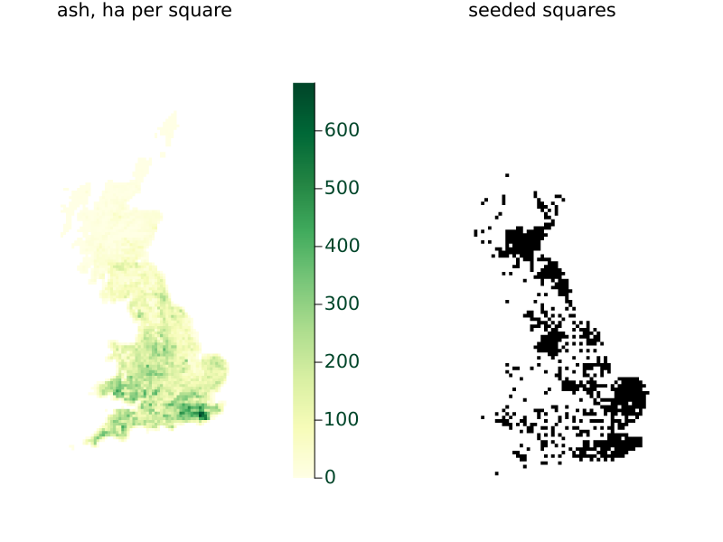
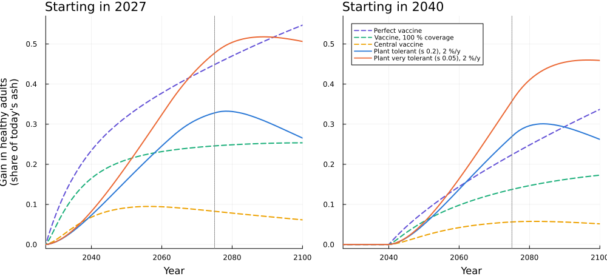
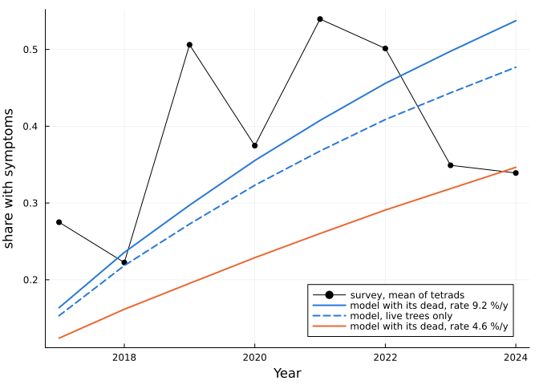
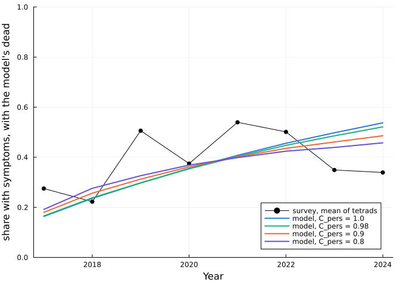
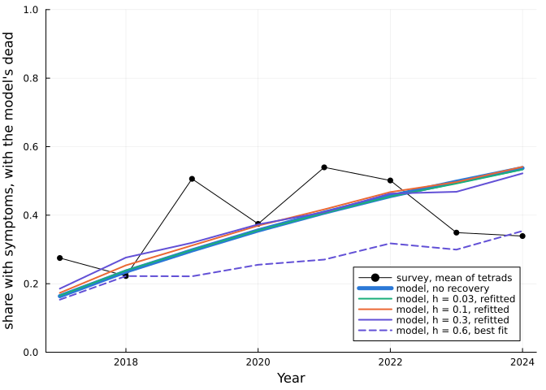
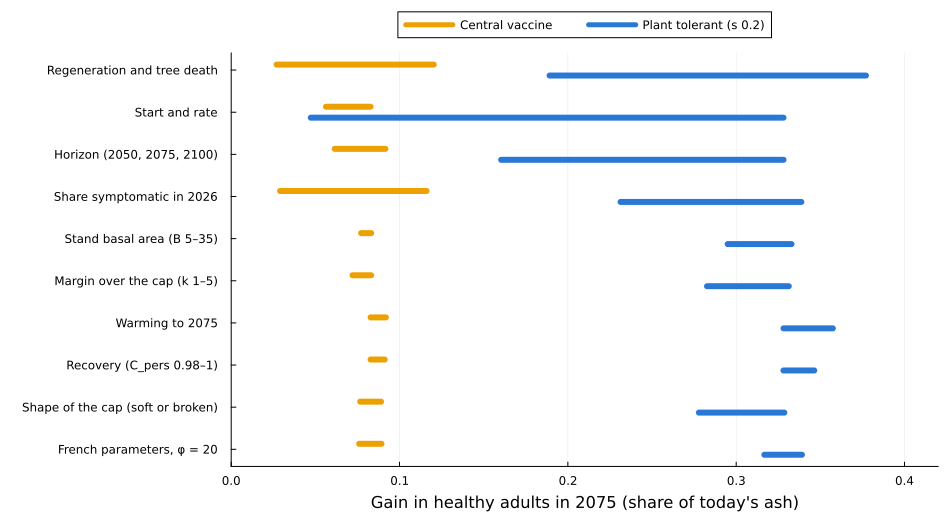

# Interventions against ash dieback in Great Britain
Simon Frost

- [Overview](#overview)
- [Setup](#setup)
- [Inputs](#inputs)
- [The host model and the
  interventions](#the-host-model-and-the-interventions)
- [The ranking at each horizon](#the-ranking-at-each-horizon)
- [Timing decides between vaccines and
  planting](#timing-decides-between-vaccines-and-planting)
- [Product quality](#product-quality)
- [Regeneration and tree death](#regeneration-and-tree-death)
- [The share already symptomatic](#the-share-already-symptomatic)
  - [Against Kent’s survey](#against-kents-survey)
- [The margin over the spore cap](#the-margin-over-the-spore-cap)
- [Recovery](#recovery)
  - [Recovery after hot summers](#recovery-after-hot-summers)
- [A softer cap](#a-softer-cap)
  - [Power laws](#power-laws)
- [Clearing litter in one stand](#clearing-litter-in-one-stand)
- [Warming](#warming)
- [The French parameters](#the-french-parameters)
- [What changes the result](#what-changes-the-result)
- [Summary](#summary)
  - [What field data would help most](#what-field-data-would-help-most)
  - [Limits](#limits)

## Overview

Which interventions would best protect ash in Great Britain, and what
decides the answer? This vignette runs the French model of vignette 5 on
Great Britain with a changing host, to compare vaccinating trees,
planting tolerant stock, felling and clearing leaf litter, to 2075 and
on to 2100.

**In short, which intervention comes out ahead depends mainly on how
good the product is, when it can start and at what rate, and how far
ahead you look.** Long-term regeneration and the share of trees already
symptomatic can also change the order, and so can the little recovery of
symptomatic trees that the French data allow. The fitted disease
parameters, the shape of the spore cap and warming to 2075 change
vaccine and planting results far less. The numbers are in the
[summary](#summary) at the end, with the field data that would help
most.

**This is a comparison under assumptions, not a forecast.** No ash
vaccine exists, so vaccination is a generic strategy whose efficacy,
duration and reach are inputs. The traits of tolerant stock and the rate
of regeneration are assumed too. Nothing is fitted to British data: the
spread and symptom parameters come from France.

Every result below, in tables, figures and text, is computed by the code
in this document, apart from two counts quoted from Forest Research’s
map of first finds, whose full data this package doesn’t hold (see
`data/gb/README.md`). The sweeps need a few thousand runs of a model
taking several seconds each, so each saves its results to `results/` as
it goes, and picks up from there. Delete a file there to recompute that
sweep, or all of them to recompute everything, which takes hours.

## Setup

``` julia
using AshDieback
using CSV
using DataFrames
using LinearAlgebra
using Plots
using Printf
using Random
using Statistics

BLAS.set_num_threads(1)  # the threads go to the runs of a sweep
const RESULTS = joinpath(@__DIR__, "results")
mkpath(RESULTS)

"Print a Markdown table from a cell with `#| output: asis`."
function md_table(header, rows)
    println("| ", join(header, " | "), " |")
    println("|", repeat("---|", length(header)))
    foreach(r -> println("| ", join(r, " | "), " |"), rows)
    println()
end
fmt(x, d = 3) = @sprintf("%.*f", d, x)
interval(v) = (quantile(v, 0.025), quantile(v, 0.975))
fmti(v) = string(fmt(mean(v)), " [", fmt(interval(v)[1]), ", ", fmt(interval(v)[2]), "]")

const YELLOW, BLUE, ORANGE, AQUA, VIOLET = "#eda100", "#2a78d6", "#eb6834", "#1baf7a", "#6250d6"
nothing
```

## Inputs

Great Britain is 10 km squares of the OS National Grid. Ash area comes
from a modelled 1 km map. The epidemic starts in 2014 in the squares
where it was first found in 2012–2015. By October 2025, Forest
Research’s map shows it in 1779 squares, which hold 88 % of the ash
(counted from the map and the ash data; the package holds only the
seeded squares):

``` julia
inputs = load_gb_inputs()
prob0, cell = gb_problem(inputs; B = 15.0)
K = prob0.data.ash_density
(; squares = length(inputs.squares), ash_ha = round(Int, sum(inputs.ash_ha)), squares_seeded = count(inputs.seeded),
 share_of_ash_in_seeded_squares = round(sum(inputs.ash_ha[inputs.seeded]) / sum(inputs.ash_ha); digits = 2))
```

    (squares = 2827, ash_ha = 284072, squares_seeded = 734, share_of_ash_in_seeded_squares = 0.36)

``` julia
ash_map, seed_map = fill(NaN, size(K)), fill(NaN, size(K))
for (k, s) in enumerate(inputs.squares)
    i, j = cell(s...)
    ash_map[i, j] = inputs.ash_ha[k]
    seed_map[i, j] = inputs.seeded[k] ? 1.0 : 0.0
end
plot(heatmap(ash_map'; title = "ash, ha per square", aspect_ratio = 1, axis = false, ticks = false, c = :YlGn),
     heatmap(seed_map'; title = "seeded squares", aspect_ratio = 1, axis = false, ticks = false, c = :Greys, colorbar = false);
     layout = (1, 2), size = (800, 600))
```



Stand basal area B converts ash area to the model’s density, and it
isn’t measured directly. The National Forest Inventory’s volume of ash,
with an assumed form height, gives B of about 11 to 17 on this map’s
area if woodland alone counts, and trees outside woodland would raise
it. So B = 15 is central here, with 5 to 35 tried below.

## The host model and the interventions

The spore model stays as in France: production, diffusion, the cap S and
the temperature function. `HostProblem` adds a changing host: classes of
tree, juveniles, death and recruitment. Tree classes have a relative
susceptibility, and leaf litter is produced in proportion to live ash.

These settings are estimates, mostly unmeasured. A native tolerant share
of 5 % has a tenth of the death rate. Symptomatic trees die at μ = 0.04
a year, which fits Europe-wide survival records. New trees arrive at ρ =
0.03 a year, for which only short studies exist.

``` julia
const START = 2027

function host_for(ρ, μ, sc)
    sus = HostClass(:susceptible; share = 0.95, mortality = μ)
    # s_t sets the native tolerant class as well as planted stock, so each scenario has a matching baseline.
    tol = HostClass(:tolerant; share = 0.05, susceptibility = sc.s_t, mortality = 0.1 * μ)
    classes = [sus, tol]
    if sc.vaccine !== nothing
        push!(classes, vaccinated_class(sus; efficacy = sc.vaccine.efficacy, inoculum = 1.0, mortality = μ))
    end
    return HostDynamics(classes; background_mortality = 0.005, juvenile_years = 15.0, juvenile_mortality_factor = 2.5,
                        juvenile_inoculum = 0.1, regeneration_rate = ρ, heritability = 0.5)
end

const SCENARIOS = Dict{String,NamedTuple}()
register!(name; vaccine = nothing, ivs = AbstractIntervention[], s_t = 0.2) = (SCENARIOS[name] = (; name, vaccine, ivs, s_t); name)
base_of(name) = (s = SCENARIOS[name].s_t; s == 0.2 ? "baseline" : "baseline s $s")

function vaccinate!(name; efficacy = 0.9, waning = 0.05, max_coverage = 0.3, rate = 0.1, start = START, also = AbstractIntervention[])
    iv = Vaccinate(; from = :susceptible, to = :vaccinated_susceptible, years = start:2100, rate, max_coverage, waning,
                   symptomatic = false, juveniles = true, cells = nothing)
    return register!(name; vaccine = (; efficacy), ivs = AbstractIntervention[iv, also...])
end
plant_iv(rate, start, class = :tolerant) = PlantStock(; class, years = start:2075, rate)
plant_name(s, rate, start) = "plant s $s, $(100rate) %/y from $start"
plant!(s, rate, start) = register!(plant_name(s, rate, start); ivs = AbstractIntervention[plant_iv(rate, start)], s_t = s)

register!("baseline")
register!("baseline s 0.05"; s_t = 0.05)
register!("baseline s 0.5"; s_t = 0.5)
for start in (2027, 2040)
    vaccinate!("central vaccine from $start"; start)
    vaccinate!("100 % vaccine from $start"; start, max_coverage = 1.0, rate = 0.5)
    vaccinate!("perfect vaccine from $start"; start, efficacy = 1.0, waning = 0.0, max_coverage = 1.0, rate = 1.0)
    register!("plant ordinary, 2.0 %/y from $start"; ivs = AbstractIntervention[plant_iv(0.02, start, :susceptible)])
    foreach(s -> plant!(s, 0.02, start), (0.05, 0.5))
    plant!(0.05, 0.005, start)
end
for start in (2027, 2035, 2040, 2050), rate in (0.005, 0.01, 0.02)
    plant!(0.2, rate, start)
end
vaccinate!("efficacy 0.5"; efficacy = 0.5)
vaccinate!("lasts 5 years"; waning = 0.2)
vaccinate!("lifelong"; waning = 0.0)
vaccinate!("coverage up to 60 %"; max_coverage = 0.6)
vaccinate!("central vaccine + planting"; also = AbstractIntervention[plant_iv(0.02, START)])
register!("fell 50 %"; ivs = AbstractIntervention[Fell(; years = START:2100, rate = 0.5)])
register!("clear 50 % of litter"; ivs = AbstractIntervention[ReduceLitter(; years = START:2100, effect = 0.5)])
register!("clear 95 % of litter"; ivs = AbstractIntervention[ReduceLitter(; years = START:2100, effect = 0.95)])

const CENTRAL_V, HUNDRED_V, PERFECT_V = "central vaccine from 2027", "100 % vaccine from 2027", "perfect vaccine from 2027"
const PLANT, PLANT_T, PLANT_W, PLANT_O = plant_name(0.2, 0.02, 2027), plant_name(0.05, 0.02, 2027), plant_name(0.5, 0.02, 2027),
                                         "plant ordinary, 2.0 %/y from 2027"
length(SCENARIOS)
```

    37

The central vaccine has efficacy 0.9, lasts 20 years on average, and
reaches 10 % of healthy trees a year up to 30 %. It protects only trees
not yet symptomatic. Tolerant stock has relative susceptibility s (0.2
central, 0.05 “very tolerant”). Planting fills gaps left by dead ash, up
to 2075.

**The measure is healthy adult ash in a given year, as a share of
today’s ash area.** It counts adult trees only, so it delays the credit
for planting by the juvenile period of 15 years. Live area would hide
the differences, since planting refills it whatever the stock’s quality.
A gain is against the baseline of the same setting and the same s.

This is the machinery for the sweeps. Each case is one run, labelled by
strings, and each finished case is appended to the sweep’s file:

``` julia
const ASH = K .> 0
const SOUTH = let m = falses(size(K))
    foreach(s -> s[2] < 300 && (m[cell(s...)...] = true), inputs.squares)
    m .& ASH
end
const NORTH = let m = falses(size(K))
    foreach(s -> s[2] >= 600 && (m[cell(s...)...] = true), inputs.squares)
    m .& ASH
end
const OUTCOMES = [:year, :live, :adults, :healthy_adults, :q, :saturated, :mean_F, :treated_ha, :healthy_south, :healthy_north]

function outcome_rows(sol, years, B)
    K = sol.prob.prob.data.ash_density
    S = sol.prob.prob.p.S_sat
    ys = host_years(sol)
    live, adults = live_host(sol), live_host(sol; juveniles = false)
    q = symptom_share(sol)
    total = sum(K[ASH])
    wt = K[ASH] ./ total
    healthy_in(l, use) = sum(sum(view(sol.healthy, :, :, k, l)[use]) for k in axes(sol.healthy, 3))
    return map(years) do y
        l = y - first(ys) + 1
        F = view(sol.fungi, :, :, l - 1)[ASH]
        (; year = y, live = sum(view(live, :, :, l)[ASH]) / total, adults = sum(view(adults, :, :, l)[ASH]) / total,
         healthy_adults = healthy_in(l, ASH) / total, q = sum(wt .* view(q, :, :, l)[ASH]), saturated = sum(wt[F .>= 0.9999 * S]),
         mean_F = sum(wt .* F), treated_ha = isempty(sol.applied) ? 0.0 : sum(view(sol.applied, :, 1:l)) * 1e4 / B,
         healthy_south = healthy_in(l, SOUTH) / sum(K[SOUTH]), healthy_north = healthy_in(l, NORTH) / sum(K[NORTH]))
    end
end

function run_case(c)
    settings = ModelSettings(; initialization_year = c.init, final_year = maximum(c.years), delta_t = 1.0, saturation_sharpness = c.n,
                             cap_exponent = c.b)
    sc = SCENARIOS[c.scenario]
    prob = AshDiebackProblem(c.data, c.θ; settings)
    return outcome_rows(solve(HostProblem(prob, host_for(c.ρ, c.μ, sc); interventions = sc.ivs)), c.years, c.B)
end

const THETA = [1000.0, 0.0, 23.26, 0.0, 18.51, 92.0, 21.50001, 1.0, 0.05, 0.056]
const DATA15 = prob0.data
const DEFAULT_YEARS = (2026, 2050, 2075)
case(labels, scenario; data = DATA15, B = 15.0, θ = THETA, ρ = 0.03, μ = 0.04, years = DEFAULT_YEARS, init = 2014, n = Inf, b = 0.0) =
    (; labels, scenario, data, B, θ, ρ, μ, years, init, n, b)

"Run the cases not yet in results/name.csv, then return the rows of all the cases."
function sweep(name, cases)
    path = joinpath(RESULTS, name * ".csv")
    labels = collect(keys(first(cases).labels))
    key_columns = vcat(labels, :scenario)
    case_key(c) = join((values(c.labels)..., c.scenario), "|")
    row_key(r) = join((r[l] for l in key_columns), "|")
    wanted = Dict(case_key(c) => length(c.years) for c in cases)
    @assert length(wanted) == length(cases)
    read_rows() = unique(CSV.read(path, DataFrame; types = Dict(l => String for l in key_columns), stringtype = String),
                         vcat(key_columns, :year); keep = :last)
    finished = Set{String}()
    if isfile(path)
        for g in groupby(read_rows(), key_columns)
            k = row_key(first(g))
            get(wanted, k, -1) == nrow(g) && push!(finished, k)
        end
    end
    todo = filter(c -> case_key(c) ∉ finished, cases)
    if !isempty(todo)
        isfile(path) || write(path, join(vcat(key_columns, OUTCOMES), ",") * "\n")
        lk = ReentrantLock()
        io = open(path, "a")
        Threads.@threads :dynamic for n in eachindex(todo)
            c = todo[n]
            out = run_case(c)
            text = join((join((values(c.labels)..., "\"" * c.scenario * "\"",
                               (r[f] isa Int ? r[f] : round(r[f]; sigdigits = 7) for f in OUTCOMES)...), ",") for r in out), "\n") * "\n"
            lock(lk) do
                write(io, text)
                flush(io)
            end
        end
        close(io)
    end
    selected = filter(r -> haskey(wanted, row_key(r)), read_rows())
    @assert nrow(selected) == sum(values(wanted)) "$name: expected $(sum(values(wanted))) rows, found $(nrow(selected))"
    return selected
end

"Lookups into a sweep: `value(labels..., scenario)` and `gain(labels..., scenario)`, for one year and column."
function lookups(df; year = 2075, col = :healthy_adults)
    labels = [n for n in propertynames(df) if n ∉ OUTCOMES]
    d = filter(:year => ==(year), df)
    v = Dict(Tuple(String[string(r[l]) for l in labels]) => Float64(r[col]) for r in eachrow(d))
    value(args...) = v[Tuple(String[string(a) for a in args])]
    gain(args...) = value(args...) - value(args[1:(end - 1)]..., base_of(args[end]))
    return (; value, gain)
end
nothing
```

## The ranking at each horizon

The central case, at the French best-fit parameters, year by year to
2100:

``` julia
central_names = ["baseline", "baseline s 0.05", "baseline s 0.5", sort(filter(n -> !startswith(n, "baseline"), collect(keys(SCENARIOS))))...]
timing = sweep("timing", [case((; setting = "central"), n; years = 2026:2100) for n in central_names])
nrow(timing)
```

    2775

``` julia
gain_y(name, y; col = :healthy_adults) = lookups(timing; year = y, col).gain("central", name)
value_y(name, y; col = :healthy_adults) = lookups(timing; year = y, col).value("central", name)
"Mean area treated a year over 2027-2075, ha, to two significant figures."
ha_per_year(name) = round(Int, round(value_y(name, 2075; col = :treated_ha) / 49; sigdigits = 2))
peak_year(name) = (2026:2100)[argmax([gain_y(name, y) for y in 2026:2100])]
base75 = (healthy = value_y("baseline", 2075), adults = value_y("baseline", 2075; col = :adults),
          q26 = value_y("baseline", 2026; col = :q), q75 = value_y("baseline", 2075; col = :q),
          sat75 = value_y("baseline", 2075; col = :saturated), live75 = value_y("baseline", 2075; col = :live))
map(x -> round(x; digits = 3), base75)
```

    (healthy = 0.062, adults = 0.26, q26 = 0.527, q75 = 0.78, sat75 = 0.931, live75 = 0.322)

Without any intervention, healthy adults in 2075 are 0.06 of today’s
ash, and all adults 0.26. One point (0.01) is about 2841 ha. Each gain:

``` julia
ranked = [PLANT_T, PERFECT_V, "clear 95 % of litter", "central vaccine + planting", PLANT, HUNDRED_V, PLANT_W, CENTRAL_V, PLANT_O,
          "fell 50 %", "clear 50 % of litter"]
md_table(["From 2027", "2050", "2075", "2100", "Change in all adults, 2075"],
         [[n, fmt(gain_y(n, 2050)), "**" * fmt(gain_y(n, 2075)) * "**", fmt(gain_y(n, 2100)), @sprintf("%+.2f", gain_y(n, 2075; col = :adults))]
          for n in ranked])
```

| From 2027 | 2050 | 2075 | 2100 | Change in all adults, 2075 |
|----|----|----|----|----|
| plant s 0.05, 2.0 %/y from 2027 | 0.197 | **0.477** | 0.506 | +0.51 |
| perfect vaccine from 2027 | 0.319 | **0.448** | 0.547 | +0.33 |
| clear 95 % of litter | 0.252 | **0.400** | 0.515 | +0.27 |
| central vaccine + planting | 0.248 | **0.364** | 0.279 | +0.53 |
| plant s 0.2, 2.0 %/y from 2027 | 0.160 | **0.328** | 0.265 | +0.51 |
| 100 % vaccine from 2027 | 0.211 | **0.246** | 0.254 | +0.20 |
| plant s 0.5, 2.0 %/y from 2027 | 0.108 | **0.165** | 0.076 | +0.50 |
| central vaccine from 2027 | 0.092 | **0.083** | 0.062 | +0.08 |
| plant ordinary, 2.0 %/y from 2027 | 0.057 | **0.072** | 0.013 | +0.25 |
| fell 50 % | 0.006 | **0.041** | 0.086 | -0.16 |
| clear 50 % of litter | 0.006 | **0.015** | 0.032 | +0.01 |

At 2 %/y from 2027, planting’s gain peaks in 2078 at s 0.2 and 2089 at s
0.05, then falls, probably because these runs stop planting in 2075. At
s 0.5 it already peaks in 2072, before the stop. So the 2100 column for
planting shows what follows a stop, not a forecast with planting
continuing.

## Timing decides between vaccines and planting

``` julia
series = [("Perfect vaccine", "perfect vaccine from ", VIOLET, :dash), ("Vaccine, 100 % coverage", "100 % vaccine from ", AQUA, :dash),
          ("Central vaccine", "central vaccine from ", YELLOW, :dash)]
wide = sort(unstack(timing, :year, :scenario, :healthy_adults), :year)
@assert wide.year == 2026:2100
curve(name) = wide[!, name] .- wide[!, base_of(name)]
function timing_panel(start; kw...)
    p = plot(; title = "Starting in $start", xlabel = "Year", ylims = (-0.01, 0.57), xlims = (2027, 2100), titlelocation = :left, kw...)
    for (label, prefix, colour, style) in series
        plot!(p, 2026:2100, curve(prefix * string(start)); label, color = colour, linestyle = style, linewidth = 2)
    end
    plot!(p, 2026:2100, curve(plant_name(0.2, 0.02, start)); label = "Plant tolerant (s 0.2), 2 %/y", color = BLUE, linewidth = 2)
    plot!(p, 2026:2100, curve(plant_name(0.05, 0.02, start)); label = "Plant very tolerant (s 0.05), 2 %/y", color = ORANGE, linewidth = 2)
    vline!(p, [2075]; color = :gray, linestyle = :dot, label = "")
    return p
end
plot(timing_panel(2027; ylabel = "Gain in healthy adults\n(share of today's ash)", legend = false),
     timing_panel(2040; legend = :topleft, legendfontsize = 7); layout = (1, 2), size = (1000, 460), left_margin = 4Plots.mm, bottom_margin = 4Plots.mm)
```



*Dashed lines are vaccines, solid lines planting. French best-fit
parameters, B = 15, no warming.*

The curves cross, so the ranking depends on the horizon. Each entry is
when the first overtakes the second, for good unless stated:

``` julia
function crossings(a, b, y0, y1 = 2100)
    ca, cb = curve(a), curve(b)
    out = String[]
    previous = nothing
    for (i, y) in enumerate(2026:y1)
        y < y0 && continue
        ahead = ca[i] > cb[i]
        previous !== nothing && ahead != previous && push!(out, ahead ? string(y) : "behind again from $y")
        previous = ahead
    end
    return isempty(out) ? (previous ? "ahead from the start" : "not by $y1") : join(out, ", ")
end
md_table(["Crossover", "Both from 2027", "Both from 2040"],
         [["Tolerant planting (s 0.2, 2 %/y) passes central vaccine", crossings(PLANT, CENTRAL_V, 2029),
           crossings(plant_name(0.2, 0.02, 2040), "central vaccine from 2040", 2042)],
          ["Tolerant planting (s 0.2, 2 %/y) passes 100 % vaccine", crossings(PLANT, HUNDRED_V, 2029),
           crossings(plant_name(0.2, 0.02, 2040), "100 % vaccine from 2040", 2042)],
          ["Very tolerant planting (s 0.05, 2 %/y) passes perfect vaccine", crossings(PLANT_T, PERFECT_V, 2029),
           crossings(plant_name(0.05, 0.02, 2040), "perfect vaccine from 2040", 2042)]])
```

| Crossover | Both from 2027 | Both from 2040 |
|----|----|----|
| Tolerant planting (s 0.2, 2 %/y) passes central vaccine | 2039 | ahead from the start |
| Tolerant planting (s 0.2, 2 %/y) passes 100 % vaccine | 2058 | 2053 |
| Very tolerant planting (s 0.05, 2 %/y) passes perfect vaccine | 2068, behind again from 2092 | 2057 |

A delay hits vaccines harder, as they protect only trees still healthy,
whereas planting probably replaces trees that have died, and more have
died by then. Starting in 2040 rather than 2027 costs a perfect vaccine
50 % of its 2075 gain, the 100 % vaccine 44 %, and tolerant planting at
2 %/y 18 %.

**Supply matters as much as the start date.** Every run so far starts
planting at 2 %/y in 2027, which is about 5000 ha of ash a year, and 0.5
%/y is about 1400 ha. All new UK woodland was [15 580 ha in
2024/25](https://cdn.forestresearch.gov.uk/2025/09/FS2025_Ch1-68d4f71b97f6f.pdf),
though replanting ash on existing sites wouldn’t count in that figure.
Tolerant ash is at the [archive
stage](https://livingashproject.org.uk/the-living-ash-project-a-decade-of-progress-in-ash-dieback-tolerance/),
so these rates from 2027 are probably not achievable. Gains in 2075:

``` julia
md_table(["Tolerant planting (s 0.2)", "0.5 %/y", "1 %/y", "2 %/y"],
         [["From $s", (fmt(gain_y(plant_name(0.2, r, s), 2075)) for r in (0.005, 0.01, 0.02))...] for s in (2027, 2035, 2040, 2050)])
md_table(["Vaccine", "From 2027", "From 2040"],
         [[label, fmt(gain_y(p * "2027", 2075)), fmt(gain_y(p * "2040", 2075))]
          for (label, p) in (("Central", "central vaccine from "), ("100 % coverage", "100 % vaccine from "), ("Perfect", "perfect vaccine from "))])
```

| Tolerant planting (s 0.2) | 0.5 %/y | 1 %/y | 2 %/y |
|---------------------------|---------|-------|-------|
| From 2027                 | 0.095   | 0.186 | 0.328 |
| From 2035                 | 0.080   | 0.158 | 0.305 |
| From 2040                 | 0.070   | 0.138 | 0.269 |
| From 2050                 | 0.047   | 0.094 | 0.186 |

| Vaccine        | From 2027 | From 2040 |
|----------------|-----------|-----------|
| Central        | 0.083     | 0.056     |
| 100 % coverage | 0.246     | 0.137     |
| Perfect        | 0.448     | 0.224     |

When tolerant planting at the lowest rate passes the central vaccine
started in 2027:

``` julia
first_pass(name) = crossings(name, CENTRAL_V, 2029, 2075)
(; from_2027 = first_pass(plant_name(0.2, 0.005, 2027)), from_2035 = first_pass(plant_name(0.2, 0.005, 2035)),
 from_2040 = first_pass(plant_name(0.2, 0.005, 2040)))
```

    (from_2027 = "2071", from_2035 = "not by 2075", from_2040 = "not by 2075")

## Product quality

Quality moves results as far as anything else here. A vaccine’s efficacy
and duration matter more than its coverage cap, because reaching 10 % a
year is what limits it:

``` julia
quality_v = [("Efficacy 0.5", "efficacy 0.5"), ("Lasts 5 years", "lasts 5 years"), ("Central: efficacy 0.9, 20 years", CENTRAL_V),
             ("Coverage up to 60 %", "coverage up to 60 %"), ("Lifelong", "lifelong"), ("100 % coverage, reaching 50 % a year", HUNDRED_V),
             ("Perfect: all healthy trees at once, for life", PERFECT_V)]
md_table(["Vaccine, from 2027", "Gain in 2075"], [[a, fmt(gain_y(n, 2075))] for (a, n) in quality_v])
md_table(["Planting 2 %/y from 2027", "Gain in 2075"],
         [["Ordinary stock", fmt(gain_y(PLANT_O, 2075))], ["s 0.5", fmt(gain_y(PLANT_W, 2075))], ["s 0.2", fmt(gain_y(PLANT, 2075))],
          ["s 0.05", fmt(gain_y(PLANT_T, 2075))]])
```

| Vaccine, from 2027                           | Gain in 2075 |
|----------------------------------------------|--------------|
| Efficacy 0.5                                 | 0.026        |
| Lasts 5 years                                | 0.031        |
| Central: efficacy 0.9, 20 years              | 0.083        |
| Coverage up to 60 %                          | 0.093        |
| Lifelong                                     | 0.103        |
| 100 % coverage, reaching 50 % a year         | 0.246        |
| Perfect: all healthy trees at once, for life | 0.448        |

| Planting 2 %/y from 2027 | Gain in 2075 |
|--------------------------|--------------|
| Ordinary stock           | 0.072        |
| s 0.5                    | 0.165        |
| s 0.2                    | 0.328        |
| s 0.05                   | 0.477        |

## Regeneration and tree death

Regeneration ρ and the death of symptomatic trees μ are the host model’s
main unknowns. Each run here is at B = 25:

``` julia
data25 = gb_problem(inputs; B = 25.0)[1].data
const RHOS, MUS = (0.01, 0.03, 0.1), (0.02, 0.04, 0.1)
grid_names = ["baseline", "baseline s 0.05", "baseline s 0.5", CENTRAL_V, HUNDRED_V, PERFECT_V, PLANT, PLANT_T, PLANT_W, PLANT_O,
              plant_name(0.2, 0.005, 2027)]
grid_runs = sweep("regeneration", vec([case((; rho = string(ρ), mu = string(μ)), n; data = data25, B = 25.0, ρ, μ)
                                       for ρ in RHOS, μ in MUS, n in grid_names]))
gg = lookups(grid_runs).gain
corners = [(ρ, μ) for ρ in RHOS for μ in MUS]
grid_range(n) = extrema(gg(ρ, μ, n) for (ρ, μ) in corners)
beats(a, b) = [(ρ, μ) for (ρ, μ) in corners if gg(ρ, μ, a) > gg(ρ, μ, b)]
nrow(grid_runs)
```

    297

``` julia
md_table(["Scenario", "Lowest gain over the grid", "Highest"],
         [[n, fmt(grid_range(n)[1]), fmt(grid_range(n)[2])] for n in (PLANT_T, PERFECT_V, PLANT, HUNDRED_V, PLANT_W, CENTRAL_V, PLANT_O)])
md_table(["Which beats which, of 9 cells (ρ, μ)", "Cells", "Where it loses"],
         [[string(a, " > ", b), length(beats(a, b)), join(string.(setdiff(corners, beats(a, b))), " ")]
          for (a, b) in ((PLANT, CENTRAL_V), (PLANT, HUNDRED_V), (PLANT_T, PERFECT_V), (PLANT_W, CENTRAL_V), (plant_name(0.2, 0.005, 2027), CENTRAL_V))])
```

| Scenario                          | Lowest gain over the grid | Highest |
|-----------------------------------|---------------------------|---------|
| plant s 0.05, 2.0 %/y from 2027   | 0.298                     | 0.541   |
| perfect vaccine from 2027         | 0.344                     | 0.637   |
| plant s 0.2, 2.0 %/y from 2027    | 0.189                     | 0.377   |
| 100 % vaccine from 2027           | 0.175                     | 0.388   |
| plant s 0.5, 2.0 %/y from 2027    | 0.073                     | 0.198   |
| central vaccine from 2027         | 0.027                     | 0.120   |
| plant ordinary, 2.0 %/y from 2027 | 0.020                     | 0.085   |

| Which beats which, of 9 cells (ρ, μ) | Cells | Where it loses |
|----|----|----|
| plant s 0.2, 2.0 %/y from 2027 \> central vaccine from 2027 | 9 |  |
| plant s 0.2, 2.0 %/y from 2027 \> 100 % vaccine from 2027 | 5 | (0.03, 0.02) (0.1, 0.02) (0.1, 0.04) (0.1, 0.1) |
| plant s 0.05, 2.0 %/y from 2027 \> perfect vaccine from 2027 | 4 | (0.01, 0.02) (0.03, 0.02) (0.1, 0.02) (0.1, 0.04) (0.1, 0.1) |
| plant s 0.5, 2.0 %/y from 2027 \> central vaccine from 2027 | 7 | (0.1, 0.02) (0.1, 0.04) |
| plant s 0.2, 0.5 %/y from 2027 \> central vaccine from 2027 | 7 | (0.1, 0.02) (0.1, 0.04) |

So high regeneration can make even a 100 % vaccine beat s 0.2 planting.
Long-term regeneration in affected stands is also the input with the
least evidence.

## The share already symptomatic

A vaccine helps only trees still healthy, so it depends on how many have
symptoms by 2026, which the model gives but doesn’t observe. Here the
epidemic starts earlier or later, or the yearly rate of new symptoms
changes (r_S doubled or halved, at B = 25):

``` julia
share_settings = (("seeded 2010", 1.0, 2010), ("seeded 2014 (central)", 1.0, 2014), ("seeded 2018", 1.0, 2018),
                  ("rate halved", 2.0, 2014), ("rate doubled", 0.5, 2014))
theta_rate(rs) = [1000.0 * rs, 0.0, 23.26, 0.0, 18.51, 92.0, 21.50001, 1.0, 0.05, 0.056]
share_names = ["baseline", "baseline s 0.05", CENTRAL_V, HUNDRED_V, PERFECT_V, PLANT, PLANT_T]
share_runs = sweep("share_symptomatic", [case((; setting = l), n; data = data25, B = 25.0, θ = theta_rate(rs), init)
                                         for (l, rs, init) in share_settings for n in share_names])
sg, sq = lookups(share_runs).gain, lookups(share_runs; year = 2026, col = :q).value
nrow(share_runs)
```

    105

``` julia
md_table(["Setting", "q in 2026", "Central vaccine", "100 % vaccine", "Perfect vaccine", "Plant s 0.2", "Plant s 0.05"],
         [[l, fmt(sq(l, "baseline"), 2), (fmt(sg(l, n)) for n in (CENTRAL_V, HUNDRED_V, PERFECT_V, PLANT, PLANT_T))...] for (l, _, _) in share_settings])
```

| Setting | q in 2026 | Central vaccine | 100 % vaccine | Perfect vaccine | Plant s 0.2 | Plant s 0.05 |
|----|----|----|----|----|----|----|
| seeded 2010 | 0.63 | 0.073 | 0.210 | 0.381 | 0.339 | 0.491 |
| seeded 2014 (central) | 0.53 | 0.083 | 0.246 | 0.450 | 0.331 | 0.482 |
| seeded 2018 | 0.39 | 0.094 | 0.297 | 0.548 | 0.322 | 0.470 |
| rate halved | 0.32 | 0.116 | 0.360 | 0.521 | 0.334 | 0.412 |
| rate doubled | 0.79 | 0.029 | 0.109 | 0.299 | 0.231 | 0.457 |

### Against Kent’s survey

Kent’s nine tetrads (2 km squares of ash on or next to public land) give
the only long series of crown condition found so far. The survey’s
“symptoms” appear to include standing dead trees, so the model is shown
with and without its own dead. Nothing is fitted. The package holds only
the survey’s yearly mean over tetrads and the 10 km square each tetrad
lies in, placed by hand from its place names:

``` julia
kent_mean = CSV.read(joinpath(datadir(), "gb", "kent_survey_mean.csv"), DataFrame)
kent = CSV.read(joinpath(datadir(), "gb", "kent_squares_10km.csv"), DataFrame)
kent_years = 2017:2024
@assert kent_mean.year == collect(kent_years)
survey_mean = kent_mean.mean_share

function kent_model(rs; theta = theta_rate(rs), h = 0.0, lag = 1)
    prob, _ = gb_problem(inputs; B = 15.0, theta, final_year = 2030)
    h == 0 || (prob = AshDiebackProblem(prob.data, theta; settings = ModelSettings(; initialization_year = 2014, final_year = 2030,
                                                                                    delta_t = 1.0, heat_recovery = h, heat_recovery_lag = lag)))
    sol = solve(HostProblem(prob, host_for(0.03, 0.04, SCENARIOS["baseline"])))
    ys = host_years(sol)
    cells = [cell(r.easting_km, r.northing_km) for r in eachrow(kent)]
    shares = map(kent_years) do y
        l = y - first(ys) + 1
        vals = map(cells) do (i, j)
            infected = sum(view(sol.symptomatic, i, j, :, l)) + sum(view(sol.juvenile_symptomatic, i, j, :, l))
            alive = infected + sum(view(sol.healthy, i, j, :, l)) + sum(view(sol.juvenile_healthy, i, j, :, l))
            dead = sol.disease_deaths[i, j, l]  # already cumulative
            (infected / alive, (infected + dead) / (alive + dead))
        end
        (mean(first.(vals)), mean(last.(vals)))
    end
    return first.(shares), last.(shares)
end
central_live, central_dead = kent_model(1.0)
slow_live, slow_dead = kent_model(2.0)
late_years = findall(>=(2019), kent_years)
rms(a) = sqrt(mean((a[late_years] .- survey_mean[late_years]) .^ 2))
plot(kent_years, survey_mean; label = "survey, mean of tetrads", marker = :circle, color = :black, xlabel = "Year", ylabel = "share with symptoms", legend = :bottomright)
plot!(kent_years, central_dead; label = "model with its dead, rate 9.2 %/y", color = BLUE, linewidth = 2)
plot!(kent_years, central_live; label = "model, live trees only", color = BLUE, linestyle = :dash, linewidth = 2)
plot!(kent_years, slow_dead; label = "model with its dead, rate 4.6 %/y", color = ORANGE, linewidth = 2)
```



``` julia
(; survey_2019_2024 = round(mean(survey_mean[late_years]); digits = 3), model_with_dead = round(mean(central_dead[late_years]); digits = 3),
 rmse_central = round(rms(central_dead); digits = 3), rmse_slow = round(rms(slow_dead); digits = 3),
 survey_2023_24 = round.(survey_mean[end-1:end]; digits = 3), slow_2023_24 = round.(slow_dead[end-1:end]; digits = 3))
```

    (survey_2019_2024 = 0.435, model_with_dead = 0.425, rmse_central = 0.144, rmse_slow = 0.2, survey_2023_24 = [0.349, 0.339], slow_2023_24 = [0.319, 0.346])

Over 2019–2024 the survey averages 0.435 and the model with its dead
0.425, with no fitting. But the shape is wrong: the survey rises to
about 0.5 by 2019, dips in 2020 and falls after 2022, while the model
only rises, as it allows no recovery. The central rate fits the six
years better, and the slower rate matches the last two. So q in 2026
stays open at about 0.32 to 0.53. Over that range the 100 % vaccine goes
from below s 0.2 planting to above it, and a perfect vaccine from below
s 0.05 planting to above it.

## The margin over the spore cap

Spore load is capped at S, and at saturation the margin over the cap is
2β₀d, whatever S is. So the model’s weak protection of neighbours comes
from that margin, and felling and clearing litter work only if they
bring spores below the cap. There are two routes to a smaller margin:
lower d through B, which France can’t test, and lower β₀, which it can.

So this varies **B, at French parameters,** and **β₀ fixed at 23.26/k
with D, S, C_init and κ refitted to France** by Nelder–Mead, then run on
Great Britain at B = 25. The refit is not checked for convergence, so a
loss may be overstated:

``` julia
function nelder_mead(f, x0; step = 0.1, maxeval = 300)
    n = length(x0)
    pts = [copy(x0) for _ in 1:(n + 1)]
    foreach(i -> pts[i + 1][i] += step, 1:n)
    vals = f.(pts)
    evals = n + 1
    while evals < maxeval
        o = sortperm(vals)
        pts, vals = pts[o], vals[o]
        c = sum(pts[1:n]) / n
        r = c .+ (c .- pts[end])
        fr = f(r); evals += 1
        if fr < vals[1]
            e = c .+ 2 .* (c .- pts[end])
            fe = f(e); evals += 1
            pts[end], vals[end] = fe < fr ? (e, fe) : (r, fr)
        elseif fr < vals[n]
            pts[end], vals[end] = r, fr
        else
            k = fr < vals[end] ? c .+ 0.5 .* (r .- c) : c .+ 0.5 .* (pts[end] .- c)
            fk = f(k); evals += 1
            if fk < min(fr, vals[end])
                pts[end], vals[end] = k, fk
            else
                for i in 2:(n + 1)
                    pts[i] = pts[1] .+ 0.5 .* (pts[i] .- pts[1])
                    vals[i] = f(pts[i]); evals += 1
                end
            end
        end
    end
    i = argmin(vals)
    return pts[i], vals[i]
end

function french_refits(ks)
    path = joinpath(RESULTS, "french_refits.csv")
    isfile(path) || write(path, "k,D,S,C_init,kappa,loss\n")
    saved = CSV.read(path, DataFrame)
    todo = [k for k in ks if k ∉ saved.k]
    base = load_peoc_data()
    ref = loglikelihood(AshDiebackProblem(base, [1000.0, 0.0, 23.26, 0.0, 18.51, 92.0, 21.50001, 1.0, 0.00855, 0.056]))
    lk = ReentrantLock()
    Threads.@threads :dynamic for n in eachindex(todo)
        k = todo[n]
        ll(x) = begin  # x = log(D, S, C_init, κ)
            v = loglikelihood(AshDiebackProblem(base, [1000.0, 0.0, 23.26 / k, 0.0, exp(x[1]), exp(x[2]), 21.50001, 1.0, exp(x[3]), exp(x[4])]))
            isfinite(v) ? -v : 1e12
        end
        scan = [18.51 * f for f in (1.0, 1.4, 2.0, 2.8, 4.0, 5.6, 8.0, 11.2, 16.0, 22.4, 32.0)]
        d0 = scan[argmin([ll(log.([d, 92.0, 0.00855, 0.056])) for d in scan])]
        x, _ = nelder_mead(ll, log.([d0, 92.0, 0.00855, 0.056]); maxeval = 250)
        x, v = nelder_mead(ll, x; step = 0.03, maxeval = 150)
        line = join((k, exp(x[1]), exp(x[2]), exp(x[3]), exp(x[4]), v + ref), ",") * "\n"
        lock(() -> open(io -> write(io, line), path, "a"), lk)
    end
    return sort(CSV.read(path, DataFrame), :k)
end
const KS = (1.0, 1.25, 1.5, 2.0, 3.0, 5.0)
refits = french_refits(KS)
const BS = (5.0, 10.0, 15.0, 25.0, 35.0)
data_b = Dict(b => gb_problem(inputs; B = b)[1].data for b in BS)
margin_names = ["baseline", CENTRAL_V, PLANT, "fell 50 %", "clear 50 % of litter", "clear 95 % of litter"]
# k = 5 warns about far-field accuracy at this time step. Only the French likelihood reads those tails.
margin_cases = vcat([case((; setting = "B=$b"), n; data = data_b[b], B = b) for b in BS for n in margin_names],
                    [case((; setting = "k=$(r.k)"), n; data = data25, B = 25.0, θ = [1000.0, 0.0, 23.26 / r.k, 0.0, r.D, r.S, 21.50001, 1.0, 0.05, r.kappa])
                     for r in eachrow(refits) for n in margin_names])
margin_runs = sweep("margin", margin_cases)
mg, mv = lookups(margin_runs).gain, lookups(margin_runs).value
ma, msat = lookups(margin_runs; col = :adults).gain, lookups(margin_runs; col = :saturated).value
nrow(margin_runs)
```

    198

``` julia
md_table(["k", "β₀", "D", "S", "κ", "Log-likelihood lost", "φ for a 95 % cut"],
         [[r.k, fmt(23.26 / r.k, 2), fmt(r.D, 1), fmt(r.S, 1), fmt(r.kappa), fmt(max(r.loss, 0.0), 1), round(Int, r.loss / 1.92)] for r in eachrow(refits)])
margin_table(settings) = md_table(["Gain in healthy adults, 2075", settings...],
    vcat([["Baseline healthy adults", (fmt(mv(s, "baseline")) for s in settings)...]],
         [["Ash at the cap", (fmt(msat(s, "baseline"), 2) for s in settings)...]],
         [[n, (fmt(mg(s, n)) for s in settings)...] for n in margin_names[2:end]],
         [["Fell 50 %, change in all adults", (fmt(ma(s, "fell 50 %")) for s in settings)...]]))
margin_table(["B=$b" for b in BS])
margin_table(["k=$k" for k in KS])
```

| k    | β₀    | D    | S    | κ     | Log-likelihood lost | φ for a 95 % cut |
|------|-------|------|------|-------|---------------------|------------------|
| 1.0  | 23.26 | 18.5 | 92.0 | 0.056 | 0.0                 | 0                |
| 1.25 | 18.61 | 21.7 | 92.2 | 0.057 | 11.7                | 6                |
| 1.5  | 15.51 | 24.1 | 95.0 | 0.055 | 30.2                | 16               |
| 2.0  | 11.63 | 29.7 | 97.4 | 0.057 | 83.7                | 44               |
| 3.0  | 7.75  | 44.2 | 97.3 | 0.065 | 274.6               | 143              |
| 5.0  | 4.65  | 81.5 | 97.3 | 0.072 | 938.6               | 489              |

| Gain in healthy adults, 2075    | B=5.0  | B=10.0 | B=15.0 | B=25.0 | B=35.0 |
|---------------------------------|--------|--------|--------|--------|--------|
| Baseline healthy adults         | 0.107  | 0.071  | 0.062  | 0.055  | 0.053  |
| Ash at the cap                  | 0.43   | 0.83   | 0.93   | 0.97   | 0.97   |
| central vaccine from 2027       | 0.077  | 0.081  | 0.083  | 0.083  | 0.083  |
| plant s 0.2, 2.0 %/y from 2027  | 0.295  | 0.324  | 0.328  | 0.331  | 0.333  |
| fell 50 %                       | 0.172  | 0.083  | 0.041  | 0.006  | -0.006 |
| clear 50 % of litter            | 0.124  | 0.033  | 0.015  | 0.007  | 0.005  |
| clear 95 % of litter            | 0.399  | 0.408  | 0.400  | 0.347  | 0.258  |
| Fell 50 %, change in all adults | -0.011 | -0.112 | -0.156 | -0.192 | -0.205 |

| Gain in healthy adults, 2075    | k=1.0  | k=1.25 | k=1.5  | k=2.0  | k=3.0  | k=5.0 |
|---------------------------------|--------|--------|--------|--------|--------|-------|
| Baseline healthy adults         | 0.055  | 0.057  | 0.058  | 0.061  | 0.073  | 0.117 |
| Ash at the cap                  | 0.97   | 0.96   | 0.94   | 0.87   | 0.69   | 0.04  |
| central vaccine from 2027       | 0.083  | 0.083  | 0.081  | 0.078  | 0.076  | 0.072 |
| plant s 0.2, 2.0 %/y from 2027  | 0.331  | 0.330  | 0.326  | 0.321  | 0.312  | 0.283 |
| fell 50 %                       | 0.006  | 0.020  | 0.037  | 0.069  | 0.121  | 0.201 |
| clear 50 % of litter            | 0.007  | 0.009  | 0.013  | 0.023  | 0.054  | 0.164 |
| clear 95 % of litter            | 0.347  | 0.382  | 0.391  | 0.396  | 0.399  | 0.385 |
| Fell 50 %, change in all adults | -0.192 | -0.178 | -0.159 | -0.126 | -0.069 | 0.024 |

The central vaccine and planting hardly move, because they protect the
trees they act on. Felling and partial litter clearing are what depend
on the margin, so B is the input to pin down for those.

## Recovery

Every run so far has C_pers = 1: a tree with symptoms keeps them until
it dies. With C_pers \< 1, a share 1 − C_pers of symptomatic trees
recover each year and can be infected again, so the share symptomatic
levels off below 1, at about q̃ / (1 − C_pers + C_pers q̃) for a yearly
chance q̃ of new symptoms. Kent’s fall after 2022 could be recovery. The
French data can test it. Here C_pers is fixed and β₀, D, S, C_init and κ
are refitted to France by Nelder–Mead, as for the margin above. The
refits run one after another, since threaded refits crashed with heap
corruption under Julia 1.12’s parallel garbage collector, so recomputing
them takes some hours:

``` julia
const CS = (1.0, 0.99, 0.985, 0.98, 0.97, 0.95, 0.9, 0.8, 0.7, 0.5)
xlogy0(k, r) = k == 0 ? 0.0 : k * log(r)
function dispersion(sol)  # Pearson and deviance per df over cells with n q (1 − q) ≥ 1
    p = d = 0.0
    m = 0
    for (l, (o, b)) in enumerate(zip(sol.prob.survey, sol.prob.binomial))
        q = view(sol.symptoms, :, :, l)
        for i in eachindex(o.x)
            k, nk = b.infected[i], b.healthy[i]
            n = k + nk
            qi = clamp(q[o.x[i], o.y[i]], 1e-300, 1 - 1e-16)
            n * qi * (1 - qi) >= 1 || continue
            p += (k - n * qi)^2 / (n * qi * (1 - qi))
            d += 2 * (xlogy0(k, k / (n * qi)) + xlogy0(nk, nk / (n * (1 - qi))))
            m += 1
        end
    end
    return p / (m - 6), d / (m - 6), m
end
θ_rec(x, C) = [1000.0, 0.0, exp(x[1]), 0.0, exp(x[2]), exp(x[3]), 21.50001, C, exp(x[4]), exp(x[5])]

function recovery_refits(Cs)
    path = joinpath(RESULTS, "recovery_refits.csv")
    isfile(path) || write(path, "C_pers,beta_0,D,S,C_init,kappa,loss,pearson,deviance,cells\n")
    todo = [C for C in Cs if C ∉ CSV.read(path, DataFrame).C_pers]
    if !isempty(todo)
        base = load_peoc_data()
        ref = loglikelihood(AshDiebackProblem(base, [1000.0, 0.0, 23.26, 0.0, 18.51, 92.0, 21.50001, 1.0, 0.00855, 0.056]))
        for C in todo
            nll(x) = begin  # x = log(β₀, D, S, C_init, κ)
                v = loglikelihood(AshDiebackProblem(base, θ_rec(x, C)))
                isfinite(v) ? -v : 1e12
            end
            # With recovery, the observed rise needs a larger yearly chance of symptoms, so start from a scan of β₀ and S.
            starts = [log.([23.26 * fb, 18.51, 92.0 * fs, 0.00855, 0.056]) for fb in (1.0, 1.5, 2.5) for fs in (1.0, 1.4, 2.0, 3.0)]
            x0 = starts[argmin(nll.(starts))]
            x, _ = nelder_mead(nll, x0; maxeval = 400)
            x, _ = nelder_mead(nll, x; step = 0.05, maxeval = 250)
            x, v = nelder_mead(nll, x; step = 0.01, maxeval = 150)
            pe, de, m = dispersion(solve(AshDiebackProblem(base, θ_rec(x, C))))
            open(io -> write(io, join((C, exp.(x)..., v + ref, pe, de, m), ",") * "\n"), path, "a")
        end
    end
    return sort(CSV.read(path, DataFrame), :C_pers; rev = true)
end
rec = recovery_refits(CS)
const PHI_REC = 20.0
# The 95 % limit on C_pers: where the loss over φ crosses 1.92, interpolating between refits
c_limit = let i = findfirst(>(1.92), rec.loss ./ PHI_REC)
    a, b = rec[i - 1, :], rec[i, :]
    a.C_pers + (1.92 * PHI_REC - a.loss) / (b.loss - a.loss) * (b.C_pers - a.C_pers)
end
nothing
```

``` julia
md_table(["C_pers", "Recover each year", "β₀", "D", "S", "κ", "Log-likelihood lost", "Lost / φ", "Pearson / df"],
         [[r.C_pers, fmt(1 - r.C_pers, 3), fmt(r.beta_0, 1), fmt(r.D, 1), fmt(r.S, 0), fmt(r.kappa), fmt(max(r.loss, 0.0), 1),
           fmt(max(r.loss, 0.0) / PHI_REC, 1), fmt(r.pearson, 1)] for r in eachrow(rec)])
```

| C_pers | Recover each year | β₀ | D | S | κ | Log-likelihood lost | Lost / φ | Pearson / df |
|----|----|----|----|----|----|----|----|----|
| 1.0 | 0.000 | 23.2 | 18.5 | 92 | 0.056 | 0.0 | 0.0 | 20.2 |
| 0.99 | 0.010 | 23.3 | 18.5 | 94 | 0.058 | 13.8 | 0.7 | 20.1 |
| 0.985 | 0.015 | 23.4 | 18.5 | 95 | 0.059 | 24.1 | 1.2 | 20.0 |
| 0.98 | 0.020 | 23.3 | 18.5 | 96 | 0.060 | 36.3 | 1.8 | 20.0 |
| 0.97 | 0.030 | 22.1 | 19.0 | 99 | 0.060 | 63.5 | 3.2 | 20.1 |
| 0.95 | 0.050 | 17.2 | 21.6 | 107 | 0.059 | 127.7 | 6.4 | 19.5 |
| 0.9 | 0.100 | 16.4 | 22.3 | 119 | 0.068 | 347.4 | 17.4 | 19.5 |
| 0.8 | 0.200 | 11.1 | 29.2 | 151 | 0.082 | 898.0 | 44.9 | 19.8 |
| 0.7 | 0.300 | 10.5 | 30.1 | 179 | 0.089 | 1468.7 | 73.4 | 20.6 |
| 0.5 | 0.500 | 10.2 | 30.3 | 228 | 0.091 | 2613.8 | 130.7 | 21.8 |

**France allows little recovery.** Even with the log-likelihood divided
by φ = 20, the 95 % limit is at C_pers ≈ 0.979, so at most about 2 % of
symptomatic trees recovering each year. Recovery also leaves the
overdispersion at about 20, so it doesn’t explain the scatter. As the
refits are not checked for convergence, a loss may be overstated, but
the loss grows steadily as C_pers falls. On Great Britain, at B = 15,
with each C_pers’s refitted parameters (and C_init = 0.05 as before),
including values France rejects, to see what Kent’s level would need:

``` julia
const GB_CS = (1.0, 0.98, 0.9, 0.8)
rec_row(C) = rec[findfirst(==(C), rec.C_pers), :]
θ_gb(r) = [1000.0, 0.0, r.beta_0, 0.0, r.D, r.S, 21.50001, r.C_pers, 0.05, r.kappa]
rec_names = ["baseline", "baseline s 0.05", CENTRAL_V, HUNDRED_V, PERFECT_V, PLANT, PLANT_T, "fell 50 %", "clear 95 % of litter"]
rec_runs = sweep("recovery", [case((; setting = "C=$C"), n; θ = θ_gb(rec_row(C))) for C in GB_CS for n in rec_names])
rg, rv = lookups(rec_runs).gain, lookups(rec_runs).value
rq26, rq75 = lookups(rec_runs; year = 2026, col = :q).value, lookups(rec_runs; col = :q).value
nrow(rec_runs)
```

    108

``` julia
rec_cols = [CENTRAL_V, HUNDRED_V, PERFECT_V, PLANT, PLANT_T, "clear 95 % of litter", "fell 50 %"]
md_table(["C_pers", "q 2026", "q 2075", "Healthy adults 2075", "Central vaccine", "100 % vaccine", "Perfect vaccine",
          "Plant s 0.2", "Plant s 0.05", "Clear 95 % of litter", "Fell 50 %"],
         [[C, fmt(rq26("C=$C", "baseline"), 2), fmt(rq75("C=$C", "baseline"), 2), fmt(rv("C=$C", "baseline")),
           (fmt(rg("C=$C", n)) for n in rec_cols)...] for C in GB_CS])
```

| C_pers | q 2026 | q 2075 | Healthy adults 2075 | Central vaccine | 100 % vaccine | Perfect vaccine | Plant s 0.2 | Plant s 0.05 | Clear 95 % of litter | Fell 50 % |
|----|----|----|----|----|----|----|----|----|----|----|
| 1.0 | 0.53 | 0.78 | 0.062 | 0.083 | 0.246 | 0.448 | 0.328 | 0.477 | 0.400 | 0.042 |
| 0.98 | 0.50 | 0.65 | 0.112 | 0.091 | 0.308 | 0.521 | 0.346 | 0.463 | 0.490 | -0.008 |
| 0.9 | 0.44 | 0.45 | 0.224 | 0.098 | 0.370 | 0.561 | 0.353 | 0.414 | 0.549 | -0.073 |
| 0.8 | 0.39 | 0.37 | 0.288 | 0.095 | 0.372 | 0.538 | 0.334 | 0.376 | 0.530 | -0.072 |

**Within what France allows, recovery helps the trees and changes the
order at the top.** At C_pers = 0.98, healthy adults in 2075 are 0.112
of today’s ash with no intervention, against 0.062 with no recovery, and
q in 2075 is 0.65 rather than 0.78. Vaccines and litter clearing gain
more, probably because recovered trees can be protected again, and less
inoculum lets more of them stay healthy. A perfect vaccine gains 0.521
and clearing 95 % of litter 0.490, both above very tolerant planting’s
0.463, which leads with no recovery. Felling half of symptomatic adults
a year gains -0.008, as it removes trees that could have recovered. The
central vaccine still gains much less than planting at the central
tolerance.

``` julia
kent_rec = Dict(C => kent_model(1.0; theta = θ_gb(rec_row(C))) for C in GB_CS)
fig_rec = plot(kent_years, survey_mean; label = "survey, mean of tetrads", marker = :circle, color = :black, xlabel = "Year",
               ylabel = "share with symptoms, with the model's dead", legend = :bottomright, ylims = (0, 1))
for (C, col) in zip(GB_CS, (BLUE, AQUA, ORANGE, VIOLET))
    plot!(fig_rec, kent_years, kent_rec[C][2]; label = "model, C_pers = $C", color = col, linewidth = 2)
end
fig_rec
```



``` julia
rec_rmse = Dict(C => sqrt(mean((kent_rec[C][2][late_years] .- survey_mean[late_years]) .^ 2)) for C in GB_CS)
(; rmse_2019_2024 = [C => round(rec_rmse[C]; digits = 3) for C in GB_CS])
```

    (rmse_2019_2024 = [1.0 => 0.144, 0.98 => 0.14, 0.9 => 0.126, 0.8 => 0.116],)

**Recovery doesn’t give Kent’s shape.** Even at C_pers = 0.8, which
France rejects, the model only levels off, and its error over 2019–2024
falls only from 0.144 to 0.116. A steady rate of recovery can’t make the
share fall while spores stay at the cap, so Kent’s fall needs something
that changes over time, such as felling, a change of observers, or
recovery that varies from year to year.

### Recovery after hot summers

Hot summers are the obvious source of recovery that varies from year to
year. Kent’s summers had T28, the days over 28 °C, well above the others
in 2018 and 2022 (mean over its squares):

``` julia
kent_cells = [cell(r.easting_km, r.northing_km) for r in eachrow(kent)]
kent_T = [round(mean(DATA15.temperature[i, j, y - first(DATA15.climate_years) + 1] for (i, j) in kent_cells); digits = 1)
          for y in 2016:2024]
(; years = 2016:2024, T28 = kent_T, f_T = round.(temperature_effect.(kent_T, 21.50001, 0.056); digits = 2))
```

    (years = 2016:2024, T28 = [4.0, 1.1, 12.2, 6.5, 8.6, 2.7, 11.5, 0.9, 3.8], f_T = [0.99, 1.0, 0.95, 0.98, 0.97, 0.99, 0.96, 1.0, 0.99])

The temperature function f(T) hardly moves at these values, so recovery
here rises with T itself: a share 1 − C_pers (1 − h min(T/γ, 1)) of
symptomatic trees recovers each year (`persistence`), with T of the
summer before the survey, which also sets new symptoms (lag 1), or of
the survey’s own summer (lag 0). With C_pers = 1, h is the share
recovering in a summer at γ = 21.5 days. As for C_pers, β₀, D, S, C_init
and κ are refitted to France at each h, one refit after another:

``` julia
"Refit β₀, D, S, C_init and κ to France under `settings`, with C_pers = 1; return them, the loss and the dispersion."
function refit_france(settings; starts = [log.([23.26 * fb, 18.51, 92.0 * fs, 0.00855, 0.056]) for fb in (1.0, 1.5, 2.5) for fs in (1.0, 1.5, 2.5, 4.0)])
    base = load_peoc_data()
    # the reference is the paper's model, with the hard cap and no heat recovery, at θmax
    ref = loglikelihood(AshDiebackProblem(base, [1000.0, 0.0, 23.26, 0.0, 18.51, 92.0, 21.50001, 1.0, 0.00855, 0.056]))
    nll(x) = begin  # x = log(β₀, D, S, C_init, κ)
        v = loglikelihood(AshDiebackProblem(base, θ_rec(x, 1.0); settings))
        isfinite(v) ? -v : 1e12
    end
    x0 = starts[argmin(nll.(starts))]
    x, _ = nelder_mead(nll, x0; maxeval = 400)
    x, _ = nelder_mead(nll, x; step = 0.05, maxeval = 250)
    x, v = nelder_mead(nll, x; step = 0.01, maxeval = 150)
    return (exp.(x)..., v + ref, dispersion(solve(AshDiebackProblem(base, θ_rec(x, 1.0); settings)))...)
end

"Refit at each key not yet in results/name.csv, one after another, and return all the rows."
function refits_for(name, columns, keys, settings_of; kw...)
    path = joinpath(RESULTS, name * ".csv")
    isfile(path) || write(path, join(vcat(columns, ["beta_0", "D", "S", "C_init", "kappa", "loss", "pearson", "deviance", "cells"]), ",") * "\n")
    done = Set(Tuple(r[c] for c in columns) for r in eachrow(CSV.read(path, DataFrame)))
    for k in keys
        k in done && continue
        open(io -> write(io, join((k..., refit_france(settings_of(k...); kw...)...), ",") * "\n"), path, "a")
    end
    return CSV.read(path, DataFrame)
end

const HS = (0.01, 0.03, 0.1, 0.3, 1.0)
heat = refits_for("heat_refits", ["h", "lag"], [(h, lag) for h in HS for lag in (1, 0)],
                  (h, lag) -> ModelSettings(; heat_recovery = h, heat_recovery_lag = lag))
heat_row(h, lag) = heat[findfirst(r -> r.h == h && r.lag == lag, eachrow(heat)), :]
# The 95 % limit on h for each lag: where the loss over φ crosses 1.92, interpolating between refits
h_limit(lag) = let r = sort(filter(:lag => ==(lag), heat), :h), i = findfirst(>(1.92 * PHI_REC), r.loss)
    r.h[i - 1] + (1.92 * PHI_REC - r.loss[i - 1]) / (r.loss[i] - r.loss[i - 1]) * (r.h[i] - r.h[i - 1])
end
nothing
```

``` julia
md_table(["h", "Heat of", "β₀", "D", "S", "κ", "Log-likelihood lost", "Lost / φ", "Pearson / df"],
         [[r.h, r.lag == 1 ? "summer before" : "same summer",
           (r.loss > 1e11 ? ("–", "–", "–", "–", "zero likelihood", "–", "–") :
            (fmt(r.beta_0, 1), fmt(r.D, 1), fmt(r.S, 0), fmt(r.kappa), fmt(r.loss, 1), fmt(r.loss / PHI_REC, 1), fmt(r.pearson, 1)))...]
          for r in eachrow(heat)])
```

| h    | Heat of       | β₀   | D    | S   | κ     | Log-likelihood lost | Lost / φ | Pearson / df |
|------|---------------|------|------|-----|-------|---------------------|----------|--------------|
| 0.01 | summer before | 23.3 | 18.5 | 93  | 0.054 | 2.9                 | 0.1      | 20.2         |
| 0.01 | same summer   | 23.3 | 18.5 | 93  | 0.054 | 1.9                 | 0.1      | 20.2         |
| 0.03 | summer before | 23.4 | 18.5 | 94  | 0.051 | 17.1                | 0.9      | 20.1         |
| 0.03 | same summer   | 23.4 | 18.5 | 94  | 0.052 | 15.0                | 0.8      | 20.1         |
| 0.1  | summer before | 17.2 | 21.6 | 105 | 0.035 | 118.8               | 5.9      | 19.5         |
| 0.1  | same summer   | 17.1 | 21.6 | 105 | 0.037 | 121.1               | 6.1      | 19.5         |
| 0.3  | summer before | 15.5 | 22.9 | 122 | 0.007 | 681.6               | 34.1     | 19.5         |
| 0.3  | same summer   | 15.4 | 23.0 | 123 | 0.016 | 731.9               | 36.6     | 19.6         |
| 1.0  | summer before | –    | –    | –   | –     | zero likelihood     | –        | –            |
| 1.0  | same summer   | –    | –    | –   | –     | zero likelihood     | –        | –            |

**France allows only a little recovery after hot summers:** the 95 %
limit is h ≈ 0.045 whichever summer counts, so at most about 5 % of
symptomatic trees recovering in a summer as hot as γ. In Kent’s hottest
summer, that is at most 2.6 %. On Kent’s tetrads, with each refit’s
parameters, including those France rejects, and h = 0.6 at the French
best fit as a stronger test:

``` julia
θ_fit(r) = [1000.0, 0.0, r.beta_0, 0.0, r.D, r.S, 21.50001, 1.0, 0.05, r.kappa]  # a refit to France, with C_init = 0.05 on GB
kent_heat = Dict((h, lag) => kent_model(1.0; theta = θ_fit(heat_row(h, lag)), h, lag)[2]
                 for h in (0.03, 0.1, 0.3) for lag in (1, 0))
for lag in (1, 0)
    kent_heat[(0.6, lag)] = kent_model(1.0; h = 0.6, lag)[2]
end
fig_heat = plot(kent_years, survey_mean; label = "survey, mean of tetrads", marker = :circle, color = :black, xlabel = "Year",
                ylabel = "share with symptoms, with the model's dead", legend = :bottomright, ylims = (0, 1))
plot!(fig_heat, kent_years, central_dead; label = "model, no recovery", color = BLUE, linewidth = 5)
for (h, col) in zip((0.03, 0.1, 0.3), (AQUA, ORANGE, VIOLET))
    plot!(fig_heat, kent_years, kent_heat[(h, 1)]; label = "model, h = $h, refitted", color = col, linewidth = 2)
end
plot!(fig_heat, kent_years, kent_heat[(0.6, 1)]; label = "model, h = 0.6, best fit", color = VIOLET, linestyle = :dash, linewidth = 2)
fig_heat
```



``` julia
heat_rmse(h, lag) = rms(kent_heat[(h, lag)])
md_table(["Error over 2019–2024", "No recovery", "h = 0.03", "h = 0.1", "h = 0.3", "h = 0.6 (best fit)"],
         [[lag == 1 ? "Heat of the summer before" : "Heat of the same summer", fmt(rms(central_dead)),
           (fmt(heat_rmse(h, lag)) for h in (0.03, 0.1, 0.3, 0.6))...] for lag in (1, 0)])
```

| Error over 2019–2024 | No recovery | h = 0.03 | h = 0.1 | h = 0.3 | h = 0.6 (best fit) |
|----|----|----|----|----|----|
| Heat of the summer before | 0.144 | 0.142 | 0.139 | 0.130 | 0.184 |
| Heat of the same summer | 0.144 | 0.143 | 0.142 | 0.136 | 0.185 |

**Recovery after hot summers doesn’t give Kent’s fall either.** Within
what France allows, the curve barely moves. At h = 0.3, which France
rejects, it flattens after the hot summer of 2022 and the error falls
only to 0.130. At h = 0.6 it dips in 2023 but sits well below the survey
before, and the error rises to 0.184. In every case the model’s share is
higher in 2024 than in 2022, while the survey falls from 0.50 to 0.34,
so the fall more likely lies in felling, the survey or something the
model leaves out.

## A softer cap

Every run so far caps the spore load at S: F = min(w, S). The sharp
corner is an assumption of the paper, and much of what follows depends
on it, since the protection of neighbours and the effect of litter
clearing come from the margin over the cap. `saturation_sharpness = n`
replaces it with F = w/(1 + (w/S)ⁿ)^(1/n), which is the hard cap as n →
∞ and Michaelis–Menten, wS/(w + S), at n = 1. As n → 0, F tends to a
multiple of √(wS), a response with no cap at all. At each n, β₀, D, S,
C_init and κ are refitted to France as above:

``` julia
const NS = (16.0, 8.0, 4.0, 2.0, 1.0, 0.75, 0.5, 0.25)
soft = sort(refits_for("softcap_refits", ["n"], [(n,) for n in NS], n -> ModelSettings(; saturation_sharpness = n)), :n; rev = true)
soft_row(n) = soft[findfirst(==(n), soft.n), :]
θ_soft(n) = isinf(n) ? THETA : θ_fit(soft_row(n))
nothing
```

``` julia
md_table(["n", "β₀", "D", "S", "κ", "Log-likelihood gained", "Gained / φ", "Pearson / df"],
         [[r.n, fmt(r.beta_0, 1), fmt(r.D, 1), fmt(r.S, 0), fmt(r.kappa), fmt(-r.loss, 1), fmt(-r.loss / PHI_REC, 1), fmt(r.pearson, 1)]
          for r in eachrow(soft)])
```

| n    | β₀    | D    | S   | κ     | Log-likelihood gained | Gained / φ | Pearson / df |
|------|-------|------|-----|-------|-----------------------|------------|--------------|
| 16.0 | 22.9  | 18.7 | 92  | 0.056 | 3.6                   | 0.2        | 20.3         |
| 8.0  | 22.7  | 18.8 | 93  | 0.055 | 17.0                  | 0.8        | 20.3         |
| 4.0  | 21.9  | 19.3 | 94  | 0.053 | 63.3                  | 3.2        | 20.4         |
| 2.0  | 19.8  | 21.3 | 99  | 0.050 | 202.0                 | 10.1       | 20.6         |
| 1.0  | 21.2  | 22.7 | 118 | 0.039 | 534.0                 | 26.7       | 20.8         |
| 0.75 | 25.9  | 21.6 | 136 | 0.032 | 700.7                 | 35.0       | 20.8         |
| 0.5  | 42.1  | 19.2 | 185 | 0.024 | 894.3                 | 44.7       | 21.1         |
| 0.25 | 195.0 | 15.1 | 538 | 0.018 | 964.5                 | 48.2       | 21.9         |

**France prefers a softer cap, and the softer the better.** The fit
improves steadily as n falls, by 534 at n = 1 and 964 at n = 0.25, far
past the cut-off of 1.92 φ ≈ 38 even allowing for overdispersion. As n
falls, β₀ and S grow together and κ falls, so the data lean towards a
concave response like √w rather than a cap. The softer cap doesn’t
reduce the overdispersion. The refits are not checked for convergence,
so a gain may be understated. On Great Britain, at B = 15:

``` julia
const GB_NS = (Inf, 8.0, 2.0, 1.0, 0.5, 0.25)
soft_names = ["baseline", "baseline s 0.05", CENTRAL_V, PERFECT_V, PLANT, PLANT_T, "fell 50 %", "clear 50 % of litter", "clear 95 % of litter"]
soft_runs = sweep("softcap", [case((; cap = "n=$n"), name; θ = θ_soft(n), n) for n in GB_NS for name in soft_names])
cg, cv = lookups(soft_runs).gain, lookups(soft_runs).value
nrow(soft_runs)
```

    162

``` julia
md_table(["Healthy adults, 2075", ("n = $(isinf(n) ? "∞ (hard cap)" : n)" for n in GB_NS)...],
         vcat([["Baseline", (fmt(cv("n=$n", "baseline")) for n in GB_NS)...]],
              [[name, (fmt(cg("n=$n", name)) for n in GB_NS)...] for name in soft_names[3:end]]))
```

| Healthy adults, 2075 | n = ∞ (hard cap) | n = 8.0 | n = 2.0 | n = 1.0 | n = 0.5 | n = 0.25 |
|----|----|----|----|----|----|----|
| Baseline | 0.062 | 0.062 | 0.069 | 0.082 | 0.091 | 0.100 |
| central vaccine from 2027 | 0.083 | 0.082 | 0.078 | 0.077 | 0.078 | 0.080 |
| perfect vaccine from 2027 | 0.448 | 0.447 | 0.434 | 0.420 | 0.414 | 0.411 |
| plant s 0.2, 2.0 %/y from 2027 | 0.328 | 0.327 | 0.316 | 0.303 | 0.298 | 0.294 |
| plant s 0.05, 2.0 %/y from 2027 | 0.477 | 0.477 | 0.470 | 0.458 | 0.450 | 0.442 |
| fell 50 % | 0.041 | 0.047 | 0.074 | 0.076 | 0.059 | 0.052 |
| clear 50 % of litter | 0.015 | 0.017 | 0.037 | 0.058 | 0.062 | 0.064 |
| clear 95 % of litter | 0.400 | 0.399 | 0.394 | 0.384 | 0.375 | 0.355 |

**The ranking holds at every n.** A softer cap lets more trees stay
healthy without intervention, and so trims the gains of vaccines,
planting and 95 % litter clearing by a few points. Felling and partial
litter clearing gain more, because below the cap every spore removed
counts, but they peak at 0.076 and 0.064, still far below the rest.

### Power laws

Two more shapes show what the data want from the cap. A pure power law,
F = S (w/S)ᵃ (`spore_exponent = a`), has no cap, but with a \< 1 it also
raises loads far below S. A broken power law, F = w up to S and S (w/S)ᵇ
above it (`cap_exponent = b`), keeps the paper’s response below S and
lets F go on rising above it: b = 0 is the hard cap and b = 1 no cap.
Each is refitted as above. The pure power law starts from a wider scan,
as its scale is set by S and β₀ together:

``` julia
const AS, BEXPS = (0.2, 0.3, 0.4, 0.5, 0.6, 0.7, 0.8, 1.0), (0.0, 0.1, 0.2, 0.3, 0.5, 0.7)
power_starts = [log.([23.26 * fb, 18.51 * fd, 92.0 * fs, 0.00855, 0.056]) for fb in (0.5, 1.0, 2.0, 4.0) for fd in (0.5, 1.0)
                for fs in (0.003, 0.01, 0.03, 0.1, 0.3, 1.0)]
broken_starts = [log.([23.26 * fb, 18.51, 92.0 * fs, 0.00855, 0.056]) for fb in (1.0, 1.5, 2.5) for fs in (0.25, 0.5, 1.0, 1.5, 2.5)]
power = sort(refits_for("power_refits", ["a"], [(a,) for a in AS], a -> ModelSettings(; spore_exponent = a); starts = power_starts), :a)
broken = sort(refits_for("broken_refits", ["b"], [(b,) for b in BEXPS], b -> ModelSettings(; cap_exponent = b); starts = broken_starts), :b)
broken_row(b) = broken[findfirst(==(b), broken.b), :]
gained(r) = r.loss > 1e11 ? -Inf : -r.loss
nothing
```

``` julia
shape_row(form, x, r) = [form, x, (r.loss > 1e11 ? ("–", "–", "–", "–", "zero likelihood", "–", "–") :
    (fmt(r.beta_0, 1), fmt(r.D, 1), fmt(r.S, 1), fmt(r.kappa), fmt(-r.loss, 1), fmt(-r.loss / PHI_REC, 1), fmt(r.pearson, 1)))...]
md_table(["Form", "Exponent", "β₀", "D", "S", "κ", "Log-likelihood gained", "Gained / φ", "Pearson / df"],
         vcat([shape_row("pure power, a", r.a, r) for r in eachrow(power)], [shape_row("broken power, b", r.b, r) for r in eachrow(broken)]))
```

| Form | Exponent | β₀ | D | S | κ | Log-likelihood gained | Gained / φ | Pearson / df |
|----|----|----|----|----|----|----|----|----|
| pure power, a | 0.2 | 38.4 | 4.1 | 28.4 | 0.210 | -3604.8 | -180.2 | 21.3 |
| pure power, a | 0.3 | 11.8 | 8.9 | 31.6 | 0.144 | -2146.6 | -107.3 | 20.5 |
| pure power, a | 0.4 | 64.5 | 14.9 | 7.8 | 0.089 | -841.5 | -42.1 | 20.6 |
| pure power, a | 0.5 | 20.3 | 26.1 | 8.8 | 0.057 | 14.5 | 0.7 | 21.9 |
| pure power, a | 0.6 | 8.1 | 52.0 | 11.2 | 0.050 | 95.4 | 4.8 | 23.9 |
| pure power, a | 0.7 | 26.0 | 118.1 | 0.2 | 0.088 | -356.4 | -17.8 | 23.9 |
| pure power, a | 0.8 | – | – | – | – | zero likelihood | – | – |
| pure power, a | 1.0 | – | – | – | – | zero likelihood | – | – |
| broken power, b | 0.0 | 23.2 | 18.5 | 92.0 | 0.056 | 0.0 | 0.0 | 20.2 |
| broken power, b | 0.1 | 37.7 | 14.3 | 68.0 | 0.042 | 393.4 | 19.7 | 19.7 |
| broken power, b | 0.2 | 50.7 | 13.2 | 43.2 | 0.030 | 746.0 | 37.3 | 19.5 |
| broken power, b | 0.3 | 58.0 | 13.7 | 24.0 | 0.021 | 990.1 | 49.5 | 20.5 |
| broken power, b | 0.5 | 25.4 | 30.1 | 8.0 | 0.016 | 784.4 | 39.2 | 23.4 |
| broken power, b | 0.7 | – | – | – | – | zero likelihood | – | – |

**France rejects the pure power law, but fits the broken one as well as
the softest cap.** The pure power law gains at most 95, at a = 0.6, and
is worse than the hard cap at the other exponents but one: raising loads
far below S puts symptoms far ahead of the front. The broken power law
gains 990 at b = 0.3, against 964 for the soft cap at n = 0.25, a gap
well within 1.92 φ. At b = 0 it gives back the paper’s fit. So France
wants F to follow w at low loads and to go on rising slowly above S, and
it can’t tell a soft cap from a broken power law. On Great Britain:

``` julia
const GB_BS = (0.1, 0.2, 0.3, 0.5)
broken_runs = sweep("broken", [case((; cap = "b=$b"), name; θ = θ_fit(broken_row(b)), b) for b in GB_BS for name in soft_names])
bkg, bkv = lookups(broken_runs).gain, lookups(broken_runs).value
nrow(broken_runs)
```

    108

``` julia
md_table(["Healthy adults, 2075", "Hard cap", ("b = $b" for b in GB_BS)...],
         vcat([["Baseline", fmt(cv("n=Inf", "baseline")), (fmt(bkv("b=$b", "baseline")) for b in GB_BS)...]],
              [[name, fmt(cg("n=Inf", name)), (fmt(bkg("b=$b", name)) for b in GB_BS)...] for name in soft_names[3:end]]))
```

| Healthy adults, 2075            | Hard cap | b = 0.1 | b = 0.2 | b = 0.3 | b = 0.5 |
|---------------------------------|----------|---------|---------|---------|---------|
| Baseline                        | 0.062    | 0.063   | 0.073   | 0.088   | 0.173   |
| central vaccine from 2027       | 0.083    | 0.085   | 0.087   | 0.088   | 0.089   |
| perfect vaccine from 2027       | 0.448    | 0.449   | 0.448   | 0.439   | 0.421   |
| plant s 0.2, 2.0 %/y from 2027  | 0.328    | 0.329   | 0.325   | 0.315   | 0.278   |
| plant s 0.05, 2.0 %/y from 2027 | 0.477    | 0.476   | 0.469   | 0.456   | 0.390   |
| fell 50 %                       | 0.041    | 0.005   | 0.004   | 0.018   | 0.073   |
| clear 50 % of litter            | 0.015    | 0.013   | 0.022   | 0.035   | 0.103   |
| clear 95 % of litter            | 0.400    | 0.356   | 0.316   | 0.314   | 0.386   |

**Above the cap, how far F still rises decides 95 % litter clearing.**
At the best fit, b = 0.3, clearing 95 % gains 0.314 against 0.400 under
the hard cap, level with s 0.2 planting (0.315) rather than above it,
because the 5 % left still keeps most loads above S, where F still
rises. Vaccines and planting move little, and felling gains 0.018. At b
= 0.5, which France fits less well, a perfect vaccine (0.421) passes
very tolerant planting (0.390).

## Clearing litter in one stand

Spores mix across each 10 km square in the model, so clearing litter
acts only when the whole square clears it. A stand clearing its own
litter keeps the spores that would have landed on it from its own trees,
but not those from the rest of the square. This tests that with two
scales. A stand clears a share e of its own litter from 2027, and a
share s of the spores landing in it come from its own litter, the rest
from the square’s load w before the cap. So the stand’s load in year a
is

`w_stand = w × ((1 − s) + s × (c F_stand(a − 2) + c F_stand(a − 1)) / (F(a − 2) + F(a − 1)))`,

with c = 1 − e once clearing starts, and F_stand = `saturate`(w_stand,
S, n). The stand’s own source follows its own F, as the square’s follows
its rachis of the two years before. The measure is the chance that a
tree healthy in 2027 stays free of symptoms to 2050, ash-weighted over
squares, on the central baseline. The square’s host stands in for the
stand’s, so the stand’s own extra survival is left out, which
understates the gain a little. Under the hard cap the stand gains only
if s e exceeds 1 − S/w, and the load is far above the cap:

``` julia
stand_settings(n) = ModelSettings(; initialization_year = 2014, final_year = 2075, delta_t = 1.0, saturation_sharpness = n)
stand_sol = Dict(n => solve(HostProblem(AshDiebackProblem(DATA15, θ_soft(n); settings = stand_settings(n)),
                                        host_for(0.03, 0.04, SCENARIOS["baseline"]))) for n in (Inf, 1.0))
"Ash-weighted quantile x of w/S over the squares in year y."
function load_quantile(sol, y, x)
    l = findfirst(==(y), simulated_years(sol.prob.prob.settings))
    r = sol.spore_load[:, :, l][ASH] ./ sol.prob.prob.p.S_sat
    o = sortperm(r)
    return r[o][findfirst(>=(x), cumsum(K[ASH][o] ./ sum(K[ASH])))]
end
(; median_w_over_S = [y => round(load_quantile(stand_sol[Inf], y, 0.5); digits = 1) for y in (2026, 2050, 2074)],
 lowest_tenth_w_over_S = [y => round(load_quantile(stand_sol[Inf], y, 0.1); digits = 1) for y in (2026, 2050, 2074)])
```

    (median_w_over_S = [2026 => 9.2, 2050 => 5.0, 2074 => 3.0], lowest_tenth_w_over_S = [2026 => 3.8, 2050 => 2.1, 2074 => 1.2])

``` julia
"Ash-weighted chance that a tree healthy in `start` stays free of symptoms to `to`, in its square and in a stand of self-share `s` clearing `e`."
function stand_free(sol, s, e; start = START, to = 2050)
    prob = sol.prob.prob
    d, p, n = prob.data, prob.p, prob.settings.saturation_sharpness
    sim = simulated_years(prob.settings)
    t0 = first(sim) - first(d.climate_years) + 1
    W, F = sol.spore_load, sol.fungi
    c(l) = sim[l] >= start ? 1 - e : 1.0
    # symptoms of year a + 1 come from F and T of year a
    free(Fs, i, j) = prod(1 - min(Fs[l] * temperature_effect(d.temperature[i, j, t0 + l - 1], p.gamma, p.kappa) / p.r_symp, 1.0)
                          for l in eachindex(sim) if start <= sim[l] < to)
    total = sum(K[ASH])
    square = stand = 0.0
    for I in findall(ASH)
        i, j = Tuple(I)
        Fs = F[i, j, :]
        for l in 3:length(sim)
            sim[l] > start || continue
            den = F[i, j, l - 2] + F[i, j, l - 1]
            own = den > 0 ? (c(l - 2) * Fs[l - 2] + c(l - 1) * Fs[l - 1]) / den : 1.0
            Fs[l] = saturate(W[i, j, l] * ((1 - s) + s * own), p.S_sat, n)
        end
        square += K[I] / total * free(view(F, i, j, :), i, j)
        stand += K[I] / total * free(Fs, i, j)
    end
    return square, stand
end
const SELF = (0.0, 0.2, 0.5, 0.8, 0.95, 0.99)
stand_out = Dict((n, s, e) => stand_free(stand_sol[n], s, e)[2] for n in (Inf, 1.0) for s in SELF for e in (0.5, 0.95))
nothing
```

``` julia
md_table(["Share of the stand's spores from its own litter", "Hard cap, clear 50 %", "Hard cap, clear 95 %",
          "Soft cap n = 1, clear 50 %", "Soft cap n = 1, clear 95 %"],
         [[s == 0 ? "0 (as the square)" : s, (fmt(stand_out[(n, s, e)]) for n in (Inf, 1.0) for e in (0.5, 0.95))...] for s in SELF])
```

| Share of the stand’s spores from its own litter | Hard cap, clear 50 % | Hard cap, clear 95 % | Soft cap n = 1, clear 50 % | Soft cap n = 1, clear 95 % |
|----|----|----|----|----|
| 0 (as the square) | 0.121 | 0.121 | 0.127 | 0.127 |
| 0.2 | 0.121 | 0.122 | 0.133 | 0.139 |
| 0.5 | 0.123 | 0.126 | 0.146 | 0.172 |
| 0.8 | 0.128 | 0.153 | 0.171 | 0.270 |
| 0.95 | 0.133 | 0.341 | 0.198 | 0.484 |
| 0.99 | 0.135 | 0.621 | 0.211 | 0.681 |

How large is s? For a round stand inside uniform ash, it is the share of
a stand’s spores that land in it. For the 2Dt kernel (Clark et
al. 1999), P(distance \> r) = (1 + r²/u)^−(p−1), with mean dispersal
distances of 0.2 to 2.6 km, the range reported by Grosdidier et
al. (2018), by simulation:

``` julia
# The mean distance of the 2Dt kernel is √u √π Γ(p − 3/2) / (2 Γ(p − 1)); the ratio of Γs for each p:
const GAMMA_RATIO = Dict(1.75 => 2.9586751191886385, 2.0 => sqrt(π), 3.0 => sqrt(π) / 2)
kernel_u(m, p) = (m / (sqrt(π) * GAMMA_RATIO[p] / 2))^2
"Share of the spores of a round stand of `ha` hectares that land in it, for the 2Dt kernel of mean `m` km and tail `p`."
function self_share(ha, m, p; draws = 400_000, rng = Xoshiro(1))
    R, u = sqrt(ha / 100 / π), kernel_u(m, p)
    hit = 0
    for _ in 1:draws
        ρ, a = R * sqrt(rand(rng)), 2π * rand(rng)
        r, b = sqrt(u * (rand(rng)^(-1 / (p - 1)) - 1)), 2π * rand(rng)
        hit += (ρ * cos(a) + r * cos(b))^2 + (ρ * sin(a) + r * sin(b))^2 <= R^2
    end
    return hit / draws
end
const STAND_HA = (10, 100, 1000)
kernels = [(p, m) for p in (1.75, 2.0, 3.0) for m in (0.2, 0.5, 1.4, 2.6)]
shares = Dict((p, m, ha) => self_share(ha, m, p) for (p, m) in kernels for ha in STAND_HA)
md_table(["Tail p", "Mean distance, km", ("s, $ha ha" for ha in STAND_HA)...],
         [[p, m, (fmt(shares[(p, m, ha)], 2) for ha in STAND_HA)...] for (p, m) in kernels])
share_range(ha) = extrema(shares[(p, m, ha)] for (p, m) in kernels)
```

| Tail p | Mean distance, km | s, 10 ha | s, 100 ha | s, 1000 ha |
|--------|-------------------|----------|-----------|------------|
| 1.75   | 0.2               | 0.58     | 0.83      | 0.94       |
| 1.75   | 0.5               | 0.29     | 0.64      | 0.86       |
| 1.75   | 1.4               | 0.07     | 0.33      | 0.67       |
| 1.75   | 2.6               | 0.02     | 0.16      | 0.50       |
| 2.0    | 0.2               | 0.50     | 0.80      | 0.93       |
| 2.0    | 0.5               | 0.20     | 0.57      | 0.84       |
| 2.0    | 1.4               | 0.04     | 0.23      | 0.61       |
| 2.0    | 2.6               | 0.01     | 0.10      | 0.41       |
| 3.0    | 0.2               | 0.42     | 0.78      | 0.93       |
| 3.0    | 0.5               | 0.13     | 0.51      | 0.82       |
| 3.0    | 1.4               | 0.02     | 0.16      | 0.55       |
| 3.0    | 2.6               | 0.01     | 0.05      | 0.32       |

    share_range (generic function with 1 method)

**Clearing one stand’s litter protects it only if the stand is large and
the kernel short.** A 10 ha stand keeps 0.01 to 0.58 of its spores, and
100 ha 0.05 to 0.83. Under the hard cap, even clearing 95 % at s = 0.5
raises the chance of staying healthy to 2050 from 0.121 to only 0.126.
Under the softer cap that France prefers, the stand gains more, to 0.172
at s = 0.5 and 0.270 at s = 0.8. So the 10 km model’s lack of a stand
scale costs little under the hard cap, but some under a softer one.

## Warming

The temperature function is close to a step, so summers past about 21.5
days over 28 °C stop new symptoms in the model. CHESS-SCAPE gives such
summers late in the century under RCP8.5. Ash-weighted, for 2071–2080:

``` julia
future = load_gb_future(inputs)
const MEMBERS, GAMMA, KAPPA = ("01", "04", "06", "15"), 21.50001, 0.056
f_T(T) = max(0.0, 1 - T / GAMMA)^KAPPA
w_ash = inputs.ash_ha ./ sum(inputs.ash_ha)
function climate_row(m)
    t = mean(m; dims = 2)
    ft = mean(f_T.(m); dims = 2)
    past = mean(m .>= GAMMA; dims = 2)
    return (sum(w_ash .* t), sum(w_ash .* ft), sum(w_ash .* past))
end
haduk = climate_row(inputs.t28)
climate_range(sc, i) = extrema(climate_row(future[(sc, m)][:, 46:55])[i] for m in MEMBERS)
rng_txt(v, d) = string(fmt(v[1], d), " to ", fmt(v[2], d))
md_table(["", "Mean T28", "Mean f", "Ash past the cutoff"],
         [["HadUK 2004–2025", fmt(haduk[1], 2), fmt(haduk[2]), fmt(haduk[3])],
          ["RCP4.5, four members", rng_txt(climate_range("rcp45", 1), 2), rng_txt(climate_range("rcp45", 2), 2), rng_txt(climate_range("rcp45", 3), 2)],
          ["RCP8.5, four members", rng_txt(climate_range("rcp85", 1), 2), rng_txt(climate_range("rcp85", 2), 2), rng_txt(climate_range("rcp85", 3), 2)]])
```

|                      | Mean T28       | Mean f       | Ash past the cutoff |
|----------------------|----------------|--------------|---------------------|
| HadUK 2004–2025      | 2.42           | 0.992        | 0.000               |
| RCP4.5, four members | 3.98 to 10.12  | 0.81 to 0.98 | 0.00 to 0.16        |
| RCP8.5, four members | 12.06 to 25.43 | 0.36 to 0.79 | 0.19 to 0.62        |

Yet the effect on results by 2075 is small:

``` julia
climates = vcat([("none", "-")], [(sc, m) for sc in ("rcp45", "rcp85") for m in MEMBERS])
data_for(sc, m) = sc == "none" ? DATA15 : gb_problem(inputs; B = 15.0, temperature = future[(sc, m)])[1].data
warm_names = ["baseline", "baseline s 0.05", "baseline s 0.5", CENTRAL_V, HUNDRED_V, PERFECT_V, PLANT, PLANT_T, PLANT_W, PLANT_O, "fell 50 %", "clear 95 % of litter"]
warm_cases = reduce(vcat, [(d = data_for(sc, m); [case((; climate = sc, member = m), n; data = d) for n in warm_names]) for (sc, m) in climates])
warm_runs = sweep("warming", warm_cases)
wg, wv = lookups(warm_runs).gain, lookups(warm_runs).value
ws, wn = lookups(warm_runs; col = :healthy_south).value, lookups(warm_runs; col = :healthy_north).value
nrow(warm_runs)
```

    324

``` julia
wrange(sc, f) = extrema(f(sc, m) for m in MEMBERS)
txt(v) = string(fmt(v[1]), "–", fmt(v[2]))
md_table(["Healthy adults, 2075", "No warming", "RCP4.5", "RCP8.5"],
         [["Baseline, all GB", fmt(wv("none", "-", "baseline")), txt(wrange("rcp45", (s, m) -> wv(s, m, "baseline"))), txt(wrange("rcp85", (s, m) -> wv(s, m, "baseline")))],
          ["Baseline, below 300 km north", fmt(ws("none", "-", "baseline")), txt(wrange("rcp45", (s, m) -> ws(s, m, "baseline"))), txt(wrange("rcp85", (s, m) -> ws(s, m, "baseline")))],
          ["Baseline, from 600 km north", fmt(wn("none", "-", "baseline")), txt(wrange("rcp45", (s, m) -> wn(s, m, "baseline"))), txt(wrange("rcp85", (s, m) -> wn(s, m, "baseline")))]])
md_table(["Gain in healthy adults, 2075", "No warming", "RCP4.5", "RCP8.5"],
         [[n, fmt(wg("none", "-", n)), txt(wrange("rcp45", (s, m) -> wg(s, m, n))), txt(wrange("rcp85", (s, m) -> wg(s, m, n)))]
          for n in (PLANT_T, PERFECT_V, "clear 95 % of litter", PLANT, HUNDRED_V, PLANT_W, CENTRAL_V, PLANT_O, "fell 50 %")])
```

| Healthy adults, 2075         | No warming | RCP4.5      | RCP8.5      |
|------------------------------|------------|-------------|-------------|
| Baseline, all GB             | 0.062      | 0.062–0.068 | 0.066–0.090 |
| Baseline, below 300 km north | 0.051      | 0.052–0.060 | 0.058–0.091 |
| Baseline, from 600 km north  | 0.188      | 0.188–0.188 | 0.188–0.188 |

| Gain in healthy adults, 2075      | No warming | RCP4.5      | RCP8.5      |
|-----------------------------------|------------|-------------|-------------|
| plant s 0.05, 2.0 %/y from 2027   | 0.477      | 0.477–0.478 | 0.477–0.479 |
| perfect vaccine from 2027         | 0.448      | 0.444–0.448 | 0.432–0.445 |
| clear 95 % of litter              | 0.400      | 0.396–0.400 | 0.380–0.396 |
| plant s 0.2, 2.0 %/y from 2027    | 0.328      | 0.329–0.337 | 0.335–0.357 |
| 100 % vaccine from 2027           | 0.246      | 0.246–0.250 | 0.248–0.258 |
| plant s 0.5, 2.0 %/y from 2027    | 0.165      | 0.165–0.177 | 0.174–0.213 |
| central vaccine from 2027         | 0.083      | 0.083–0.085 | 0.084–0.092 |
| plant ordinary, 2.0 %/y from 2027 | 0.072      | 0.073–0.083 | 0.080–0.127 |
| fell 50 %                         | 0.041      | 0.036–0.041 | 0.017–0.038 |

The likely reason, not tested separately here, is that the hot decades
come late, after most trees have symptoms, and warming acts only on new
symptoms, which don’t reverse. This is an upper limit on what warming
does for ash, given the rest of the model, since spores, litter, death
and ash growth don’t respond to it. Drought and heat stress on ash
itself aren’t in the model at all. RCP4.5 is scaled from RCP8.5, and the
scenarios stop in 2080.

## The French parameters

Vignette 5 shows that the French survey counts are about 20 times as
variable as binomial, and gives two sets of draws: 20 from the published
posterior (φ = 1) and 60 allowing for that (φ = 20). Here each draw runs
under every scenario, at B = 15 and 25, so gains and ranks are paired
within a draw. Only β₀, D, S and κ come from France. C_init is France’s
start, so here it stays at 0.05 in the seed squares:

``` julia
draws = CSV.read(joinpath(@__DIR__, "..", "05_reproducing_the_paper", "results", "posterior_draws.csv"), DataFrame; stringtype = String)
post_names = ["baseline", "baseline s 0.05", "baseline s 0.5", ranked...]
post_cases = [case((; set = r.set, draw = string(r.draw), B = string(Int(b)), beta_0 = @sprintf("%.6f", r.beta_0)), n;
                   data = b == 15.0 ? DATA15 : data25, B = b,
                   θ = [1000.0, 0.0, r.beta_0, 0.0, r.D, r.S_sat, 21.50001, 1.0, 0.05, r.kappa])
              for b in (15.0, 25.0) for r in eachrow(draws) for n in post_names]
post_runs = sweep("posterior", post_cases)
draw_table = [(r.set, r.draw, @sprintf("%.6f", r.beta_0)) for r in eachrow(draws)]
pl75, pl50, pa75 = lookups(post_runs), lookups(post_runs; year = 2050), lookups(post_runs; col = :adults)
over(g, set, b, n) = [g(s, d, b, β, n) for (s, d, β) in draw_table if s == set]
nrow(post_runs)
```

    6720

The ranking, with 95 % of the φ = 20 draws, at B = 15:

``` julia
md_table(["Intervention, from 2027", "2050", "2075", "Published posterior, 2075", "Change in all adults, 2075"],
         [[n, fmti(over(pl50.gain, "phi20", 15, n)), "**" * fmti(over(pl75.gain, "phi20", 15, n)) * "**", fmti(over(pl75.gain, "phi1", 15, n)),
           @sprintf("%+.2f", mean(over(pa75.gain, "phi20", 15, n)))] for n in ranked])
```

| Intervention, from 2027 | 2050 | 2075 | Published posterior, 2075 | Change in all adults, 2075 |
|----|----|----|----|----|
| plant s 0.05, 2.0 %/y from 2027 | 0.197 \[0.195, 0.199\] | **0.478 \[0.472, 0.483\]** | 0.477 \[0.476, 0.479\] | +0.52 |
| perfect vaccine from 2027 | 0.318 \[0.305, 0.332\] | **0.448 \[0.430, 0.468\]** | 0.448 \[0.445, 0.451\] | +0.33 |
| clear 95 % of litter | 0.226 \[0.133, 0.265\] | **0.374 \[0.279, 0.414\]** | 0.399 \[0.394, 0.402\] | +0.25 |
| central vaccine + planting | 0.247 \[0.237, 0.260\] | **0.364 \[0.351, 0.377\]** | 0.364 \[0.362, 0.365\] | +0.53 |
| plant s 0.2, 2.0 %/y from 2027 | 0.161 \[0.157, 0.165\] | **0.328 \[0.317, 0.339\]** | 0.328 \[0.326, 0.329\] | +0.51 |
| 100 % vaccine from 2027 | 0.210 \[0.197, 0.225\] | **0.244 \[0.226, 0.266\]** | 0.245 \[0.242, 0.248\] | +0.20 |
| plant s 0.5, 2.0 %/y from 2027 | 0.107 \[0.102, 0.114\] | **0.164 \[0.152, 0.177\]** | 0.164 \[0.162, 0.166\] | +0.50 |
| central vaccine from 2027 | 0.091 \[0.083, 0.099\] | **0.082 \[0.076, 0.089\]** | 0.083 \[0.081, 0.084\] | +0.08 |
| plant ordinary, 2.0 %/y from 2027 | 0.057 \[0.052, 0.063\] | **0.071 \[0.063, 0.082\]** | 0.072 \[0.070, 0.073\] | +0.25 |
| fell 50 % | 0.005 \[-0.006, 0.030\] | **0.034 \[-0.006, 0.092\]** | 0.042 \[0.034, 0.050\] | -0.16 |
| clear 50 % of litter | 0.006 \[0.003, 0.012\] | **0.014 \[0.005, 0.035\]** | 0.015 \[0.013, 0.017\] | +0.01 |

At B = 25, and how often each pair keeps its order, over the same draws:

``` julia
share_beating(set, b, x, y) = mean(over(pl75.gain, set, b, x) .> over(pl75.gain, set, b, y))
pairs_p = ((PLANT_T, PERFECT_V), (PERFECT_V, "clear 95 % of litter"), ("clear 95 % of litter", PLANT), (PLANT, HUNDRED_V), (PLANT, CENTRAL_V),
           (PLANT_W, CENTRAL_V), (CENTRAL_V, PLANT_O), (CENTRAL_V, "fell 50 %"), ("fell 50 %", PLANT_O), ("fell 50 %", "clear 50 % of litter"))
md_table(["First beats second, share of draws", "φ = 1, B 15", "φ = 20, B 15", "φ = 1, B 25", "φ = 20, B 25"],
         [[string(x, " > ", y), (fmt(share_beating(s, b, x, y), 2) for b in (15, 25) for s in ("phi1", "phi20"))...] for (x, y) in pairs_p])
md_table(["Near a threshold, φ = 20", "B = 15", "B = 25"],
         [[n, fmti(over(pl75.gain, "phi20", 15, n)), fmti(over(pl75.gain, "phi20", 25, n))] for n in ("clear 95 % of litter", "fell 50 %", "clear 50 % of litter")])
```

| First beats second, share of draws | φ = 1, B 15 | φ = 20, B 15 | φ = 1, B 25 | φ = 20, B 25 |
|----|----|----|----|----|
| plant s 0.05, 2.0 %/y from 2027 \> perfect vaccine from 2027 | 1.00 | 1.00 | 1.00 | 1.00 |
| perfect vaccine from 2027 \> clear 95 % of litter | 1.00 | 1.00 | 1.00 | 1.00 |
| clear 95 % of litter \> plant s 0.2, 2.0 %/y from 2027 | 1.00 | 0.83 | 0.85 | 0.45 |
| plant s 0.2, 2.0 %/y from 2027 \> 100 % vaccine from 2027 | 1.00 | 1.00 | 1.00 | 1.00 |
| plant s 0.2, 2.0 %/y from 2027 \> central vaccine from 2027 | 1.00 | 1.00 | 1.00 | 1.00 |
| plant s 0.5, 2.0 %/y from 2027 \> central vaccine from 2027 | 1.00 | 1.00 | 1.00 | 1.00 |
| central vaccine from 2027 \> plant ordinary, 2.0 %/y from 2027 | 1.00 | 1.00 | 1.00 | 1.00 |
| central vaccine from 2027 \> fell 50 % | 1.00 | 0.93 | 1.00 | 1.00 |
| fell 50 % \> plant ordinary, 2.0 %/y from 2027 | 0.00 | 0.08 | 0.00 | 0.00 |
| fell 50 % \> clear 50 % of litter | 1.00 | 0.77 | 0.45 | 0.38 |

| Near a threshold, φ = 20 | B = 15                  | B = 25                  |
|--------------------------|-------------------------|-------------------------|
| clear 95 % of litter     | 0.374 \[0.279, 0.414\]  | 0.296 \[0.137, 0.390\]  |
| fell 50 %                | 0.034 \[-0.006, 0.092\] | 0.005 \[-0.016, 0.041\] |
| clear 50 % of litter     | 0.014 \[0.005, 0.035\]  | 0.006 \[0.002, 0.013\]  |

Vaccine and planting gains barely move, even allowing for φ = 20.
Measures near a threshold do, because they work only if they bring
spores below the cap, which depends on β₀ and D.

## What changes the result

Pulling these together, for the central vaccine and tolerant planting,
each unknown one at a time:

``` julia
rows_m = [("Regeneration and tree death", extrema(gg(ρ, μ, CENTRAL_V) for (ρ, μ) in corners), extrema(gg(ρ, μ, PLANT) for (ρ, μ) in corners)),
          ("Start and rate", extrema(gain_y(n, 2075) for n in (CENTRAL_V, "central vaccine from 2040")),
           extrema(gain_y(plant_name(0.2, r, s), 2075) for r in (0.005, 0.01, 0.02) for s in (2027, 2035, 2040, 2050))),
          ("Horizon (2050, 2075, 2100)", extrema(gain_y(CENTRAL_V, y) for y in (2050, 2075, 2100)), extrema(gain_y(PLANT, y) for y in (2050, 2075, 2100))),
          ("Share symptomatic in 2026", extrema(sg(l, CENTRAL_V) for (l, _, _) in share_settings), extrema(sg(l, PLANT) for (l, _, _) in share_settings)),
          ("Stand basal area (B 5–35)", extrema(mg("B=$b", CENTRAL_V) for b in BS), extrema(mg("B=$b", PLANT) for b in BS)),
          ("Margin over the cap (k 1–5)", extrema(mg("k=$k", CENTRAL_V) for k in KS), extrema(mg("k=$k", PLANT) for k in KS)),
          ("Warming to 2075", extrema(wg(s, m, CENTRAL_V) for (s, m) in climates), extrema(wg(s, m, PLANT) for (s, m) in climates)),
          ("Recovery (C_pers 0.98–1)", extrema(rg("C=$C", CENTRAL_V) for C in (1.0, 0.98)), extrema(rg("C=$C", PLANT) for C in (1.0, 0.98))),
          ("Shape of the cap (soft or broken)", extrema(vcat([cg("n=$n", CENTRAL_V) for n in GB_NS], [bkg("b=$b", CENTRAL_V) for b in GB_BS])),
           extrema(vcat([cg("n=$n", PLANT) for n in GB_NS], [bkg("b=$b", PLANT) for b in GB_BS]))),
          ("French parameters, φ = 20", interval(over(pl75.gain, "phi20", 15, CENTRAL_V)), interval(over(pl75.gain, "phi20", 15, PLANT)))]
fig_m = plot(; yticks = (1:length(rows_m), reverse(first.(rows_m))), xlims = (0, 0.42), xlabel = "Gain in healthy adults in 2075 (share of today's ash)",
             legend = :outertop, legendcolumns = 2, size = (950, 520), left_margin = 4Plots.mm, bottom_margin = 4Plots.mm, grid = :x)
for (i, r) in enumerate(reverse(rows_m))
    plot!(fig_m, collect(r[2]), [i + 0.13, i + 0.13]; color = YELLOW, linewidth = 6, label = i == 1 ? "Central vaccine" : "")
    plot!(fig_m, collect(r[3]), [i - 0.13, i - 0.13]; color = BLUE, linewidth = 6, label = i == 1 ? "Plant tolerant (s 0.2)" : "")
end
fig_m
```



``` julia
md_table(["Unknown", "Central vaccine", "Tolerant planting (s 0.2)"], [[r[1], txt(r[2]), txt(r[3])] for r in rows_m])
```

| Unknown | Central vaccine | Tolerant planting (s 0.2) |
|----|----|----|
| Regeneration and tree death | 0.027–0.120 | 0.189–0.377 |
| Start and rate | 0.056–0.083 | 0.047–0.328 |
| Horizon (2050, 2075, 2100) | 0.062–0.092 | 0.160–0.328 |
| Share symptomatic in 2026 | 0.029–0.116 | 0.231–0.339 |
| Stand basal area (B 5–35) | 0.077–0.083 | 0.295–0.333 |
| Margin over the cap (k 1–5) | 0.072–0.083 | 0.283–0.331 |
| Warming to 2075 | 0.083–0.092 | 0.328–0.357 |
| Recovery (C_pers 0.98–1) | 0.083–0.091 | 0.328–0.346 |
| Shape of the cap (soft or broken) | 0.077–0.089 | 0.278–0.329 |
| French parameters, φ = 20 | 0.076–0.089 | 0.317–0.339 |

Quality of the product, in the section above, moves them as far again,
and it is set by the input chosen. Regeneration and tree death, the
share symptomatic and the margin use B = 25, and the others use B = 15.
Those two values of B give gains within 0.003 for these two
interventions. Felling and litter are not shown, as they depend on B and
the margin.

## Summary

- **Planting tolerant stock at scale gives the largest gains by 2075, if
  it can start soon.** Planting 2 % a year from 2027 gains 0.33 of
  today’s ash as healthy adults at the central tolerance and 0.48 at s
  0.05, against 0.08 for the central vaccine, but about 5000 ha of ash a
  year is probably not achievable.
- **Slower or later planting loses that lead.** At 0.5 % a year from
  2027, planting passes the central vaccine started in 2027 only
  in 2071. From 2035 at that rate, it does not pass it by 2075.
- **Vaccines pay sooner.** If both start in 2027, a 100 % vaccine leads
  planting at the central tolerance until 2058, and a perfect vaccine
  leads very tolerant planting until 2068.
- **A vaccine’s value lies in efficacy, duration and reach, and falls
  with delay.** The central vaccine gains 0.08. Efficacy of 0.5 gives
  0.03, protection lasting 5 years 0.03, and a start in 2040 0.06.
- **Regeneration and the share already symptomatic can change the
  order.** The 100 % vaccine beats planting at the central tolerance in
  4 of the 9 cells of the regeneration grid, and when 0.32 of ash is
  symptomatic in 2026 rather than 0.53.
- **France allows little recovery, but even that favours a perfect
  vaccine and litter clearing.** At most about 2 % of symptomatic trees
  can recover each year. At that rate, a perfect vaccine (0.52) and
  clearing 95 % of litter (0.49) pass very tolerant planting (0.46) at B
  = 15. Recovery doesn’t explain Kent’s fall, whether steady or after
  hot summers, of which France allows at most about 5 % in a summer at
  γ.
- **France prefers a softer spore cap than the paper’s, and the ranking
  mostly holds.** The fit improves steadily as the cap softens, by 964
  in log-likelihood at n = 0.25, and by as much with a broken power law
  that keeps rising above S (990 at b = 0.3). A soft cap raises the
  baseline in 2075 from 0.06 to 0.10 and trims the main gains, for
  example s 0.2 planting from 0.33 to 0.29. Under the broken power law,
  clearing 95 % of litter falls to 0.31, level with that planting.
- **Felling and clearing part of the litter do little for healthy
  trees.** Felling half of symptomatic adults a year gains 0.03 healthy
  adults and changes all adults by -0.16. Clearing 50 % of litter gains
  0.01. At the best-fit parameters, clearing 95 % ends the epidemic in
  the model, but it means treating about 160000 ha a year, and its
  effect is the most uncertain here (0.14 to 0.41 over B and the French
  parameters). A single stand clearing 95 % of its own litter gains
  little under the hard cap, unless most of its spores are its own, as
  only large stands under short kernels manage.

### What field data would help most

These are ordered by how much they could change the ranking above.

1.  **Field performance and supply of tolerant stock.** How much less
    often do selected trees develop symptoms and die in the field, and
    how many could be planted a year, from when?
2.  **Long-term regeneration.** It decides the long-run result and
    whether a 100 % vaccine beats planting. Repeat counts of seedlings
    and saplings in affected stands would address it.
3.  **Repeated surveys of symptoms and deaths with a fixed protocol,
    including recovery.** Kent’s fall after 2022 could be felling, a
    change of observers or recovery. Neither a steady rate of recovery
    nor recovery after hot summers produces it in the model, and France
    allows little, but even 2 % a year changes the order at the top, so
    tracking the same trees would settle it.
4.  **For a vaccine: efficacy, duration and how fast it could reach
    trees.** All are assumed here, and they matter more than the
    coverage cap.
5.  **Ash basal area including trees outside woodland.** This matters
    for felling and partial litter clearing only.
6.  **A test below the spore cap.** The French data prefer a softer cap
    than the paper’s, but they can’t pin down its shape, and the shape
    decides how much partial litter clearing and felling do. Symptoms
    against measured spore load, in stands cleared or not, would settle
    it.

### Limits

- **Nothing is fitted to Britain,** and the check against Kent uses nine
  small tetrads on public land, matching in level and not in shape.
- **Inputs without evidence:** every vaccine input, tolerant stock’s
  traits, the native tolerant share and regeneration. These are sweeps,
  not estimates.
- **Recovery is at a steady rate, and only up to what France allows**
  (about 2 % a year), except as a test. Recovery after hot summers is
  tested on France and Kent only, not on the interventions.
- **The stand scale is a side calculation.** Spores mix across each 10
  km square in the sweeps. The two-scale test of a single stand ignores
  the stand’s own host, and its share of its own spores rests on kernels
  measured elsewhere.
- **The cap’s shape is open.** The sweeps use the paper’s hard cap,
  which France fits worse than a soft cap or a broken power law, and it
  can’t choose between those two. The ranking mostly holds across the
  shapes tried, but 95 % litter clearing falls to the level of s 0.2
  planting under the best broken power law, a perfect vaccine passes
  very tolerant planting at b = 0.5, and felling and partial clearing
  gain more under a soft cap, while staying small.
- **No costs.** Areas treated are not costs, and a hectare planted
  differs from a hectare vaccinated. Felling’s reasons of safety and
  amenity are outside the measure.
- **Few draws, one change at a time.** The outer limits of each interval
  are rough. Apart from the French parameters with B, the unknowns are
  varied one at a time, so joint extremes aren’t tested.
- **Planting availability is unchecked.** Current rules on moving or
  planting ash, and nursery capacity, aren’t established here.
