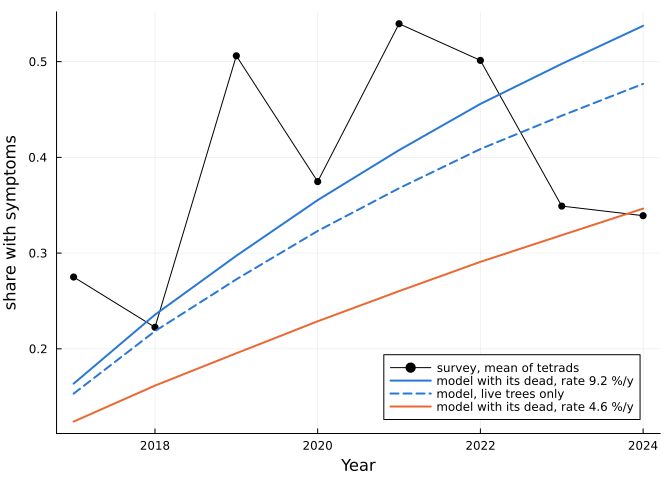
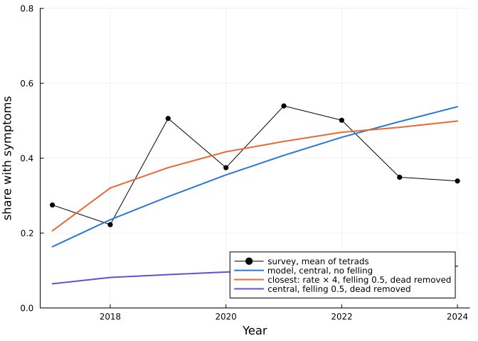
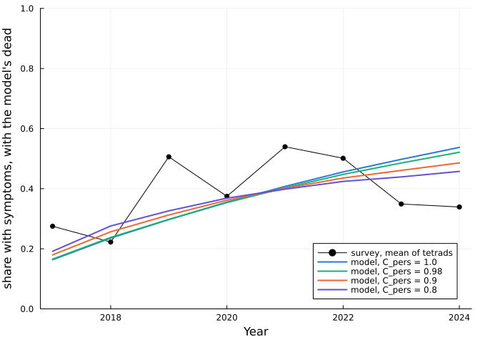
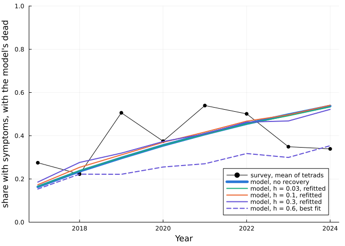

# Checking the Great Britain model
Simon Frost

- [Overview](#overview)
- [Setup](#setup)
- [Against Kent’s survey](#against-kents-survey)
  - [What the survey counts](#what-the-survey-counts)
- [Recovery](#recovery)
  - [Recovery after hot summers](#recovery-after-hot-summers)
- [A softer cap](#a-softer-cap)
  - [Power laws](#power-laws)
- [Clearing litter in one stand](#clearing-litter-in-one-stand)
- [The French posterior under the broken
  cap](#the-french-posterior-under-the-broken-cap)
- [The cap’s exponent free](#the-caps-exponent-free)
- [What changes the result](#what-changes-the-result)
- [Summary](#summary)
  - [Limits](#limits)

## Overview

Vignette 6 compares interventions against ash dieback in Great Britain
with three simplifications of the paper’s model: symptomatic trees never
recover, spore load has a hard cap S, and spores mix across each 10 km
square. This vignette checks them against the French survey, which fits
the model, and against Kent’s survey of crown condition, the one long
British series found. Where a check changes the model, the interventions
are rerun under it.

**In short, vaccines and planting keep their order under every check,
and litter clearing is what the model’s structure decides.** France
prefers a softer spore cap than the paper’s, and under it the lead of
clearing 95 % of litter over tolerant planting shrinks, or at b = 0.3
reverses. Kent’s survey matches the model’s level but not its shape, and
nothing tried here (recovery, the cap’s shape, or trees leaving the
count) gives its fall after 2022. The numbers are in the
[summary](#summary).

## Setup

This vignette builds on vignette 6’s code: its chunks labelled
`shared-*` (packages, inputs, the host model and scenarios, the sweep
machinery, and the sweeps over regeneration, the share symptomatic, the
margin and the French posterior). They run here from vignette 6’s
source, so the two can’t drift apart, with their printed tables
suppressed. Both vignettes cache their sweeps in
`06_interventions_gb/results/`.

``` julia
const V6 = normpath(joinpath(@__DIR__, "..", "06_interventions_gb", "06_interventions_gb.qmd"))
function shared_code(path)
    chunks, cur = String[], nothing
    for l in eachline(path)
        if cur === nothing
            startswith(l, "```{julia}") && (cur = String[])
        elseif l == "```"
            any(startswith("#| label: shared-"), cur) && push!(chunks, join(cur, "\n"))
            cur = nothing
        else
            push!(cur, l)
        end
    end
    return join(chunks, "\n\n")
end
redirect_stdout(devnull) do
    include_string(@__MODULE__, shared_code(V6), V6)
end
(; scenarios = length(SCENARIOS), results = relpath(RESULTS, @__DIR__))
```

    (scenarios = 37, results = "../06_interventions_gb/results")

## Against Kent’s survey

Kent’s nine tetrads (2 km squares of ash on or next to public land) give
the only long series of crown condition found so far. The survey’s
“symptoms” appear to include standing dead trees, so the model is shown
with and without its own dead. Nothing is fitted. The package holds only
the survey’s yearly mean over tetrads and the 10 km square each tetrad
lies in, placed by hand from its place names:

``` julia
kent_mean = CSV.read(joinpath(datadir(), "gb", "kent_survey_mean.csv"), DataFrame)
kent = CSV.read(joinpath(datadir(), "gb", "kent_squares_10km.csv"), DataFrame)
kent_years = 2017:2024
@assert kent_mean.year == collect(kent_years)
survey_mean = kent_mean.mean_share

function kent_model(rs; theta = theta_rate(rs), h = 0.0, lag = 1, b = 0.0)
    prob, _ = gb_problem(inputs; B = 15.0, theta, final_year = 2030)
    h == 0 && b == 0 ||
        (prob = AshDiebackProblem(prob.data, theta; settings = ModelSettings(; initialization_year = 2014, final_year = 2030, delta_t = 1.0,
                                                                              heat_recovery = h, heat_recovery_lag = lag, cap_exponent = b)))
    sol = solve(HostProblem(prob, host_for(0.03, 0.04, SCENARIOS["baseline"])))
    ys = host_years(sol)
    cells = [cell(r.easting_km, r.northing_km) for r in eachrow(kent)]
    shares = map(kent_years) do y
        l = y - first(ys) + 1
        vals = map(cells) do (i, j)
            infected = sum(view(sol.symptomatic, i, j, :, l)) + sum(view(sol.juvenile_symptomatic, i, j, :, l))
            alive = infected + sum(view(sol.healthy, i, j, :, l)) + sum(view(sol.juvenile_healthy, i, j, :, l))
            dead = sol.disease_deaths[i, j, l]  # already cumulative
            (infected / alive, (infected + dead) / (alive + dead))
        end
        (mean(first.(vals)), mean(last.(vals)))
    end
    return first.(shares), last.(shares)
end
central_live, central_dead = kent_model(1.0)
slow_live, slow_dead = kent_model(2.0)
late_years = findall(>=(2019), kent_years)
rms(a) = sqrt(mean((a[late_years] .- survey_mean[late_years]) .^ 2))
plot(kent_years, survey_mean; label = "survey, mean of tetrads", marker = :circle, color = :black, xlabel = "Year", ylabel = "share with symptoms", legend = :bottomright)
plot!(kent_years, central_dead; label = "model with its dead, rate 9.2 %/y", color = BLUE, linewidth = 2)
plot!(kent_years, central_live; label = "model, live trees only", color = BLUE, linestyle = :dash, linewidth = 2)
plot!(kent_years, slow_dead; label = "model with its dead, rate 4.6 %/y", color = ORANGE, linewidth = 2)
```



``` julia
(; survey_2019_2024 = round(mean(survey_mean[late_years]); digits = 3), model_with_dead = round(mean(central_dead[late_years]); digits = 3),
 rmse_central = round(rms(central_dead); digits = 3), rmse_slow = round(rms(slow_dead); digits = 3),
 survey_2023_24 = round.(survey_mean[end-1:end]; digits = 3), slow_2023_24 = round.(slow_dead[end-1:end]; digits = 3))
```

    (survey_2019_2024 = 0.435, model_with_dead = 0.425, rmse_central = 0.144, rmse_slow = 0.2, survey_2023_24 = [0.349, 0.339], slow_2023_24 = [0.319, 0.346])

Over 2019–2024 the survey averages 0.435 and the model with its dead
0.425, with no fitting. But the shape is wrong: the survey rises to
about 0.5 by 2019, dips in 2020 and falls after 2022, while the model
only rises, as it allows no recovery. The central rate fits the six
years better, and the slower rate matches the last two. So q in 2026
stays open at about 0.32 to 0.53. Over that range the 100 % vaccine goes
from below s 0.2 planting to above it, and a perfect vaccine from below
s 0.05 planting to above it.

### What the survey counts

The survey’s trees stand on or next to public land, where the county
fells ash for safety (the report’s last page gives its spending), and
its “symptoms” seem to include standing dead trees. Removing trees from
the count could level the share off instead of letting it rise: if
symptomatic trees leave faster than healthy ones gain symptoms, the
share settles near the ratio of the two rates. Here symptomatic adults
in Kent’s nine squares are felled at a rate r a year from 2014 (`Fell`,
so recruits refill the gaps), and standing dead leave the count at once
or never. The rate of new symptoms is the central one or 2, 3 or 4 times
it (r_S = 1000, 500, 330, 250):

``` julia
kent_mask = falses(size(DATA15.ash_density))
foreach(((i, j),) -> kent_mask[i, j] = true, [cell(t.easting_km, t.northing_km) for t in eachrow(kent)])
slope(a) = (t = kent_years[late_years] .- mean(kent_years[late_years]); sum(t .* (a[late_years] .- mean(a[late_years]))) / sum(abs2, t))

"Kent's mean share with symptoms when symptomatic adults are felled at `r` a year, with the dead kept and with them removed."
function kent_removal(rs, r)
    prob, _ = gb_problem(inputs; B = 15.0, theta = theta_rate(rs), final_year = 2030)
    ivs = r == 0 ? AbstractIntervention[] : AbstractIntervention[Fell(; years = 2014:2030, rate = r, cells = kent_mask)]
    sol = solve(HostProblem(prob, host_for(0.03, 0.04, SCENARIOS["baseline"]); interventions = ivs))
    l0 = first(kent_years) - first(host_years(sol)) + 1
    cells = [cell(t.easting_km, t.northing_km) for t in eachrow(kent)]
    shares = map(eachindex(kent_years)) do k
        l = l0 + k - 1
        vals = map(cells) do (i, j)
            infected = sum(view(sol.symptomatic, i, j, :, l)) + sum(view(sol.juvenile_symptomatic, i, j, :, l))
            alive = infected + sum(view(sol.healthy, i, j, :, l)) + sum(view(sol.juvenile_healthy, i, j, :, l))
            dead = sol.disease_deaths[i, j, l]
            ((infected + dead) / (alive + dead), infected / alive)
        end
        (mean(first.(vals)), mean(last.(vals)))
    end
    return (; kept = first.(shares), removed = last.(shares))
end
removal = [(rs, r) for rs in (1.0, 0.5, 0.33, 0.25) for r in (0.0, 0.1, 0.2, 0.3, 0.5)]
removal_runs = Vector{Any}(undef, length(removal))
Threads.@threads :dynamic for k in eachindex(removal)
    removal_runs[k] = kent_removal(removal[k]...)
end
removal_rows = [(; times = round(Int, 1 / rs), r, dead, v = getproperty(removal_runs[k], dead))
                for (k, (rs, r)) in enumerate(removal) for dead in (:kept, :removed)]
best_removal = removal_rows[argmin([rms(x.v) for x in removal_rows])]
flat = sqrt(mean(abs2, survey_mean[late_years] .- mean(survey_mean[late_years])))
(; survey_slope = round(slope(survey_mean); digits = 3), flat_line_rmse = round(flat; digits = 3),
 best = (best_removal.times, best_removal.r, best_removal.dead, round(rms(best_removal.v); digits = 3)),
 least_slope = round(minimum(slope(x.v) for x in removal_rows); digits = 3))
```

    (survey_slope = -0.027, flat_line_rmse = 0.082, best = (4, 0.5, :removed, 0.11), least_slope = 0.004)

``` julia
md_table(["Rate of new symptoms", "Felling a year", "RMSE, dead kept", "RMSE, dead removed", "Slope 2019–24, dead removed", "2024, dead removed"],
         [[string("× ", round(Int, 1 / rs)), fmt(r, 1), fmt(rms(removal_runs[k].kept)), fmt(rms(removal_runs[k].removed)),
           @sprintf("%+.3f", slope(removal_runs[k].removed)), fmt(removal_runs[k].removed[end])] for (k, (rs, r)) in enumerate(removal)])
```

| Rate of new symptoms | Felling a year | RMSE, dead kept | RMSE, dead removed | Slope 2019–24, dead removed | 2024, dead removed |
|----|----|----|----|----|----|
| × 1 | 0.0 | 0.144 | 0.143 | +0.041 | 0.477 |
| × 1 | 0.1 | 0.154 | 0.178 | +0.026 | 0.356 |
| × 1 | 0.2 | 0.193 | 0.230 | +0.015 | 0.260 |
| × 1 | 0.3 | 0.235 | 0.278 | +0.009 | 0.191 |
| × 1 | 0.5 | 0.300 | 0.344 | +0.004 | 0.112 |
| × 2 | 0.0 | 0.260 | 0.226 | +0.055 | 0.721 |
| × 2 | 0.1 | 0.196 | 0.154 | +0.042 | 0.601 |
| × 2 | 0.2 | 0.147 | 0.118 | +0.030 | 0.481 |
| × 2 | 0.3 | 0.131 | 0.144 | +0.020 | 0.378 |
| × 2 | 0.5 | 0.179 | 0.241 | +0.012 | 0.240 |
| × 3 | 0.0 | 0.371 | 0.343 | +0.052 | 0.850 |
| × 3 | 0.1 | 0.314 | 0.270 | +0.046 | 0.759 |
| × 3 | 0.2 | 0.256 | 0.191 | +0.037 | 0.653 |
| × 3 | 0.3 | 0.202 | 0.126 | +0.028 | 0.545 |
| × 3 | 0.5 | 0.149 | 0.144 | +0.020 | 0.380 |
| × 4 | 0.0 | 0.437 | 0.416 | +0.042 | 0.909 |
| × 4 | 0.1 | 0.393 | 0.357 | +0.040 | 0.843 |
| × 4 | 0.2 | 0.345 | 0.286 | +0.035 | 0.758 |
| × 4 | 0.3 | 0.296 | 0.208 | +0.029 | 0.662 |
| × 4 | 0.5 | 0.218 | 0.110 | +0.024 | 0.499 |

``` julia
plot(kent_years, survey_mean; label = "survey, mean of tetrads", marker = :circle, color = :black, xlabel = "Year", ylabel = "share with symptoms",
     legend = :bottomright, ylims = (0, 0.8))
plot!(kent_years, central_dead; label = "model, central, no felling", color = BLUE, linewidth = 2)
plot!(kent_years, best_removal.v; label = "closest: rate × $(best_removal.times), felling $(best_removal.r), dead $(best_removal.dead)", color = ORANGE, linewidth = 2)
plot!(kent_years, removal_runs[findfirst(==((1.0, 0.5)), removal)].removed; label = "central, felling 0.5, dead removed", color = VIOLET, linewidth = 2)
```



Over 2019–2024 the survey falls by 0.027 a year. No setting here falls:
the least slope is +0.004 a year, and felling enough to flatten the
curve drags it far below the survey, unless symptoms come several times
faster. The closest of these, with the rate × 4 and felling 0.5 a year,
has an RMSE of 0.110, against 0.082 for a flat line at the survey’s
mean. So removals from the survey don’t give its shape in the model
either.

## Recovery

Every run in vignette 6 has C_pers = 1: a tree with symptoms keeps them
until it dies. With C_pers \< 1, a share 1 − C_pers of symptomatic trees
recover each year and can be infected again, so the share symptomatic
levels off below 1, at about q̃ / (1 − C_pers + C_pers q̃) for a yearly
chance q̃ of new symptoms. Kent’s fall after 2022 could be recovery. The
French data can test it. Here C_pers is fixed and β₀, D, S, C_init and κ
are refitted to France by Nelder–Mead, as for the margin in vignette 6.
The refits run one after another, since threaded refits crashed with
heap corruption under Julia 1.12’s parallel garbage collector, so
recomputing them takes some hours:

``` julia
const CS = (1.0, 0.99, 0.985, 0.98, 0.97, 0.95, 0.9, 0.8, 0.7, 0.5)
xlogy0(k, r) = k == 0 ? 0.0 : k * log(r)
function dispersion(sol)  # Pearson and deviance per df over cells with n q (1 − q) ≥ 1
    p = d = 0.0
    m = 0
    for (l, (o, b)) in enumerate(zip(sol.prob.survey, sol.prob.binomial))
        q = view(sol.symptoms, :, :, l)
        for i in eachindex(o.x)
            k, nk = b.infected[i], b.healthy[i]
            n = k + nk
            qi = clamp(q[o.x[i], o.y[i]], 1e-300, 1 - 1e-16)
            n * qi * (1 - qi) >= 1 || continue
            p += (k - n * qi)^2 / (n * qi * (1 - qi))
            d += 2 * (xlogy0(k, k / (n * qi)) + xlogy0(nk, nk / (n * (1 - qi))))
            m += 1
        end
    end
    return p / (m - 6), d / (m - 6), m
end
θ_rec(x, C) = [1000.0, 0.0, exp(x[1]), 0.0, exp(x[2]), exp(x[3]), 21.50001, C, exp(x[4]), exp(x[5])]

function recovery_refits(Cs)
    path = joinpath(RESULTS, "recovery_refits.csv")
    isfile(path) || write(path, "C_pers,beta_0,D,S,C_init,kappa,loss,pearson,deviance,cells\n")
    todo = [C for C in Cs if C ∉ CSV.read(path, DataFrame).C_pers]
    if !isempty(todo)
        base = load_peoc_data()
        ref = loglikelihood(AshDiebackProblem(base, [1000.0, 0.0, 23.26, 0.0, 18.51, 92.0, 21.50001, 1.0, 0.00855, 0.056]))
        for C in todo
            nll(x) = begin  # x = log(β₀, D, S, C_init, κ)
                v = loglikelihood(AshDiebackProblem(base, θ_rec(x, C)))
                isfinite(v) ? -v : 1e12
            end
            # With recovery, the observed rise needs a larger yearly chance of symptoms, so start from a scan of β₀ and S.
            starts = [log.([23.26 * fb, 18.51, 92.0 * fs, 0.00855, 0.056]) for fb in (1.0, 1.5, 2.5) for fs in (1.0, 1.4, 2.0, 3.0)]
            x0 = starts[argmin(nll.(starts))]
            x, _ = nelder_mead(nll, x0; maxeval = 400)
            x, _ = nelder_mead(nll, x; step = 0.05, maxeval = 250)
            x, v = nelder_mead(nll, x; step = 0.01, maxeval = 150)
            pe, de, m = dispersion(solve(AshDiebackProblem(base, θ_rec(x, C))))
            open(io -> write(io, join((C, exp.(x)..., v + ref, pe, de, m), ",") * "\n"), path, "a")
        end
    end
    return sort(CSV.read(path, DataFrame), :C_pers; rev = true)
end
rec = recovery_refits(CS)
const PHI_REC = 20.0
# The 95 % limit on C_pers: where the loss over φ crosses 1.92, interpolating between refits
c_limit = let i = findfirst(>(1.92), rec.loss ./ PHI_REC)
    a, b = rec[i - 1, :], rec[i, :]
    a.C_pers + (1.92 * PHI_REC - a.loss) / (b.loss - a.loss) * (b.C_pers - a.C_pers)
end
nothing
```

``` julia
md_table(["C_pers", "Recover each year", "β₀", "D", "S", "κ", "Log-likelihood lost", "Lost / φ", "Pearson / df"],
         [[r.C_pers, fmt(1 - r.C_pers, 3), fmt(r.beta_0, 1), fmt(r.D, 1), fmt(r.S, 0), fmt(r.kappa), fmt(max(r.loss, 0.0), 1),
           fmt(max(r.loss, 0.0) / PHI_REC, 1), fmt(r.pearson, 1)] for r in eachrow(rec)])
```

| C_pers | Recover each year | β₀ | D | S | κ | Log-likelihood lost | Lost / φ | Pearson / df |
|----|----|----|----|----|----|----|----|----|
| 1.0 | 0.000 | 23.2 | 18.5 | 92 | 0.056 | 0.0 | 0.0 | 20.2 |
| 0.99 | 0.010 | 23.3 | 18.5 | 94 | 0.058 | 13.8 | 0.7 | 20.1 |
| 0.985 | 0.015 | 23.4 | 18.5 | 95 | 0.059 | 24.1 | 1.2 | 20.0 |
| 0.98 | 0.020 | 23.3 | 18.5 | 96 | 0.060 | 36.3 | 1.8 | 20.0 |
| 0.97 | 0.030 | 22.1 | 19.0 | 99 | 0.060 | 63.5 | 3.2 | 20.1 |
| 0.95 | 0.050 | 17.2 | 21.6 | 107 | 0.059 | 127.7 | 6.4 | 19.5 |
| 0.9 | 0.100 | 16.4 | 22.3 | 119 | 0.068 | 347.4 | 17.4 | 19.5 |
| 0.8 | 0.200 | 11.1 | 29.2 | 151 | 0.082 | 898.0 | 44.9 | 19.8 |
| 0.7 | 0.300 | 10.5 | 30.1 | 179 | 0.089 | 1468.7 | 73.4 | 20.6 |
| 0.5 | 0.500 | 10.2 | 30.3 | 228 | 0.091 | 2613.8 | 130.7 | 21.8 |

**France allows little recovery.** Even with the log-likelihood divided
by φ = 20, the 95 % limit is at C_pers ≈ 0.979, so at most about 2 % of
symptomatic trees recovering each year. Recovery also leaves the
overdispersion at about 20, so it doesn’t explain the scatter. As the
refits are not checked for convergence, a loss may be overstated, but
the loss grows steadily as C_pers falls. On Great Britain, at B = 15,
with each C_pers’s refitted parameters (and C_init = 0.05 as before),
including values France rejects, to see what Kent’s level would need:

``` julia
const GB_CS = (1.0, 0.98, 0.9, 0.8)
rec_row(C) = rec[findfirst(==(C), rec.C_pers), :]
θ_gb(r) = [1000.0, 0.0, r.beta_0, 0.0, r.D, r.S, 21.50001, r.C_pers, 0.05, r.kappa]
rec_names = ["baseline", "baseline s 0.05", CENTRAL_V, HUNDRED_V, PERFECT_V, PLANT, PLANT_T, "fell 50 %", "clear 95 % of litter"]
rec_runs = sweep("recovery", [case((; setting = "C=$C"), n; θ = θ_gb(rec_row(C))) for C in GB_CS for n in rec_names])
rg, rv = lookups(rec_runs).gain, lookups(rec_runs).value
rq26, rq75 = lookups(rec_runs; year = 2026, col = :q).value, lookups(rec_runs; col = :q).value
nrow(rec_runs)
```

    108

``` julia
rec_cols = [CENTRAL_V, HUNDRED_V, PERFECT_V, PLANT, PLANT_T, "clear 95 % of litter", "fell 50 %"]
md_table(["C_pers", "q 2026", "q 2075", "Healthy adults 2075", "Central vaccine", "100 % vaccine", "Perfect vaccine",
          "Plant s 0.2", "Plant s 0.05", "Clear 95 % of litter", "Fell 50 %"],
         [[C, fmt(rq26("C=$C", "baseline"), 2), fmt(rq75("C=$C", "baseline"), 2), fmt(rv("C=$C", "baseline")),
           (fmt(rg("C=$C", n)) for n in rec_cols)...] for C in GB_CS])
```

| C_pers | q 2026 | q 2075 | Healthy adults 2075 | Central vaccine | 100 % vaccine | Perfect vaccine | Plant s 0.2 | Plant s 0.05 | Clear 95 % of litter | Fell 50 % |
|----|----|----|----|----|----|----|----|----|----|----|
| 1.0 | 0.53 | 0.78 | 0.062 | 0.083 | 0.246 | 0.448 | 0.328 | 0.477 | 0.400 | 0.042 |
| 0.98 | 0.50 | 0.65 | 0.112 | 0.091 | 0.308 | 0.521 | 0.346 | 0.463 | 0.490 | -0.008 |
| 0.9 | 0.44 | 0.45 | 0.224 | 0.098 | 0.370 | 0.561 | 0.353 | 0.414 | 0.549 | -0.073 |
| 0.8 | 0.39 | 0.37 | 0.288 | 0.095 | 0.372 | 0.538 | 0.334 | 0.376 | 0.530 | -0.072 |

**Within what France allows, recovery helps the trees and changes the
order at the top.** At C_pers = 0.98, healthy adults in 2075 are 0.112
of today’s ash with no intervention, against 0.062 with no recovery, and
q in 2075 is 0.65 rather than 0.78. Vaccines and litter clearing gain
more, probably because recovered trees can be protected again, and less
inoculum lets more of them stay healthy. A perfect vaccine gains 0.521
and clearing 95 % of litter 0.490, both above very tolerant planting’s
0.463, which leads with no recovery. Felling half of symptomatic adults
a year gains -0.008, as it removes trees that could have recovered. The
central vaccine still gains much less than planting at the central
tolerance.

``` julia
kent_rec = Dict(C => kent_model(1.0; theta = θ_gb(rec_row(C))) for C in GB_CS)
fig_rec = plot(kent_years, survey_mean; label = "survey, mean of tetrads", marker = :circle, color = :black, xlabel = "Year",
               ylabel = "share with symptoms, with the model's dead", legend = :bottomright, ylims = (0, 1))
for (C, col) in zip(GB_CS, (BLUE, AQUA, ORANGE, VIOLET))
    plot!(fig_rec, kent_years, kent_rec[C][2]; label = "model, C_pers = $C", color = col, linewidth = 2)
end
fig_rec
```



``` julia
rec_rmse = Dict(C => sqrt(mean((kent_rec[C][2][late_years] .- survey_mean[late_years]) .^ 2)) for C in GB_CS)
(; rmse_2019_2024 = [C => round(rec_rmse[C]; digits = 3) for C in GB_CS])
```

    (rmse_2019_2024 = [1.0 => 0.144, 0.98 => 0.14, 0.9 => 0.126, 0.8 => 0.116],)

**Recovery doesn’t give Kent’s shape.** Even at C_pers = 0.8, which
France rejects, the model only levels off, and its error over 2019–2024
falls only from 0.144 to 0.116. A steady rate of recovery can’t make the
share fall while spores stay at the cap, so Kent’s fall needs something
that changes over time, such as felling, a change of observers, or
recovery that varies from year to year.

### Recovery after hot summers

Hot summers are the obvious source of recovery that varies from year to
year. Kent’s summers had T28, the days over 28 °C, well above the others
in 2018 and 2022 (mean over its squares):

``` julia
kent_cells = [cell(r.easting_km, r.northing_km) for r in eachrow(kent)]
kent_T = [round(mean(DATA15.temperature[i, j, y - first(DATA15.climate_years) + 1] for (i, j) in kent_cells); digits = 1)
          for y in 2016:2024]
(; years = 2016:2024, T28 = kent_T, f_T = round.(temperature_effect.(kent_T, 21.50001, 0.056); digits = 2))
```

    (years = 2016:2024, T28 = [4.0, 1.1, 12.2, 6.5, 8.6, 2.7, 11.5, 0.9, 3.8], f_T = [0.99, 1.0, 0.95, 0.98, 0.97, 0.99, 0.96, 1.0, 0.99])

The temperature function f(T) hardly moves at these values, so recovery
here rises with T itself: a share 1 − C_pers (1 − h min(T/γ, 1)) of
symptomatic trees recovers each year (`persistence`), with T of the
summer before the survey, which also sets new symptoms (lag 1), or of
the survey’s own summer (lag 0). With C_pers = 1, h is the share
recovering in a summer at γ = 21.5 days. As for C_pers, β₀, D, S, C_init
and κ are refitted to France at each h, one refit after another:

``` julia
"Refit β₀, D, S, C_init and κ to France under `settings`, with C_pers = 1; return them, the loss and the dispersion."
function refit_france(settings; starts = [log.([23.26 * fb, 18.51, 92.0 * fs, 0.00855, 0.056]) for fb in (1.0, 1.5, 2.5) for fs in (1.0, 1.5, 2.5, 4.0)])
    base = load_peoc_data()
    # the reference is the paper's model, with the hard cap and no heat recovery, at θmax
    ref = loglikelihood(AshDiebackProblem(base, [1000.0, 0.0, 23.26, 0.0, 18.51, 92.0, 21.50001, 1.0, 0.00855, 0.056]))
    nll(x) = begin  # x = log(β₀, D, S, C_init, κ)
        v = loglikelihood(AshDiebackProblem(base, θ_rec(x, 1.0); settings))
        isfinite(v) ? -v : 1e12
    end
    x0 = starts[argmin(nll.(starts))]
    x, _ = nelder_mead(nll, x0; maxeval = 400)
    x, _ = nelder_mead(nll, x; step = 0.05, maxeval = 250)
    x, v = nelder_mead(nll, x; step = 0.01, maxeval = 150)
    return (exp.(x)..., v + ref, dispersion(solve(AshDiebackProblem(base, θ_rec(x, 1.0); settings)))...)
end

"Refit at each key not yet in results/name.csv, one after another, and return all the rows."
function refits_for(name, columns, keys, settings_of; kw...)
    path = joinpath(RESULTS, name * ".csv")
    isfile(path) || write(path, join(vcat(columns, ["beta_0", "D", "S", "C_init", "kappa", "loss", "pearson", "deviance", "cells"]), ",") * "\n")
    done = Set(Tuple(r[c] for c in columns) for r in eachrow(CSV.read(path, DataFrame)))
    for k in keys
        k in done && continue
        open(io -> write(io, join((k..., refit_france(settings_of(k...); kw...)...), ",") * "\n"), path, "a")
    end
    return CSV.read(path, DataFrame)
end

const HS = (0.01, 0.03, 0.1, 0.3, 1.0)
heat = refits_for("heat_refits", ["h", "lag"], [(h, lag) for h in HS for lag in (1, 0)],
                  (h, lag) -> ModelSettings(; heat_recovery = h, heat_recovery_lag = lag))
heat_row(h, lag) = heat[findfirst(r -> r.h == h && r.lag == lag, eachrow(heat)), :]
# The 95 % limit on h for each lag: where the loss over φ crosses 1.92, interpolating between refits
h_limit(lag) = let r = sort(filter(:lag => ==(lag), heat), :h), i = findfirst(>(1.92 * PHI_REC), r.loss)
    r.h[i - 1] + (1.92 * PHI_REC - r.loss[i - 1]) / (r.loss[i] - r.loss[i - 1]) * (r.h[i] - r.h[i - 1])
end
nothing
```

``` julia
md_table(["h", "Heat of", "β₀", "D", "S", "κ", "Log-likelihood lost", "Lost / φ", "Pearson / df"],
         [[r.h, r.lag == 1 ? "summer before" : "same summer",
           (r.loss > 1e11 ? ("–", "–", "–", "–", "zero likelihood", "–", "–") :
            (fmt(r.beta_0, 1), fmt(r.D, 1), fmt(r.S, 0), fmt(r.kappa), fmt(r.loss, 1), fmt(r.loss / PHI_REC, 1), fmt(r.pearson, 1)))...]
          for r in eachrow(heat)])
```

| h    | Heat of       | β₀   | D    | S   | κ     | Log-likelihood lost | Lost / φ | Pearson / df |
|------|---------------|------|------|-----|-------|---------------------|----------|--------------|
| 0.01 | summer before | 23.3 | 18.5 | 93  | 0.054 | 2.9                 | 0.1      | 20.2         |
| 0.01 | same summer   | 23.3 | 18.5 | 93  | 0.054 | 1.9                 | 0.1      | 20.2         |
| 0.03 | summer before | 23.4 | 18.5 | 94  | 0.051 | 17.1                | 0.9      | 20.1         |
| 0.03 | same summer   | 23.4 | 18.5 | 94  | 0.052 | 15.0                | 0.8      | 20.1         |
| 0.1  | summer before | 17.2 | 21.6 | 105 | 0.035 | 118.8               | 5.9      | 19.5         |
| 0.1  | same summer   | 17.1 | 21.6 | 105 | 0.037 | 121.1               | 6.1      | 19.5         |
| 0.3  | summer before | 15.5 | 22.9 | 122 | 0.007 | 681.6               | 34.1     | 19.5         |
| 0.3  | same summer   | 15.4 | 23.0 | 123 | 0.016 | 731.9               | 36.6     | 19.6         |
| 1.0  | summer before | –    | –    | –   | –     | zero likelihood     | –        | –            |
| 1.0  | same summer   | –    | –    | –   | –     | zero likelihood     | –        | –            |

**France allows only a little recovery after hot summers:** the 95 %
limit is h ≈ 0.045 whichever summer counts, so at most about 5 % of
symptomatic trees recovering in a summer as hot as γ. In Kent’s hottest
summer, that is at most 2.6 %. On Kent’s tetrads, with each refit’s
parameters, including those France rejects, and h = 0.6 at the French
best fit as a stronger test:

``` julia
θ_fit(r) = [1000.0, 0.0, r.beta_0, 0.0, r.D, r.S, 21.50001, 1.0, 0.05, r.kappa]  # a refit to France, with C_init = 0.05 on GB
kent_heat = Dict((h, lag) => kent_model(1.0; theta = θ_fit(heat_row(h, lag)), h, lag)[2]
                 for h in (0.03, 0.1, 0.3) for lag in (1, 0))
for lag in (1, 0)
    kent_heat[(0.6, lag)] = kent_model(1.0; h = 0.6, lag)[2]
end
fig_heat = plot(kent_years, survey_mean; label = "survey, mean of tetrads", marker = :circle, color = :black, xlabel = "Year",
                ylabel = "share with symptoms, with the model's dead", legend = :bottomright, ylims = (0, 1))
plot!(fig_heat, kent_years, central_dead; label = "model, no recovery", color = BLUE, linewidth = 5)
for (h, col) in zip((0.03, 0.1, 0.3), (AQUA, ORANGE, VIOLET))
    plot!(fig_heat, kent_years, kent_heat[(h, 1)]; label = "model, h = $h, refitted", color = col, linewidth = 2)
end
plot!(fig_heat, kent_years, kent_heat[(0.6, 1)]; label = "model, h = 0.6, best fit", color = VIOLET, linestyle = :dash, linewidth = 2)
fig_heat
```



``` julia
heat_rmse(h, lag) = rms(kent_heat[(h, lag)])
md_table(["Error over 2019–2024", "No recovery", "h = 0.03", "h = 0.1", "h = 0.3", "h = 0.6 (best fit)"],
         [[lag == 1 ? "Heat of the summer before" : "Heat of the same summer", fmt(rms(central_dead)),
           (fmt(heat_rmse(h, lag)) for h in (0.03, 0.1, 0.3, 0.6))...] for lag in (1, 0)])
```

| Error over 2019–2024 | No recovery | h = 0.03 | h = 0.1 | h = 0.3 | h = 0.6 (best fit) |
|----|----|----|----|----|----|
| Heat of the summer before | 0.144 | 0.142 | 0.139 | 0.130 | 0.184 |
| Heat of the same summer | 0.144 | 0.143 | 0.142 | 0.136 | 0.185 |

**Recovery after hot summers doesn’t give Kent’s fall either.** Within
what France allows, the curve barely moves. At h = 0.3, which France
rejects, it flattens after the hot summer of 2022 and the error falls
only to 0.130. At h = 0.6 it dips in 2023 but sits well below the survey
before, and the error rises to 0.184. In every case the model’s share is
higher in 2024 than in 2022, while the survey falls from 0.50 to 0.34,
so the fall more likely lies in felling, the survey or something the
model leaves out.

## A softer cap

Every run in vignette 6 and above caps the spore load at S: F = min(w,
S). The sharp corner is an assumption of the paper, and much of what
follows depends on it, since the protection of neighbours and the effect
of litter clearing come from the margin over the cap.
`saturation_sharpness = n` replaces it with F = w/(1 + (w/S)ⁿ)^(1/n),
which is the hard cap as n → ∞ and Michaelis–Menten, wS/(w + S), at n
= 1. As n → 0, F tends to a multiple of √(wS), a response with no cap at
all. At each n, β₀, D, S, C_init and κ are refitted to France as above:

``` julia
const NS = (16.0, 8.0, 4.0, 2.0, 1.0, 0.75, 0.5, 0.25)
soft = sort(refits_for("softcap_refits", ["n"], [(n,) for n in NS], n -> ModelSettings(; saturation_sharpness = n)), :n; rev = true)
soft_row(n) = soft[findfirst(==(n), soft.n), :]
θ_soft(n) = isinf(n) ? THETA : θ_fit(soft_row(n))
nothing
```

``` julia
md_table(["n", "β₀", "D", "S", "κ", "Log-likelihood gained", "Gained / φ", "Pearson / df"],
         [[r.n, fmt(r.beta_0, 1), fmt(r.D, 1), fmt(r.S, 0), fmt(r.kappa), fmt(-r.loss, 1), fmt(-r.loss / PHI_REC, 1), fmt(r.pearson, 1)]
          for r in eachrow(soft)])
```

| n    | β₀    | D    | S   | κ     | Log-likelihood gained | Gained / φ | Pearson / df |
|------|-------|------|-----|-------|-----------------------|------------|--------------|
| 16.0 | 22.9  | 18.7 | 92  | 0.056 | 3.6                   | 0.2        | 20.3         |
| 8.0  | 22.7  | 18.8 | 93  | 0.055 | 17.0                  | 0.8        | 20.3         |
| 4.0  | 21.9  | 19.3 | 94  | 0.053 | 63.3                  | 3.2        | 20.4         |
| 2.0  | 19.8  | 21.3 | 99  | 0.050 | 202.0                 | 10.1       | 20.6         |
| 1.0  | 21.2  | 22.7 | 118 | 0.039 | 534.0                 | 26.7       | 20.8         |
| 0.75 | 25.9  | 21.6 | 136 | 0.032 | 700.7                 | 35.0       | 20.8         |
| 0.5  | 42.1  | 19.2 | 185 | 0.024 | 894.3                 | 44.7       | 21.1         |
| 0.25 | 195.0 | 15.1 | 538 | 0.018 | 964.5                 | 48.2       | 21.9         |

**France prefers a softer cap, and the softer the better.** The fit
improves steadily as n falls, by 534 at n = 1 and 964 at n = 0.25, far
past the cut-off of 1.92 φ ≈ 38 even allowing for overdispersion. As n
falls, β₀ and S grow together and κ falls, so the data lean towards a
concave response like √w rather than a cap. The softer cap doesn’t
reduce the overdispersion. The refits are not checked for convergence,
so a gain may be understated. On Great Britain, at B = 15:

``` julia
const GB_NS = (Inf, 8.0, 2.0, 1.0, 0.5, 0.25)
soft_names = ["baseline", "baseline s 0.05", CENTRAL_V, PERFECT_V, PLANT, PLANT_T, "fell 50 %", "clear 50 % of litter", "clear 95 % of litter"]
soft_runs = sweep("softcap", [case((; cap = "n=$n"), name; θ = θ_soft(n), n) for n in GB_NS for name in soft_names])
cg, cv = lookups(soft_runs).gain, lookups(soft_runs).value
nrow(soft_runs)
```

    162

``` julia
md_table(["Healthy adults, 2075", ("n = $(isinf(n) ? "∞ (hard cap)" : n)" for n in GB_NS)...],
         vcat([["Baseline", (fmt(cv("n=$n", "baseline")) for n in GB_NS)...]],
              [[name, (fmt(cg("n=$n", name)) for n in GB_NS)...] for name in soft_names[3:end]]))
```

| Healthy adults, 2075 | n = ∞ (hard cap) | n = 8.0 | n = 2.0 | n = 1.0 | n = 0.5 | n = 0.25 |
|----|----|----|----|----|----|----|
| Baseline | 0.062 | 0.062 | 0.069 | 0.082 | 0.091 | 0.100 |
| central vaccine from 2027 | 0.083 | 0.082 | 0.078 | 0.077 | 0.078 | 0.080 |
| perfect vaccine from 2027 | 0.448 | 0.447 | 0.434 | 0.420 | 0.414 | 0.411 |
| plant s 0.2, 2.0 %/y from 2027 | 0.328 | 0.327 | 0.316 | 0.303 | 0.298 | 0.294 |
| plant s 0.05, 2.0 %/y from 2027 | 0.477 | 0.477 | 0.470 | 0.458 | 0.450 | 0.442 |
| fell 50 % | 0.041 | 0.047 | 0.074 | 0.076 | 0.059 | 0.052 |
| clear 50 % of litter | 0.015 | 0.017 | 0.037 | 0.058 | 0.062 | 0.064 |
| clear 95 % of litter | 0.400 | 0.399 | 0.394 | 0.384 | 0.375 | 0.355 |

**The ranking holds at every n.** A softer cap lets more trees stay
healthy without intervention, and so trims the gains of vaccines,
planting and 95 % litter clearing by a few points. Felling and partial
litter clearing gain more, because below the cap every spore removed
counts, but they peak at 0.076 and 0.064, still far below the rest.

### Power laws

Two more shapes show what the data want from the cap. A pure power law,
F = S (w/S)ᵃ (`spore_exponent = a`), has no cap, but with a \< 1 it also
raises loads far below S. A broken power law, F = w up to S and S (w/S)ᵇ
above it (`cap_exponent = b`), keeps the paper’s response below S and
lets F go on rising above it: b = 0 is the hard cap and b = 1 no cap.
Each is refitted as above. The pure power law starts from a wider scan,
as its scale is set by S and β₀ together:

``` julia
const AS, BEXPS = (0.2, 0.3, 0.4, 0.5, 0.6, 0.7, 0.8, 1.0), (0.0, 0.1, 0.2, 0.3, 0.5, 0.7)
power_starts = [log.([23.26 * fb, 18.51 * fd, 92.0 * fs, 0.00855, 0.056]) for fb in (0.5, 1.0, 2.0, 4.0) for fd in (0.5, 1.0)
                for fs in (0.003, 0.01, 0.03, 0.1, 0.3, 1.0)]
broken_starts = [log.([23.26 * fb, 18.51, 92.0 * fs, 0.00855, 0.056]) for fb in (1.0, 1.5, 2.5) for fs in (0.25, 0.5, 1.0, 1.5, 2.5)]
power = sort(refits_for("power_refits", ["a"], [(a,) for a in AS], a -> ModelSettings(; spore_exponent = a); starts = power_starts), :a)
broken = sort(refits_for("broken_refits", ["b"], [(b,) for b in BEXPS], b -> ModelSettings(; cap_exponent = b); starts = broken_starts), :b)
broken_row(b) = broken[findfirst(==(b), broken.b), :]
gained(r) = r.loss > 1e11 ? -Inf : -r.loss
nothing
```

``` julia
shape_row(form, x, r) = [form, x, (r.loss > 1e11 ? ("–", "–", "–", "–", "zero likelihood", "–", "–") :
    (fmt(r.beta_0, 1), fmt(r.D, 1), fmt(r.S, 1), fmt(r.kappa), fmt(-r.loss, 1), fmt(-r.loss / PHI_REC, 1), fmt(r.pearson, 1)))...]
md_table(["Form", "Exponent", "β₀", "D", "S", "κ", "Log-likelihood gained", "Gained / φ", "Pearson / df"],
         vcat([shape_row("pure power, a", r.a, r) for r in eachrow(power)], [shape_row("broken power, b", r.b, r) for r in eachrow(broken)]))
```

| Form | Exponent | β₀ | D | S | κ | Log-likelihood gained | Gained / φ | Pearson / df |
|----|----|----|----|----|----|----|----|----|
| pure power, a | 0.2 | 38.4 | 4.1 | 28.4 | 0.210 | -3604.8 | -180.2 | 21.3 |
| pure power, a | 0.3 | 11.8 | 8.9 | 31.6 | 0.144 | -2146.6 | -107.3 | 20.5 |
| pure power, a | 0.4 | 64.5 | 14.9 | 7.8 | 0.089 | -841.5 | -42.1 | 20.6 |
| pure power, a | 0.5 | 20.3 | 26.1 | 8.8 | 0.057 | 14.5 | 0.7 | 21.9 |
| pure power, a | 0.6 | 8.1 | 52.0 | 11.2 | 0.050 | 95.4 | 4.8 | 23.9 |
| pure power, a | 0.7 | 26.0 | 118.1 | 0.2 | 0.088 | -356.4 | -17.8 | 23.9 |
| pure power, a | 0.8 | – | – | – | – | zero likelihood | – | – |
| pure power, a | 1.0 | – | – | – | – | zero likelihood | – | – |
| broken power, b | 0.0 | 23.2 | 18.5 | 92.0 | 0.056 | 0.0 | 0.0 | 20.2 |
| broken power, b | 0.1 | 37.7 | 14.3 | 68.0 | 0.042 | 393.4 | 19.7 | 19.7 |
| broken power, b | 0.2 | 50.7 | 13.2 | 43.2 | 0.030 | 746.0 | 37.3 | 19.5 |
| broken power, b | 0.3 | 58.0 | 13.7 | 24.0 | 0.021 | 990.1 | 49.5 | 20.5 |
| broken power, b | 0.5 | 25.4 | 30.1 | 8.0 | 0.016 | 784.4 | 39.2 | 23.4 |
| broken power, b | 0.7 | – | – | – | – | zero likelihood | – | – |

**France rejects the pure power law, but fits the broken one as well as
the softest cap.** The pure power law gains at most 95, at a = 0.6, and
is worse than the hard cap at the other exponents but one: raising loads
far below S puts symptoms far ahead of the front. The broken power law
gains 990 at b = 0.3, against 964 for the soft cap at n = 0.25, a gap
well within 1.92 φ. At b = 0 it gives back the paper’s fit. So France
wants F to follow w at low loads and to go on rising slowly above S, and
it can’t tell a soft cap from a broken power law. On Great Britain:

``` julia
const GB_BS = (0.1, 0.2, 0.3, 0.5)
broken_runs = sweep("broken", [case((; cap = "b=$b"), name; θ = θ_fit(broken_row(b)), b) for b in GB_BS for name in soft_names])
bkg, bkv = lookups(broken_runs).gain, lookups(broken_runs).value
nrow(broken_runs)
```

    108

``` julia
md_table(["Healthy adults, 2075", "Hard cap", ("b = $b" for b in GB_BS)...],
         vcat([["Baseline", fmt(cv("n=Inf", "baseline")), (fmt(bkv("b=$b", "baseline")) for b in GB_BS)...]],
              [[name, fmt(cg("n=Inf", name)), (fmt(bkg("b=$b", name)) for b in GB_BS)...] for name in soft_names[3:end]]))
```

| Healthy adults, 2075            | Hard cap | b = 0.1 | b = 0.2 | b = 0.3 | b = 0.5 |
|---------------------------------|----------|---------|---------|---------|---------|
| Baseline                        | 0.062    | 0.063   | 0.073   | 0.088   | 0.173   |
| central vaccine from 2027       | 0.083    | 0.085   | 0.087   | 0.088   | 0.089   |
| perfect vaccine from 2027       | 0.448    | 0.449   | 0.448   | 0.439   | 0.421   |
| plant s 0.2, 2.0 %/y from 2027  | 0.328    | 0.329   | 0.325   | 0.315   | 0.278   |
| plant s 0.05, 2.0 %/y from 2027 | 0.477    | 0.476   | 0.469   | 0.456   | 0.390   |
| fell 50 %                       | 0.041    | 0.005   | 0.004   | 0.018   | 0.073   |
| clear 50 % of litter            | 0.015    | 0.013   | 0.022   | 0.035   | 0.103   |
| clear 95 % of litter            | 0.400    | 0.356   | 0.316   | 0.314   | 0.386   |

**Above the cap, how far F still rises decides 95 % litter clearing.**
At the best fit, b = 0.3, clearing 95 % gains 0.314 against 0.400 under
the hard cap, level with s 0.2 planting (0.315) rather than above it,
because the 5 % left still keeps most loads above S, where F still
rises. Vaccines and planting move little, and felling gains 0.018. At b
= 0.5, which France fits less well, a perfect vaccine (0.421) passes
very tolerant planting (0.390).

## Clearing litter in one stand

Spores mix across each 10 km square in the model, so clearing litter
acts only when the whole square clears it. A stand clearing its own
litter keeps the spores that would have landed on it from its own trees,
but not those from the rest of the square. This tests that with two
scales. A stand clears a share e of its own litter from 2027, and a
share s of the spores landing in it come from its own litter, the rest
from the square’s load w before the cap. So the stand’s load in year a
is

`w_stand = w × ((1 − s) + s × (c F_stand(a − 2) + c F_stand(a − 1)) / (F(a − 2) + F(a − 1)))`,

with c = 1 − e once clearing starts, and F_stand = `saturate`(w_stand,
S, n). The stand’s own source follows its own F, as the square’s follows
its rachis of the two years before. The measure is the chance that a
tree healthy in 2027 stays free of symptoms to 2050, ash-weighted over
squares, on the central baseline. The square’s host stands in for the
stand’s, so the stand’s own extra survival is left out, which
understates the gain a little. Under the hard cap the stand gains only
if s e exceeds 1 − S/w, and the load is far above the cap:

``` julia
stand_settings(n) = ModelSettings(; initialization_year = 2014, final_year = 2075, delta_t = 1.0, saturation_sharpness = n)
stand_sol = Dict(n => solve(HostProblem(AshDiebackProblem(DATA15, θ_soft(n); settings = stand_settings(n)),
                                        host_for(0.03, 0.04, SCENARIOS["baseline"]))) for n in (Inf, 1.0))
"Ash-weighted quantile x of w/S over the squares in year y."
function load_quantile(sol, y, x)
    l = findfirst(==(y), simulated_years(sol.prob.prob.settings))
    r = sol.spore_load[:, :, l][ASH] ./ sol.prob.prob.p.S_sat
    o = sortperm(r)
    return r[o][findfirst(>=(x), cumsum(K[ASH][o] ./ sum(K[ASH])))]
end
(; median_w_over_S = [y => round(load_quantile(stand_sol[Inf], y, 0.5); digits = 1) for y in (2026, 2050, 2074)],
 lowest_tenth_w_over_S = [y => round(load_quantile(stand_sol[Inf], y, 0.1); digits = 1) for y in (2026, 2050, 2074)])
```

    (median_w_over_S = [2026 => 9.2, 2050 => 5.0, 2074 => 3.0], lowest_tenth_w_over_S = [2026 => 3.8, 2050 => 2.1, 2074 => 1.2])

``` julia
"Ash-weighted chance that a tree healthy in `start` stays free of symptoms to `to`, in its square and in a stand of self-share `s` clearing `e`."
function stand_free(sol, s, e; start = START, to = 2050)
    prob = sol.prob.prob
    d, p, n = prob.data, prob.p, prob.settings.saturation_sharpness
    sim = simulated_years(prob.settings)
    t0 = first(sim) - first(d.climate_years) + 1
    W, F = sol.spore_load, sol.fungi
    c(l) = sim[l] >= start ? 1 - e : 1.0
    # symptoms of year a + 1 come from F and T of year a
    free(Fs, i, j) = prod(1 - min(Fs[l] * temperature_effect(d.temperature[i, j, t0 + l - 1], p.gamma, p.kappa) / p.r_symp, 1.0)
                          for l in eachindex(sim) if start <= sim[l] < to)
    total = sum(K[ASH])
    square = stand = 0.0
    for I in findall(ASH)
        i, j = Tuple(I)
        Fs = F[i, j, :]
        for l in 3:length(sim)
            sim[l] > start || continue
            den = F[i, j, l - 2] + F[i, j, l - 1]
            own = den > 0 ? (c(l - 2) * Fs[l - 2] + c(l - 1) * Fs[l - 1]) / den : 1.0
            Fs[l] = saturate(W[i, j, l] * ((1 - s) + s * own), p.S_sat, n)
        end
        square += K[I] / total * free(view(F, i, j, :), i, j)
        stand += K[I] / total * free(Fs, i, j)
    end
    return square, stand
end
const SELF = (0.0, 0.2, 0.5, 0.8, 0.95, 0.99)
stand_out = Dict((n, s, e) => stand_free(stand_sol[n], s, e)[2] for n in (Inf, 1.0) for s in SELF for e in (0.5, 0.95))
nothing
```

``` julia
md_table(["Share of the stand's spores from its own litter", "Hard cap, clear 50 %", "Hard cap, clear 95 %",
          "Soft cap n = 1, clear 50 %", "Soft cap n = 1, clear 95 %"],
         [[s == 0 ? "0 (as the square)" : s, (fmt(stand_out[(n, s, e)]) for n in (Inf, 1.0) for e in (0.5, 0.95))...] for s in SELF])
```

| Share of the stand’s spores from its own litter | Hard cap, clear 50 % | Hard cap, clear 95 % | Soft cap n = 1, clear 50 % | Soft cap n = 1, clear 95 % |
|----|----|----|----|----|
| 0 (as the square) | 0.121 | 0.121 | 0.127 | 0.127 |
| 0.2 | 0.121 | 0.122 | 0.133 | 0.139 |
| 0.5 | 0.123 | 0.126 | 0.146 | 0.172 |
| 0.8 | 0.128 | 0.153 | 0.171 | 0.270 |
| 0.95 | 0.133 | 0.341 | 0.198 | 0.484 |
| 0.99 | 0.135 | 0.621 | 0.211 | 0.681 |

How large is s? For a round stand inside uniform ash, it is the share of
a stand’s spores that land in it. For the 2Dt kernel (Clark et
al. 1999), P(distance \> r) = (1 + r²/u)^−(p−1), with mean dispersal
distances of 0.2 to 2.6 km, the range reported by Grosdidier et
al. (2018), by simulation:

``` julia
# The mean distance of the 2Dt kernel is √u √π Γ(p − 3/2) / (2 Γ(p − 1)); the ratio of Γs for each p:
const GAMMA_RATIO = Dict(1.75 => 2.9586751191886385, 2.0 => sqrt(π), 3.0 => sqrt(π) / 2)
kernel_u(m, p) = (m / (sqrt(π) * GAMMA_RATIO[p] / 2))^2
"Share of the spores of a round stand of `ha` hectares that land in it, for the 2Dt kernel of mean `m` km and tail `p`."
function self_share(ha, m, p; draws = 400_000, rng = Xoshiro(1))
    R, u = sqrt(ha / 100 / π), kernel_u(m, p)
    hit = 0
    for _ in 1:draws
        ρ, a = R * sqrt(rand(rng)), 2π * rand(rng)
        r, b = sqrt(u * (rand(rng)^(-1 / (p - 1)) - 1)), 2π * rand(rng)
        hit += (ρ * cos(a) + r * cos(b))^2 + (ρ * sin(a) + r * sin(b))^2 <= R^2
    end
    return hit / draws
end
const STAND_HA = (10, 100, 1000)
kernels = [(p, m) for p in (1.75, 2.0, 3.0) for m in (0.2, 0.5, 1.4, 2.6)]
shares = Dict((p, m, ha) => self_share(ha, m, p) for (p, m) in kernels for ha in STAND_HA)
md_table(["Tail p", "Mean distance, km", ("s, $ha ha" for ha in STAND_HA)...],
         [[p, m, (fmt(shares[(p, m, ha)], 2) for ha in STAND_HA)...] for (p, m) in kernels])
share_range(ha) = extrema(shares[(p, m, ha)] for (p, m) in kernels)
```

| Tail p | Mean distance, km | s, 10 ha | s, 100 ha | s, 1000 ha |
|--------|-------------------|----------|-----------|------------|
| 1.75   | 0.2               | 0.58     | 0.83      | 0.94       |
| 1.75   | 0.5               | 0.29     | 0.64      | 0.86       |
| 1.75   | 1.4               | 0.07     | 0.33      | 0.67       |
| 1.75   | 2.6               | 0.02     | 0.16      | 0.50       |
| 2.0    | 0.2               | 0.50     | 0.80      | 0.93       |
| 2.0    | 0.5               | 0.20     | 0.57      | 0.84       |
| 2.0    | 1.4               | 0.04     | 0.23      | 0.61       |
| 2.0    | 2.6               | 0.01     | 0.10      | 0.41       |
| 3.0    | 0.2               | 0.42     | 0.78      | 0.93       |
| 3.0    | 0.5               | 0.13     | 0.51      | 0.82       |
| 3.0    | 1.4               | 0.02     | 0.16      | 0.55       |
| 3.0    | 2.6               | 0.01     | 0.05      | 0.32       |

    share_range (generic function with 1 method)

**Clearing one stand’s litter protects it only if the stand is large and
the kernel short.** A 10 ha stand keeps 0.01 to 0.58 of its spores, and
100 ha 0.05 to 0.83. Under the hard cap, even clearing 95 % at s = 0.5
raises the chance of staying healthy to 2050 from 0.121 to only 0.126.
Under the softer cap that France prefers, the stand gains more, to 0.172
at s = 0.5 and 0.270 at s = 0.8. So the 10 km model’s lack of a stand
scale costs little under the hard cap, but some under a softer one.

## The French posterior under the broken cap

France fits the broken power law at b = 0.3 much better than the hard
cap (see “Power laws” above), with parameters far from the paper’s. So
vignette 6’s two sets of draws are remade under it, with b held at 0.3.
Twenty come from a fast AMIS run (15 rounds of 1000 at Δt = 1, as in
vignette 4, started at the b = 0.3 refit) and sixty from prior ×
L^(1/20), by vignette 5’s sampler. The draws are cached in
`results/broken_draws.csv`, and `scripts/run_amis.jl` makes the same
AMIS run with `cap_exponent` as its sixth argument:

``` julia
const NU, B_POST = 7, 0.3
mean_cov(Z, w) = (m = Z * w; (m, Symmetric(((Z .- m) .* w') * (Z .- m)')))
normalise(lw) = (v = exp.(lw .- maximum(lw)); v ./ sum(v))
systematic(rng, w, n) = (c = cumsum(w); u0 = rand(rng) / n; [min(searchsortedfirst(c, u0 + (i - 1) / n), length(w)) for i in 1:n])

"Vignette 5's tempered importance sampler: prior × L^(1/φ), with a Student-t proposal on log-parameters."
function tempered_round(rng, post, m, C, n; φ = PHI_REC)
    L = cholesky(C).L
    d = length(m)
    logdetL = sum(log(L[i, i]) for i in 1:d)
    Z, lq = zeros(d, n), zeros(n)
    for i in 1:n
        z = m .+ sqrt(NU / sum(abs2, randn(rng, NU))) .* (L * randn(rng, d))
        Z[:, i] = z
        lq[i] = -0.5 * (NU + d) * log1p(sum(abs2, L \ (z .- m)) / NU) - logdetL
    end
    ll, lp = fill(-Inf, n), fill(-Inf, n)
    Threads.@threads :dynamic for i in 1:n
        x = exp.(Z[:, i])
        p = logprior(post, x)
        if isfinite(p)
            lp[i] = p
            ll[i] = loglikelihood(post, x)
        end
    end
    lw = [isfinite(ll[i]) ? ll[i] / φ + lp[i] + sum(view(Z, :, i)) - lq[i] : -Inf for i in 1:n]
    return (; Z, lw, ll, lp)
end

"Twenty draws resampled from an AMIS run (`X`, `ld`, `w`), and sixty from prior × L^(1/20) started from it."
function draw_sets(post, X, ld, w, names)
    rng = Xoshiro(20261108)
    i1 = systematic(rng, w, 20)
    pos = w .> 0  # draws outside the prior, some negative, have weight 0
    m1, C1 = mean_cov(log.(X[:, pos]), w[pos] ./ sum(w[pos]))
    round1 = tempered_round(rng, post, m1, Symmetric(PHI_REC .* Matrix(C1)), 1500)
    m2, C2 = mean_cov(round1.Z, normalise(round1.lw))
    round2 = tempered_round(rng, post, m2, Symmetric(1.2 .* Matrix(C2)), 3000)
    i20 = systematic(rng, normalise(round2.lw), 60)
    d1 = insertcols!(DataFrame(permutedims(X[:, i1]), names), 1, :set => "phi1", :draw => 1:20)
    d1.logdensity = ld[i1]
    d20 = insertcols!(DataFrame(permutedims(exp.(round2.Z[:, i20])), names), 1, :set => "phi20", :draw => 1:60)
    d20.logdensity = round2.ll[i20] .+ round2.lp[i20]
    return vcat(d1, d20)
end

const BPARAMS = [:beta_0, :D, :S_sat, :C_init, :kappa]
broken_draws = let path = joinpath(RESULTS, "broken_draws.csv")
    if !isfile(path)
        r = broken_row(B_POST)
        θ0 = [1000.0, 0.0, r.beta_0, 0.0, r.D, r.S, 21.50001, 1.0, r.C_init, r.kappa]
        post_b = AshDiebackPosterior(AshDiebackProblem(load_peoc_data(), θ0; settings = ModelSettings(; delta_t = 1.0, cap_exponent = B_POST)),
                                     reduced_model_prior_ranges())
        start = AMISResult(Matrix{Float64}[], Vector{Float64}[], Vector{Float64}[], [θ0[post_b.free]],
                           [Matrix(Diagonal([3.0, 0.4, 1.0, 1e-8, 1.5e-5]))])
        X, ld, w = amis_draws(amis(Xoshiro(1), post_b, start; iterations = 15, samples = 1000, threaded = true))
        CSV.write(path, draw_sets(post_b, X, ld, w, BPARAMS))
    end
    CSV.read(path, DataFrame; stringtype = String)
end
range_of(v, d) = string(fmt(minimum(v), d), " – ", fmt(maximum(v), d))
```

    range_of (generic function with 1 method)

``` julia
md_table(["Set", "Draws", "β₀", "D", "S", "κ"],
         vcat([[string(g.set[1], ", hard cap"), nrow(g), range_of(g.beta_0, 1), range_of(g.D, 1), range_of(g.S_sat, 1), range_of(g.kappa, 3)]
               for g in groupby(draws, :set)],
              [[string(g.set[1], ", b = 0.3"), nrow(g), range_of(g.beta_0, 1), range_of(g.D, 1), range_of(g.S_sat, 1), range_of(g.kappa, 3)]
               for g in groupby(broken_draws, :set)]))
```

| Set             | Draws | β₀           | D           | S            | κ             |
|-----------------|-------|--------------|-------------|--------------|---------------|
| phi1, hard cap  | 20    | 21.2 – 25.4  | 17.4 – 19.4 | 90.5 – 94.1  | 0.037 – 0.072 |
| phi20, hard cap | 60    | 13.0 – 52.7  | 12.1 – 27.0 | 81.9 – 104.7 | 0.001 – 0.198 |
| phi1, b = 0.3   | 20    | 53.5 – 65.7  | 12.9 – 14.3 | 22.8 – 24.9  | 0.002 – 0.035 |
| phi20, b = 0.3  | 60    | 26.6 – 406.3 | 6.6 – 19.3  | 11.1 – 34.0  | 0.001 – 0.154 |

Each draw runs every scenario, as in vignette 6:

``` julia
bpost_cases = [case((; set = r.set, draw = string(r.draw), B = string(Int(B)), beta_0 = @sprintf("%.6f", r.beta_0)), n;
                    data = B == 15.0 ? DATA15 : data25, B, b = B_POST,
                    θ = [1000.0, 0.0, r.beta_0, 0.0, r.D, r.S_sat, 21.50001, 1.0, 0.05, r.kappa])
               for B in (15.0, 25.0) for r in eachrow(broken_draws) for n in post_names]
bpost_runs = sweep("posterior_broken", bpost_cases)
bl75 = lookups(bpost_runs)
bdraw_table = [(r.set, string(r.draw), @sprintf("%.6f", r.beta_0)) for r in eachrow(broken_draws)]
over_b(g, set, b, n) = [g(s, d, b, β, n) for (s, d, β) in bdraw_table if s == set]
share_b(set, b, x, y) = mean(over_b(bl75.gain, set, b, x) .> over_b(bl75.gain, set, b, y))
nrow(bpost_runs)
```

    6720

``` julia
md_table(["Gain in healthy adults, 2075, φ = 20", "Broken cap, B = 15", "Hard cap, B = 15", "Broken cap, B = 25", "Hard cap, B = 25"],
         vcat([["Healthy adults without intervention", fmti(over_b(bl75.value, "phi20", 15, "baseline")), fmti(over(pl75.value, "phi20", 15, "baseline")),
                fmti(over_b(bl75.value, "phi20", 25, "baseline")), fmti(over(pl75.value, "phi20", 25, "baseline"))]],
              [[n, fmti(over_b(bl75.gain, "phi20", 15, n)), fmti(over(pl75.gain, "phi20", 15, n)), fmti(over_b(bl75.gain, "phi20", 25, n)),
                fmti(over(pl75.gain, "phi20", 25, n))] for n in ranked]))
md_table(["First beats second, share of φ = 20 draws", "Broken cap, B 15", "Hard cap, B 15", "Broken cap, B 25", "Hard cap, B 25"],
         [[string(x, " > ", y), fmt(share_b("phi20", 15, x, y), 2), fmt(share_beating("phi20", 15, x, y), 2), fmt(share_b("phi20", 25, x, y), 2),
           fmt(share_beating("phi20", 25, x, y), 2)] for (x, y) in pairs_p])
```

| Gain in healthy adults, 2075, φ = 20 | Broken cap, B = 15 | Hard cap, B = 15 | Broken cap, B = 25 | Hard cap, B = 25 |
|----|----|----|----|----|
| Healthy adults without intervention | 0.086 \[0.075, 0.098\] | 0.060 \[0.052, 0.070\] | 0.065 \[0.057, 0.074\] | 0.055 \[0.048, 0.062\] |
| plant s 0.05, 2.0 %/y from 2027 | 0.457 \[0.450, 0.462\] | 0.478 \[0.472, 0.483\] | 0.465 \[0.462, 0.466\] | 0.482 \[0.479, 0.485\] |
| perfect vaccine from 2027 | 0.436 \[0.420, 0.452\] | 0.448 \[0.430, 0.468\] | 0.399 \[0.380, 0.419\] | 0.449 \[0.433, 0.468\] |
| clear 95 % of litter | 0.288 \[0.183, 0.383\] | 0.374 \[0.279, 0.414\] | 0.202 \[0.144, 0.308\] | 0.296 \[0.137, 0.390\] |
| central vaccine + planting | 0.348 \[0.339, 0.355\] | 0.364 \[0.351, 0.377\] | 0.326 \[0.313, 0.339\] | 0.367 \[0.356, 0.379\] |
| plant s 0.2, 2.0 %/y from 2027 | 0.314 \[0.308, 0.318\] | 0.328 \[0.317, 0.339\] | 0.299 \[0.289, 0.308\] | 0.331 \[0.322, 0.341\] |
| 100 % vaccine from 2027 | 0.253 \[0.235, 0.271\] | 0.244 \[0.226, 0.266\] | 0.215 \[0.197, 0.235\] | 0.245 \[0.227, 0.267\] |
| plant s 0.5, 2.0 %/y from 2027 | 0.156 \[0.146, 0.165\] | 0.164 \[0.152, 0.177\] | 0.135 \[0.124, 0.146\] | 0.166 \[0.155, 0.179\] |
| central vaccine from 2027 | 0.086 \[0.081, 0.092\] | 0.082 \[0.076, 0.089\] | 0.074 \[0.067, 0.081\] | 0.083 \[0.077, 0.090\] |
| plant ordinary, 2.0 %/y from 2027 | 0.079 \[0.071, 0.089\] | 0.071 \[0.063, 0.082\] | 0.063 \[0.055, 0.071\] | 0.072 \[0.064, 0.082\] |
| fell 50 % | 0.018 \[0.014, 0.022\] | 0.034 \[-0.006, 0.092\] | 0.012 \[0.010, 0.015\] | 0.005 \[-0.016, 0.041\] |
| clear 50 % of litter | 0.035 \[0.030, 0.040\] | 0.014 \[0.005, 0.035\] | 0.026 \[0.023, 0.030\] | 0.006 \[0.002, 0.013\] |

| First beats second, share of φ = 20 draws | Broken cap, B 15 | Hard cap, B 15 | Broken cap, B 25 | Hard cap, B 25 |
|----|----|----|----|----|
| plant s 0.05, 2.0 %/y from 2027 \> perfect vaccine from 2027 | 0.97 | 1.00 | 1.00 | 1.00 |
| perfect vaccine from 2027 \> clear 95 % of litter | 1.00 | 1.00 | 1.00 | 1.00 |
| clear 95 % of litter \> plant s 0.2, 2.0 %/y from 2027 | 0.38 | 0.83 | 0.03 | 0.45 |
| plant s 0.2, 2.0 %/y from 2027 \> 100 % vaccine from 2027 | 1.00 | 1.00 | 1.00 | 1.00 |
| plant s 0.2, 2.0 %/y from 2027 \> central vaccine from 2027 | 1.00 | 1.00 | 1.00 | 1.00 |
| plant s 0.5, 2.0 %/y from 2027 \> central vaccine from 2027 | 1.00 | 1.00 | 1.00 | 1.00 |
| central vaccine from 2027 \> plant ordinary, 2.0 %/y from 2027 | 1.00 | 1.00 | 1.00 | 1.00 |
| central vaccine from 2027 \> fell 50 % | 1.00 | 0.93 | 1.00 | 1.00 |
| fell 50 % \> plant ordinary, 2.0 %/y from 2027 | 0.00 | 0.08 | 0.00 | 0.00 |
| fell 50 % \> clear 50 % of litter | 0.00 | 0.77 | 0.00 | 0.38 |

Allowing for φ = 20 widens this posterior a long way, mostly upward in
β₀, as under the hard cap. Yet the mean GB gains from vaccines and
planting move by at most 0.050 from the hard cap’s, and the pairs among
them keep their order in at least 97 % of draws. Clearing 95 % of litter
loses most: it beats s 0.2 planting in 38 % of these draws at B = 15 and
3 % at B = 25, against 83 % and 45 % under the hard cap. Felling 50 %
beats clearing 50 % in 0 % of draws at B = 15, against 77 % under the
hard cap.

Nor does the broken cap help with Kent. Its RMSE over 2019–2024 (with
the dead, rate 9.2 %/y), at the b = 0.3 refit and over the φ = 20 draws
of each cap:

``` julia
kent_draws(d, b) = (rows = filter(:set => ==("phi20"), d); out = Vector{Vector{Float64}}(undef, nrow(rows));
                    Threads.@threads :dynamic for k in 1:nrow(rows)
                        r = rows[k, :]
                        out[k] = kent_model(1.0; theta = [1000.0, 0.0, r.beta_0, 0.0, r.D, r.S_sat, 21.50001, 1.0, 0.05, r.kappa], b)[2]
                    end; out)
kent_b_fit = kent_model(1.0; theta = θ_fit(broken_row(B_POST)), b = B_POST)[2]
kent_hard_d, kent_b_d = kent_draws(draws, 0.0), kent_draws(broken_draws, B_POST)
falls(v) = v[end] < v[end - 2]
(; rmse_hard_best_fit = round(rms(central_dead); digits = 3), rmse_broken_refit = round(rms(kent_b_fit); digits = 3),
 rmse_hard_phi20 = round.(extrema(rms.(kent_hard_d)); digits = 3), rmse_broken_phi20 = round.(extrema(rms.(kent_b_d)); digits = 3),
 draws_falling_after_2022 = count(falls, vcat(kent_hard_d, kent_b_d)))
```

    (rmse_hard_best_fit = 0.144, rmse_broken_refit = 0.15, rmse_hard_phi20 = (0.144, 0.149), rmse_broken_phi20 = (0.149, 0.16), draws_falling_after_2022 = 0)

Every draw of either cap rises through 2024, while the survey falls
after 2022, so the cap’s shape doesn’t explain Kent’s fall.

## The cap’s exponent free

Holding b at 0.3 ignores how closely France pins it down. With
`cap_exponent = (0, 1)`, `AshDiebackPosterior` makes b a sixth free
parameter under a uniform prior on \[0, 1\], and the same two sets of
draws follow, each with its own b. The AMIS run is rounds of 1000 at Δt
= 1, started at the b = 0.3 refit, and `scripts/run_amis.jl` makes the
same run with `free` as its sixth argument. The draws are cached in
`results/free_draws.csv`:

``` julia
const FREE_ITER = 50
const FPARAMS = [BPARAMS; :cap_exponent]
free_draws = let path = joinpath(RESULTS, "free_draws.csv")
    if !isfile(path)
        r = broken_row(B_POST)
        θ0 = [1000.0, 0.0, r.beta_0, 0.0, r.D, r.S, 21.50001, 1.0, r.C_init, r.kappa]
        post_f = AshDiebackPosterior(AshDiebackProblem(load_peoc_data(), θ0; settings = ModelSettings(; delta_t = 1.0)),
                                     reduced_model_prior_ranges(); cap_exponent = (0.0, 1.0))
        start = AMISResult(Matrix{Float64}[], Vector{Float64}[], Vector{Float64}[], [[θ0[post_f.free]; B_POST]],
                           [Matrix(Diagonal([3.0, 0.4, 1.0, 1e-8, 1.5e-5, 0.01]))])
        X, ld, w = amis_draws(amis(Xoshiro(1), post_f, start; iterations = FREE_ITER, samples = 1000, threaded = true))
        CSV.write(path, draw_sets(post_f, X, ld, w, FPARAMS))
    end
    CSV.read(path, DataFrame; stringtype = String)
end
best_ld(d) = maximum(filter(:set => ==("phi1"), d).logdensity)
(; best_logdensity_free = round(best_ld(free_draws); digits = 1), best_logdensity_b03 = round(best_ld(broken_draws); digits = 1))
```

    (best_logdensity_free = -23699.0, best_logdensity_b03 = -23753.6)

After 50 rounds, the two sets of draws span:

``` julia
md_table(["Set", "b", "β₀", "D", "S", "κ"],
         [[g.set[1], range_of(g.cap_exponent, 3), range_of(g.beta_0, 1), range_of(g.D, 1), range_of(g.S_sat, 1), range_of(g.kappa, 3)]
          for g in groupby(free_draws, :set)])
```

| Set   | b             | β₀           | D           | S           | κ             |
|-------|---------------|--------------|-------------|-------------|---------------|
| phi1  | 0.359 – 0.384 | 41.7 – 55.2  | 15.7 – 18.0 | 14.3 – 18.0 | 0.002 – 0.044 |
| phi20 | 0.296 – 0.423 | 27.7 – 139.6 | 9.9 – 24.7  | 8.4 – 27.9  | 0.000 – 0.189 |

Each draw runs every scenario at B = 15, with its own b:

``` julia
fpost_cases = [case((; set = r.set, draw = string(r.draw), B = "15", beta_0 = @sprintf("%.6f", r.beta_0)), n;
                    data = DATA15, B = 15.0, b = r.cap_exponent,
                    θ = [1000.0, 0.0, r.beta_0, 0.0, r.D, r.S_sat, 21.50001, 1.0, 0.05, r.kappa])
               for r in eachrow(free_draws) for n in post_names]
fpost_runs = sweep("posterior_free", fpost_cases)
fl75 = lookups(fpost_runs)
fdraw_table = [(r.set, string(r.draw), @sprintf("%.6f", r.beta_0)) for r in eachrow(free_draws)]
over_f(g, set, n) = [g(s, d, 15, β, n) for (s, d, β) in fdraw_table if s == set]
share_f(set, x, y) = mean(over_f(fl75.gain, set, x) .> over_f(fl75.gain, set, y))
moved_f = maximum(abs(mean(over_f(fl75.gain, "phi20", n)) - mean(over(pl75.gain, "phi20", 15, n))) for n in vac_plant)
nrow(fpost_runs)
```

    3360

``` julia
md_table(["Gain in healthy adults, 2075, φ = 20, B = 15", "b free", "b = 0.3", "Hard cap"],
         vcat([["Healthy adults without intervention", fmti(over_f(fl75.value, "phi20", "baseline")), fmti(over_b(bl75.value, "phi20", 15, "baseline")),
                fmti(over(pl75.value, "phi20", 15, "baseline"))]],
              [[n, fmti(over_f(fl75.gain, "phi20", n)), fmti(over_b(bl75.gain, "phi20", 15, n)), fmti(over(pl75.gain, "phi20", 15, n))] for n in ranked]))
md_table(["First beats second, share of φ = 20 draws, B = 15", "b free", "b = 0.3", "Hard cap"],
         [[string(x, " > ", y), fmt(share_f("phi20", x, y), 2), fmt(share_b("phi20", 15, x, y), 2), fmt(share_beating("phi20", 15, x, y), 2)]
          for (x, y) in pairs_p])
```

| Gain in healthy adults, 2075, φ = 20, B = 15 | b free | b = 0.3 | Hard cap |
|----|----|----|----|
| Healthy adults without intervention | 0.104 \[0.084, 0.125\] | 0.086 \[0.075, 0.098\] | 0.060 \[0.052, 0.070\] |
| plant s 0.05, 2.0 %/y from 2027 | 0.443 \[0.428, 0.456\] | 0.457 \[0.450, 0.462\] | 0.478 \[0.472, 0.483\] |
| perfect vaccine from 2027 | 0.434 \[0.418, 0.446\] | 0.436 \[0.420, 0.452\] | 0.448 \[0.430, 0.468\] |
| clear 95 % of litter | 0.330 \[0.232, 0.397\] | 0.288 \[0.183, 0.383\] | 0.374 \[0.279, 0.414\] |
| central vaccine + planting | 0.341 \[0.333, 0.351\] | 0.348 \[0.339, 0.355\] | 0.364 \[0.351, 0.377\] |
| plant s 0.2, 2.0 %/y from 2027 | 0.307 \[0.300, 0.316\] | 0.314 \[0.308, 0.318\] | 0.328 \[0.317, 0.339\] |
| 100 % vaccine from 2027 | 0.258 \[0.239, 0.275\] | 0.253 \[0.235, 0.271\] | 0.244 \[0.226, 0.266\] |
| plant s 0.5, 2.0 %/y from 2027 | 0.153 \[0.144, 0.161\] | 0.156 \[0.146, 0.165\] | 0.164 \[0.152, 0.177\] |
| central vaccine from 2027 | 0.088 \[0.082, 0.092\] | 0.086 \[0.081, 0.092\] | 0.082 \[0.076, 0.089\] |
| plant ordinary, 2.0 %/y from 2027 | 0.083 \[0.073, 0.093\] | 0.079 \[0.071, 0.089\] | 0.071 \[0.063, 0.082\] |
| fell 50 % | 0.032 \[0.019, 0.043\] | 0.018 \[0.014, 0.022\] | 0.034 \[-0.006, 0.092\] |
| clear 50 % of litter | 0.050 \[0.036, 0.063\] | 0.035 \[0.030, 0.040\] | 0.014 \[0.005, 0.035\] |

| First beats second, share of φ = 20 draws, B = 15 | b free | b = 0.3 | Hard cap |
|----|----|----|----|
| plant s 0.05, 2.0 %/y from 2027 \> perfect vaccine from 2027 | 0.77 | 0.97 | 1.00 |
| perfect vaccine from 2027 \> clear 95 % of litter | 1.00 | 1.00 | 1.00 |
| clear 95 % of litter \> plant s 0.2, 2.0 %/y from 2027 | 0.67 | 0.38 | 0.83 |
| plant s 0.2, 2.0 %/y from 2027 \> 100 % vaccine from 2027 | 1.00 | 1.00 | 1.00 |
| plant s 0.2, 2.0 %/y from 2027 \> central vaccine from 2027 | 1.00 | 1.00 | 1.00 |
| plant s 0.5, 2.0 %/y from 2027 \> central vaccine from 2027 | 1.00 | 1.00 | 1.00 |
| central vaccine from 2027 \> plant ordinary, 2.0 %/y from 2027 | 0.97 | 1.00 | 1.00 |
| central vaccine from 2027 \> fell 50 % | 1.00 | 1.00 | 0.93 |
| fell 50 % \> plant ordinary, 2.0 %/y from 2027 | 0.00 | 0.00 | 0.08 |
| fell 50 % \> clear 50 % of litter | 0.00 | 0.00 | 0.77 |

France puts b between 0.30 and 0.42 over the φ = 20 draws, so it rules
out the hard cap even allowing for the overdispersion. Freeing b moves
the mean gains from vaccines and planting by at most 0.035 from the hard
cap’s. Clearing 95 % of litter beats s 0.2 planting in 67 % of these
draws, against 38 % at b = 0.3 and 83 % under the hard cap.

## What changes the result

For the central vaccine and tolerant planting, as in vignette 6’s table,
the unknowns checked here:

``` julia
txt(v) = string(fmt(v[1]), "–", fmt(v[2]))
rows_c = [("Recovery (C_pers 0.98–1)", extrema(rg("C=$C", CENTRAL_V) for C in (1.0, 0.98)), extrema(rg("C=$C", PLANT) for C in (1.0, 0.98))),
          ("Shape of the cap (soft or broken)", extrema(vcat([cg("n=$n", CENTRAL_V) for n in GB_NS], [bkg("b=$b", CENTRAL_V) for b in GB_BS])),
           extrema(vcat([cg("n=$n", PLANT) for n in GB_NS], [bkg("b=$b", PLANT) for b in GB_BS]))),
          ("French parameters, hard cap, φ = 20", interval(over(pl75.gain, "phi20", 15, CENTRAL_V)), interval(over(pl75.gain, "phi20", 15, PLANT))),
          ("French parameters, b = 0.3, φ = 20", interval(over_b(bl75.gain, "phi20", 15, CENTRAL_V)), interval(over_b(bl75.gain, "phi20", 15, PLANT))),
          ("French parameters, b free, φ = 20", interval(over_f(fl75.gain, "phi20", CENTRAL_V)), interval(over_f(fl75.gain, "phi20", PLANT)))]
md_table(["Unknown", "Central vaccine", "Tolerant planting (s 0.2)"], [[r[1], txt(r[2]), txt(r[3])] for r in rows_c])
```

| Unknown | Central vaccine | Tolerant planting (s 0.2) |
|----|----|----|
| Recovery (C_pers 0.98–1) | 0.083–0.091 | 0.328–0.346 |
| Shape of the cap (soft or broken) | 0.077–0.089 | 0.278–0.329 |
| French parameters, hard cap, φ = 20 | 0.076–0.089 | 0.317–0.339 |
| French parameters, b = 0.3, φ = 20 | 0.081–0.092 | 0.308–0.318 |
| French parameters, b free, φ = 20 | 0.082–0.092 | 0.300–0.316 |

## Summary

- **Kent’s survey matches the model in level but not in shape.** Over
  2019–2024 it averages 0.435, against 0.425 for the model with its dead
  and no fitting, but it falls while the model rises. Neither recovery,
  nor the shape of the spore cap, nor removing symptomatic or dead trees
  from the count gives the fall: the closest removal setting has an RMSE
  of 0.110, against 0.082 for a flat line at the survey’s mean.
- **France allows little recovery, but even that favours a perfect
  vaccine and litter clearing.** At most about 2 % of symptomatic trees
  can recover each year. At that rate, a perfect vaccine (0.52) and
  clearing 95 % of litter (0.49) pass very tolerant planting (0.46) at B
  = 15. Recovery after hot summers is limited to about 5 % in a summer
  at γ.
- **France prefers a softer spore cap than the paper’s, and the ranking
  of vaccines and planting holds.** The fit improves by 964 in
  log-likelihood at n = 0.25, and by as much with a broken power law
  that keeps rising above S (990 at b = 0.3). With b free, France puts
  it at 0.30–0.42 over the φ = 20 draws, and vaccine and planting gains
  stay within 0.04 of the hard cap’s.
- **Litter clearing is what the cap’s shape decides.** Clearing 95 %
  beats s 0.2 planting in 83 % of φ = 20 draws under the hard cap, 38 %
  at b = 0.3 and 67 % with b free, at B = 15. A single stand clearing 95
  % of its own litter gains little under the hard cap, unless most of
  its spores are its own, as only large stands under short kernels
  manage.

### Limits

- **Kent is nine small tetrads on public land,** placed in 10 km squares
  by hand, and the package holds only their yearly mean, so year-to-year
  scatter between tetrads isn’t examined.
- **Recovery is at a steady rate, and only up to what France allows**
  (about 2 % a year), except as a test. Recovery after hot summers is
  tested on France and Kent only, not on the interventions.
- **The stand scale is a side calculation.** Spores mix across each 10
  km square in the sweeps. The two-scale test of a single stand ignores
  the stand’s own host, and its share of its own spores rests on kernels
  measured elsewhere.
- **The cap’s shape is open between a soft cap and a broken power law,**
  which France can’t choose between. Only the broken power law is
  carried through the French posterior, with b fixed at 0.3 and free, at
  B = 15 for b free.
- **The posteriors under the broken cap come from fast AMIS runs** at Δt
  = 1, which vignette 4 checks for the hard cap.
